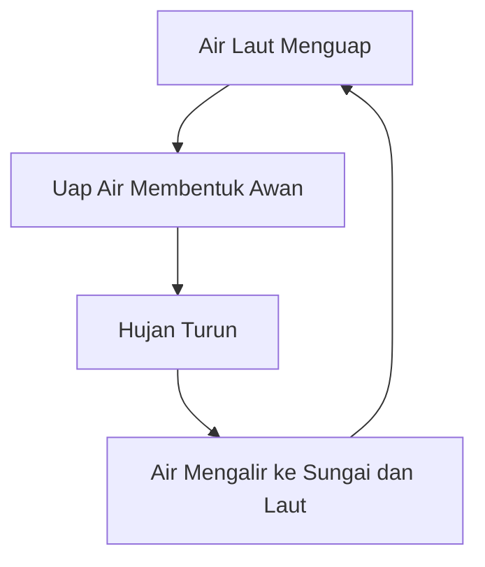

<!-- Single-file build of the kurikulum-merdeka-sd-mi skill for Gemini (Keahlian/Gems): the full skill plus all of its reference files in one Markdown file, because the Gemini uploader accepts one Markdown skill file but often rejects extra Markdown attachments. -->

# Kurikulum Merdeka SD/MI (Fase A-C)

One skill for one jenjang: SD/MI only, Fase A (Kelas I-II), Fase B (Kelas III-IV), and Fase C (Kelas V-VI), under Kurikulum Merdeka (Kemendikdasmen). It carries five roles that in other arrangements sit in separate skills, kept together here so that every rule applied to an SD/MI task comes from this jenjang alone and no rule from another jenjang leaks in: modul ajar plans the teaching, stimulus builds the reading and visual material, asesmen designs the assessment package, telaah reviews finished items independently, and konverter packages a finished set for print and CBT.
Indonesia only: this skill does not apply to other jenjang, foreign tests such as SAT, IELTS, or TOEFL, or general trivia quizzes.

## Cara memakai skill ini

Find the task in the table, work inside that section, and read its reference file before producing output. Roles hand over to each other in order: a TP list from Section 1 feeds the kisi-kisi in Section 3; Section 2 supplies stimulus on request from Sections 1 and 3; Section 4 reviews what Section 3 produced; Section 5 converts only a final, validated set.

| Tugas | Bagian | Berkas referensi |
| --- | --- | --- |
| Modul ajar, CP menjadi TP dan ATP, pengalaman Pembelajaran Mendalam, LKPD, skenario intervensi dari hasil asesmen | 1. Modul Ajar | [references/modul-ajar-kerangka-pembelajaran-mendalam-sd-mi.md](references/modul-ajar-kerangka-pembelajaran-mendalam-sd-mi.md) |
| Stimulus, wacana, gambar, tabel data, diagram sederhana untuk butir soal atau LKPD | 2. Stimulus & Ilustrasi | [references/stimulus-panduan-visual-dan-wacana-sd-mi.md](references/stimulus-panduan-visual-dan-wacana-sd-mi.md) |
| Paket asesmen (diagnostik, formatif, sumatif), kisi-kisi CP-TP, butir soal, kunci dan penskoran, KKTP, remedial dan pengayaan | 3. Asesmen | [references/asesmen-regulasi-dan-format-soal-sd-mi.md](references/asesmen-regulasi-dan-format-soal-sd-mi.md) dan [references/asesmen-kktp-solo-dan-tindak-lanjut-sd-mi.md](references/asesmen-kktp-solo-dan-tindak-lanjut-sd-mi.md) |
| Telaah, validasi, bedah pengecoh, analisis butir (P, D, efektivitas pengecoh) atas soal yang sudah ada | 4. Telaah & Validasi Butir Soal | [references/telaah-kartu-telaah-pusmendik-sd-mi.md](references/telaah-kartu-telaah-pusmendik-sd-mi.md) |
| Kartu Soal, Naskah Ujian cetak, berkas impor CBT/LMS (GIFT, Moodle XML, CSV, JSON) | 5. Konverter Naskah & CBT | [references/konverter-spesifikasi-format-ekspor-sd-mi.md](references/konverter-spesifikasi-format-ekspor-sd-mi.md) |

## Catatan status verifikasi sumber

The core framework claims have been checked against the primary documents: PPA Edisi Revisi 2025, Desain Pengembangan Soal AKM 2020, and Naskah Akademik Pembelajaran Mendalam (including the SOLO stage mapping, Tabel 3.1, pp. 44-45), and the process-assessment provisions follow Permendikdasmen No. 1 Tahun 2026, Pasal 8 and Pasal 15-19; per-claim status and page citations live in the reference files.
Three things are deliberately NOT regulation quotes and must never be presented as such: the dynamic MCMA scoring rule is a practice rule carried from earlier item-writing guidance; the stimulus lengths in Section 2 are practical calibration defaults (current official documents set no word limits for Fase A-C); and the telaah card in Section 4 has not been independently checked against the official Pusmendik documents, while its 27 percent group split and 5 percent distractor criterion are classical test theory conventions used as working standards.
The CP citation (SK Kepala BSKAP No. 046/H/KR/2025) has not been independently verified.
Before using any output for a formal or high-stakes purpose, check the rule you rely on in the official document.

## 1. Modul Ajar

Plans teaching upstream of assessment: turns a Capaian Pembelajaran (CP) into Tujuan Pembelajaran (TP), orders the TP into an Alur Tujuan Pembelajaran (ATP), and builds the learning experiences, worksheets, and formative checkpoints that make those TP reachable in a primary classroom. Assessment results then flow back into this section as concrete intervention plans for the next meetings.
Two modes of use. Standalone mode: the user asks only for teaching planning; deliver the modul ajar package below and stop, without adding test items. Invoked mode: the user (or the assessment workflow) needs the upstream half of an assessment package; the deliverable that matters most is the TP list, handed to Section 3, because a vague TP list produces vague items, so this handoff is the quality gate for the whole chain.
Background detail: [references/modul-ajar-kerangka-pembelajaran-mendalam-sd-mi.md](references/modul-ajar-kerangka-pembelajaran-mendalam-sd-mi.md).

Workflow:

1. Read the CP. Identify the element, the fase (A, B, or C), and the competencies and content named in it. If the user has not supplied the CP text or at least the subject, fase, and topic, ask for them before planning. Do not invent CP wording and present it as official text; if you draft a paraphrase, label it as a paraphrase.
2. Derive TP. Break the CP into TP that a teacher can observe and check: one verb, one content focus, one TP per statement. Keep the count teachable, usually two to five TP per meeting sequence.
3. Order the ATP. Sequence the TP from concrete to abstract and from single-aspect to integrated understanding, so the order itself scaffolds learning across meetings. At SD/MI the concrete end matters most: start from objects, pictures, and direct experience before symbols and text.
4. Map each TP to a target SOLO level and to one or two Dimensi Profil Lulusan. A TP that maps to no dimension and no SOLO level is probably filler; rewrite or drop it. Use the Naskah Akademik Pembelajaran Mendalam mapping (Tabel 3.1, pp. 44-45): Memahami covers Unistruktural and Multistruktural together, Mengaplikasi is Relasional, Merefleksi is Berpikir Abstrak yang Mendalam, and Prastruktural is not a stage but the status "Belum Memahami".
5. Design the learning experiences in three stages, stating for each stage what the teacher does, what the students do, and what product or answer shows the stage worked:
   - Memahami: students meet the phenomenon, picture, story, or object, connect prior knowledge, and name the key facts and concepts (SOLO target: Unistruktural moving to Multistruktural).
   - Mengaplikasi: students use the concept on a real case, a simple data set, or a hands-on problem, working with the parts together (SOLO target: Relasional).
   - Merefleksi: students say or show how they reasoned, check their conclusion against a new example, or apply the concept to a situation at home or school (SOLO target: Berpikir Abstrak yang Mendalam, the Naskah Akademik's term for the fifth SOLO level; "Extended Abstract" is Biggs & Collis's original English term).
6. Place formative checkpoints between stages. Each checkpoint is a short check tied to one TP: an exit question, a quick observation point, or one LKPD section. Its only job is to catch a misconception before the sumatif assessment does. The technique and instrument chosen must stay aligned with the TP (Permendikdasmen No. 1 Tahun 2026, Pasal 8). At Fase A every checkpoint is observation, performance, or play, never a written test (PPA Edisi Revisi 2025, p. 45). Deciding the item format and scoring for a checkpoint belongs to Section 3; here, state what evidence the checkpoint must produce.
7. Plan differentiation before it is needed. For each main task, note the simplified entry point (fewer variables, worked example, picture support, sentence starters) and the extension (extra variable, open data, transfer case), so the follow-up scenarios below can reuse them.
8. Hand off. Close the plan with the clean TP list for Section 3 (each TP tagged with its CP element, its position in the ATP, its target SOLO level, and the Dimensi Profil Lulusan it serves), plus the misconception list the checkpoints are watching for.

Output structure of a modul ajar, in order:

1. Identitas: school (placeholder when unknown), subject, fase and kelas, semester, time allocation, number of meetings.
2. CP and element, quoted or clearly labelled as paraphrased, with the source the user supplied.
3. TP list: numbered, one measurable statement each.
4. ATP diagram or numbered sequence showing the order across meetings and why that order.
5. Dimensi Profil Lulusan targets: which dimensions this unit develops and where each one shows up in an activity, not just a list pasted at the top.
6. Learning experiences per meeting, in the three stages, with teacher activity, student activity, and the evidence each stage produces.
7. LKPD plan: the worksheet sections, which TP each section serves, and its simplified and challenge variants (see the fase notes below).
8. Formative checkpoints: placement, the TP checked, and the evidence expected.
9. Reflection instruments: the teacher reflection set and the student reflection set from the reference file, trimmed to the unit when the user wants a short version. The teacher set serves the process assessment of Permendikdasmen No. 1 Tahun 2026, Pasal 15-19, which includes teacher self-reflection at least once per semester.
10. Handoff block: the TP list and misconception watchlist, formatted so Section 3 can consume it directly.

LKPD per fase:

- Fase A: the worksheet is mostly pictures and concrete activity. Large images to observe, match, sort, or colour with a purpose; tracing and copying short words; tasks the child completes by doing (arranging objects, pointing, demonstrating) while the teacher observes. Written answers are minimal: a word, a tick, a drawing. Instructions are read aloud by the teacher.
- Fase B: short written sections appear. One short paragraph or picture series per task, sentence starters for written answers, tables with two or three columns to complete, and simple worked examples before independent items.
- Fase C: fuller worksheets. A medium text or data table as the working material, multi-step tasks, space for a short written explanation, and a challenge section that asks for transfer to a new situation.

From assessment bands to classroom scenarios. When assessment results come back grouped by the KKTP descriptive bands, do not deliver a table that only repeats the bands. Turn each band into a scenario a teacher can run next meeting, naming the activity, the material, the grouping, and the exit evidence:

- Perlu bimbingan (Prastruktural to Unistruktural): reteach the base concept in a smaller step. Use the simplified LKPD variant, a worked example the group completes together, and short guided practice with the teacher or a trained peer tutor at the table. At Fase A this is guided play and hands-on repetition, not extra worksheets. Exit evidence: the student can state the concept and solve one guided case without help.
- Cukup (Multistruktural): the parts are known but not yet connected. Run a connecting task: a concept map, a compare-two-cases exercise, or the standard LKPD with the linking section emphasised. Exit evidence: the student explains how two parts of the material relate.
- Baik (Relasional): no reteaching. The group moves to the next TP in the ATP and gets the standard task at full difficulty. Exit evidence comes from the next unit's first checkpoint.
- Sangat baik (Berpikir Abstrak yang Mendalam): give a transfer or challenge task from the extension variant: new context, open data, or a small project. This group can also serve as peer tutors for the first group, which counts as their enrichment when the tutoring task requires them to explain and justify, not just to give answers.

Keep the grade rules from Section 3 intact while planning these scenarios: remedial grades follow Prinsip 1 (Mastery Learning, highest score after remedial, with an equal improvement chance for students who already passed), and formatif results never decide report grades or promotion. The scenarios change the teaching, not the grade policy.

Gotchas: do not write exam items inside a modul ajar (a plan that quietly contains the sumatif questions teaches to the test and breaks the handoff); do not copy a CP from memory and present it as the official SK text; do not list all 8 Dimensi Profil Lulusan as targets for every unit (pick the one to three the activities genuinely develop); do not skip the Merefleksi stage to save time; do not write TP with stacked verbs ("memahami dan menganalisis dan mengevaluasi") — one TP, one verb, one focus, split it if it needs two; do not plan differentiation as different final grades (differentiate content, process, and support; the KKTP expectation for the TP stays the same); do not design a written formative test for Fase A, in the plan or in a checkpoint; do not present citations beyond their verified status (the CP citation SK BSKAP 046/2025 is unverified, so flag it wherever a formal document relies on it).

## 2. Stimulus & Ilustrasi

Supplies the raw material Sections 1 and 3 build on: the short texts, pictures, tables, and simple diagrams that Kelas I-VI students must read and interpret. A weak stimulus caps every item built on it, so stimulus work comes before item writing, not after.
Templates, the calibration matrix, source lists, and the specification format live in [references/stimulus-panduan-visual-dan-wacana-sd-mi.md](references/stimulus-panduan-visual-dan-wacana-sd-mi.md).

The functionality test. Every visual and every stimulus must pass one test before it ships: cover it up. If the item can still be answered correctly without reading it, the stimulus fails and gets rebuilt or cut.

- A functional picture holds something the student must observe, compare, count, or order: the objects in a scene, the stages in a picture series, the difference between two simple table rows.
- A functional text carries the facts or events the item reasons about. Background colour that merely restates what the question already says is not a stimulus.
- Name the key objects a student must read (the specific objects, numbers, labels, or arrows the answer depends on) and list them with the stimulus. If you cannot name them, the visual is decoration.

Two modes of use. Standalone mode: the user asks only for stimulus material; deliver the calibrated text or visual, its source or data note, and the list of key objects, then stop, without inventing the items that will use it unless asked. Invoked mode: Section 3 (or Section 1) calls this section after the kisi-kisi exists and before items are written; the input is the kisi-kisi rows (indicator, KKO, target Bloom and SOLO level, fase) and the output is one stimulus per item group, sized and pitched so the target level is reachable: a Relasional item needs a stimulus with parts that must be connected, such as a picture series whose stages must be ordered, and a simple transfer item needs a familiar situation the child has not been drilled on. Item construction stays with the calling section.

Calibrate the text to the fase. Use the calibration matrix in the reference file as practical house defaults: sentence length, passage length, text types, and visual complexity per fase. Treat the numbers as a starting calibration to adjust for the actual class, never quote them to a user as Kemendikdasmen rules.
Write in standard Indonesian (EYD V) with short sentences and familiar words. Contexts follow the AKM frame: personal (the child's own life, family, play, pocket money), socio-cultural (school, village or neighbourhood events, local traditions, markets), and scientific (simple natural phenomena, plants and animals, weather, simple experiments). One stimulus serves one item or a small graded set; do not stretch one passage across a whole exam.

Fase anchors:

- Fase A (Kelas I-II): the stimulus is oral or a picture. No reading passage is required of the child; any words are read aloud by the teacher.
- Fase B (Kelas III-IV): a short paragraph, a labelled picture, or a table of two or three columns.
- Fase C (Kelas V-VI): one simple text, a bar chart or simple diagram, or a short text paired with a table.

Produce visuals in this order; try the methods in order and stop at the first one that produces a functional, readable visual:

1. Render in code. Markdown tables for simple multi-variable data, Mermaid for simple cycles and flows, and clean SVG for simple charts and diagrams. Code-rendered visuals are exact, editable, and print-safe, so they are the default. The reference file holds a Mermaid cycle template to adapt, not to ship unchanged.
2. Curate a real image when the item needs a real photo or phenomenon that code cannot draw honestly: an animal in its habitat, a landform, a market scene. Search the curated sources in the reference file (Wikimedia Commons for open-licensed photos and diagrams, BMKG for weather material, BPS for official statistics, BIG for Indonesian base maps). Cite the source under the visual, every time.
3. Write a [SPESIFIKASI ILUSTRASI] box when the visual is too complex to render and no suitable image exists. The box states the visual type, the reference source or search query, the key objects, the mandatory labels, and the function the item depends on, precisely enough for a teacher or illustrator to produce it. The exact block format is in the reference file.

Whichever method is used, the visual ships with labels and units where the data needs them, and a short title or caption that tells the student what they are looking at. Keep print readability strict at this jenjang: large lettering, few objects per picture, no meaning carried by colour alone.

Visual types per subject at SD/MI:

- Matematika: pictures of grouped objects to count or compare, number lines, simple geometric figures with the given lengths marked, picture graphs and bar charts built from the item's own small data table, nets of simple solids at Fase C.
- IPA: picture series of life cycles and growth stages, simple food chains, experiment setups where the steps must be read from the drawing, weather and season pictures.
- Bahasa Indonesia: a short story or information text with one supporting picture, a picture series to order into a story, labelled scenes for vocabulary and description items.
- IPS: simple maps of the school or neighbourhood, timelines of a child's day or a local event, pictures of occupations, markets, and cultural activities.
- Pendidikan Pancasila and Agama: scenes of daily behaviour and cooperation that the item asks the student to judge or continue.

Data honesty. Never present invented numbers as real statistics. When a chart or table uses plausible numbers created for the exercise, label it as simulated or example data ("Data simulasi untuk latihan") in the caption or source line. When real figures are used, name the real source (for example BPS with the table and year) so a teacher can check them. A stimulus that teaches a wrong fact fails even when the item built on it is well formed.

Gotchas:

- Decoration fails. A stock photo of a volcano next to a recall question about volcano parts adds nothing the item measures; cut it or rebuild the item so the answer lives in the image.
- Do not leak the tested formula into the stimulus. A numeracy item whose stimulus prints the formula it tests measures copying, not reasoning. This is a practice rule of this skill; no such prohibition appears in the Desain Pengembangan Soal AKM 2020, so never cite it as an official rule.
- Do not import senior-level text lengths into SD/MI. The one verified figure elsewhere, a passage of 250-300 words with sentences of 8-12 words, is the text characteristic for the Bahasa Indonesia test subject in a national test at the senior secondary level; it does not belong to SD/MI and must never be quoted as an SD/MI standard. At Fase A-C the calibration matrix in the reference file governs, as a practical default.
- Do not ship the templates from the reference file unchanged with their example numbers. Adapt the data to the item, then re-check that the key objects and the answer still agree.
- Do not use an internet image without its source line, and do not use one whose licence or origin is unclear when an open source (Wikimedia Commons, BMKG, BPS, BIG) can supply an alternative.
- Do not build a written reading stimulus for Fase A items. Fase A stimulus is spoken or pictured; the reading load itself would measure the wrong thing.

## 3. Asesmen
Designs assessment packages and test items for SD/MI: a complete package, not loose questions — identity, kisi-kisi, stimulus and items, answer key and scoring guide, KKTP rubric, remedial and enrichment follow-up, and a quality audit. Full construction rules per format are in [references/asesmen-regulasi-dan-format-soal-sd-mi.md](references/asesmen-regulasi-dan-format-soal-sd-mi.md); the scoring and follow-up detail is in [references/asesmen-kktp-solo-dan-tindak-lanjut-sd-mi.md](references/asesmen-kktp-solo-dan-tindak-lanjut-sd-mi.md).
Step 1: Clarification gate. If the request is brief (a subject and a topic, nothing more), stop and ask before writing any item:

1. Fase, kelas, and mata pelajaran.
2. Jenis asesmen: diagnostik, formatif, or sumatif, and whether the result feeds a report card.
3. Composition: how many items of each format, or confirmation to use the defaults below.
4. Cognitive target: the default LOTS:MOTS:HOTS split for SD/MI, or a custom split.
5. KKTP approach: Deskripsi Kriteria, Rubrik, Skala atau Interval Nilai, or Persentase (the four approaches named in PPA Edisi Revisi 2025, p. 48; the PPA list is open, so another approach is allowed).
6. Whether a JSON or CSV export is needed.
Skip the gate when the request already specifies these points, or when the user says to proceed with standard settings. In that case state the defaults you used at the top of the package.
Step 2: Defaults for SD/MI.

- Fase A (Kelas I-II): formative assessment runs WITHOUT written tests, through observation, performance, or play (PPA Edisi Revisi 2025, p. 45, stated for PAUD and SD in Fase A). Written PG starts at Fase B. Even for sumatif, Fase A prioritises performance, observation, and picture-based items delivered orally.
- PG option counts follow the AKM design ladder (Desain Pengembangan Soal AKM 2020, printed p. 4): Kelas 1-3 use 3 options (A-C), Kelas 4-9 use 4 options (A-D). Applied to SD/MI: Kelas III uses 3 options; Kelas IV-VI use 4 options (A-D).
- Package default of this skill (a school package design default, not an AKM quota): LOTS:MOTS:HOTS = 30:50:20, derived from the verified AKM Numerasi Kelas 5 distribution (Knowing/Applying/Reasoning 30/50/20; Desain Pengembangan Soal AKM 2020, printed p. 87). For Literasi Membaca Kelas 5 the AKM distribution is different: Menemukan Informasi 50%, Memahami 40%, Mengevaluasi dan Merefleksi 10% (printed p. 20). Use the ladder that matches the subject.
- Write in standard Indonesian (EYD V), communicative and unambiguous, with sentences short enough for the fase. In the kisi-kisi, each PG item measures one operational verb (KKO); an essay item may measure more than one.
Step 3: Stimulus and visuals. Every item that carries a stimulus must need it: a picture, table, or short text passes only if the item cannot be answered correctly without reading it; decoration fails the audit. Stimulus calibration per fase and visual production belong to Section 2; the working rules are:

- Fase A: oral or visual stimulus only, concrete and close to the child's own experience. Fase B: one short paragraph or a labelled picture or simple table.
- Fase C: one simple text in a personal or socio-cultural context, supported by a picture or table, with items graded in cognitive level inside a small set. As a writing-practice rule, never leak the formula an item is testing into its stimulus, especially in numeracy items; the item then measures copying instead of reasoning. This is a practice consideration of this skill, not an AKM regulation.
Step 4: Item formats and scoring. Supported formats at SD/MI: PG (single answer), PGK MCMA (multiple correct answers, checkbox), PGK Kategori in a simple form for Fase C (a few statements, each judged Benar/Salah), Benar/Salah, Menjodohkan, Isian or Jawaban Singkat, Uraian pendek, and Observasi or Unjuk Kerja for non-test assessment. Whichever format is chosen, the technique and instrument must stay aligned with the tujuan pembelajaran (Permendikdasmen No. 1 Tahun 2026, Pasal 8).
Scoring rules that must not be improvised:

- PG: 1 for correct, 0 for wrong.
- PGK MCMA is dynamic. For sumatif it is binary: 1 only when every correct option is chosen and no wrong option is chosen, otherwise 0. For formatif and diagnostik it is partial 2-1-0: 2 for a fully correct selection, 1 when some correct options are chosen with no wrong option, 0 when any wrong option is chosen. Never use free fractions such as 1/3 or 2/3.
- PGK Kategori: 1 point per statement judged correctly.
- Uraian Objektif (URO): list every keyword or step in the expected answer, 1 point per element present.
- Uraian Non-Objektif (URN): graded rubric built on SOLO levels, and the lowest rubric score is 0, never 1.
Step 5: Cognitive levels, KKTP, and follow-up. Tag every item twice: a Bloom level (C1-C6, grouped as LOTS = C1-C2, MOTS = C3, HOTS = C4-C6) and, for essays and KKTP descriptions, a SOLO level (Prastruktural, Unistruktural, Multistruktural, Relasional, Berpikir Abstrak yang Mendalam). Berpikir Abstrak yang Mendalam is the term the Naskah Akademik Pembelajaran Mendalam uses for the fifth SOLO level (pp. 44-45); "Extended Abstract" is Biggs & Collis's original English term for the same level.
KKTP is descriptive, not one uniform passing number like the old KKM (PPA Edisi Revisi 2025, p. 64). Use the approach chosen at the gate: Deskripsi Kriteria (Perlu bimbingan, Cukup, Baik, Sangat baik, the PPA's labels, p. 64), Rubrik, Skala atau Interval Nilai, or Persentase of TP indicators mastered. Post-remedial grades follow Prinsip 1, Mastery Learning, the principle this skill adopts: the recorded grade is the highest score the student achieves after remedial, with the fairness condition that students who already passed must get an equal chance to improve their score too. The PPA sets no post-remedial grade formula at all: the word "remedial" appears only five times in the whole PPA, and its stated aim for remedial is raising achievement through guided relearning of the unmet criteria, not merely repairing the grade (p. 54). Prinsip 1 is therefore school policy, not a regulation quote, and the package must label it as such.
Hard rule: diagnostik and formatif results never determine report grades, promotion, or graduation (PPA Edisi Revisi 2025, p. 44).
Step 6: Output package. Deliver these seven parts in order, plus the export when requested:

1. Identitas Asesmen: school (placeholder when unknown), fase and kelas, subject, assessment type, time allocation, item count.
2. Matriks Kisi-Kisi: item number, Elemen or CP, TP, core material, indicator with its KKO, cognitive level, item format.
3. Naskah Stimulus dan Butir Soal, grouped by format, each group with its work instructions.
4. Kunci Jawaban dan Pedoman Penskoran, including URO keyword lists and the SOLO rubric for URN.
5. Rubrik KKTP dan Pengolahan Nilai for the chosen approach.
6. Matriks Tindak Lanjut: remedial and enrichment actions per achievement band, differentiated by content, process, or product.
7. Catatan Telaah Mutu: the self-audit report from Step 7. Plus, when requested, the optional export: JSON or CSV for a CBT or LMS, using the schema in the second reference file. For Kartu Soal, print scripts, and GIFT or Moodle XML, hand the finished package to Section 5.
Step 7: Mandatory self-audit. Run the audit before delivering, and print its result as part 7 of the package:

- Key distribution for PG: compute R = (number of PG items / number of options) + 3. No key letter may appear more than R times. Example: 20 items with 4 options gives R = 8, so a key appearing 10 times must be rebalanced.
- Stimulus function test: remove each visual mentally. If the item is still answerable, the visual fails.
- Distractor and construction check: options homogeneous and similar in length, no "Semua jawaban di atas benar/salah", no double negatives, no item that depends on another item's answer, no formula leaked into a stimulus, URN rubric minimum is 0.
- Language and ethics check: standard Indonesian at the fase's reading level, no SARA content, no violence, no local or cultural bias that advantages one group of students.
- Fase A check: no written formative test anywhere in the package.
Gotchas:

- Do not write PG formative items for Fase A. Fase A formative assessment is observation, performance, or play. And do not use formatif or diagnostik results for report grades or promotion decisions.
- Do not give Kelas III four options or Kelas IV-VI three; the ladder is 3 options for Kelas 1-3 and 4 options for Kelas 4-6. Do not place the tested formula inside a numeracy stimulus.
- Do not start a URN rubric at 1. The minimum is 0. Do not present rules beyond their verified status: the framework claims carry page citations in the reference files; the MCMA dynamic scoring rule and the package defaults are practice rules or school-package design defaults and must never be presented as regulation.

## 4. Telaah & Validasi Butir Soal
Reviews test items that already exist for SD/MI (Fase A, B, and C). It does not write new packages; Section 3 does that. This section acts as the independent reviewer: it checks items written by an AI, by a teacher, or by a teacher working group against the Pusmendik qualitative review card, gives every item a verdict with reasons, repairs weak distractors, and, when trial results are available, runs the numbers on how each item actually performed with Kelas III-VI students. The checklists, formulas, and working standards live in [references/telaah-kartu-telaah-pusmendik-sd-mi.md](references/telaah-kartu-telaah-pusmendik-sd-mi.md); read that file before reviewing a set. It does not apply to writing items from scratch, building a kisi-kisi, or setting KKTP; route those back to Section 3.
The independence rule. An author reviewing their own items in the same pass will miss their own blind spots. That is why this section exists separately from Section 3's self-audit.

- The Section 3 self-audit is the author's quick check before delivery. This section is the second, deeper pass, run as if the reviewer did not write the items.
- Never let a review under this section silently replace the self-audit, and never present a self-audit as if it were this independent review. Name which one a report is.
- Review the item as printed, not as intended. If the indicator, the key, or the scoring guide is missing, that absence is itself a finding; do not reconstruct what the author probably meant and pass the item on that basis.
- When the reviewer and the author disagree, the card decides: cite the code that fails (for example K3 or B1) instead of arguing taste.
Workflow:
Step 1: Set up the review. Collect what the verdict will be judged against: the items, their keys, the kisi-kisi or indicator for each item, the item format, the fase and subject, and the scoring guide for essays. Items that arrive without a key or an indicator can still be reviewed for construction and language, but their Materi verdict is "cannot be confirmed" until the missing piece is supplied. Say so in the report instead of guessing.
At SD/MI, also record how the item is delivered: a Fase A instrument should be an observation guide, performance task, or picture-based oral item. A written PG set labelled Fase A fails at setup, before the card is even opened.
Step 2: Qualitative review with the card. Work item by item through the review card in the reference file:

- PG and PGK items (Fase B-C): the Materi codes (M), Konstruksi codes (K), and Bahasa codes (B), including the jenjang checks: 3 options at Kelas III, 4 options at Kelas IV-VI, sentences readable at the fase.
- Uraian items: the U-M, U-K, and U-B codes, including whether a URO keyword list or a URN SOLO rubric is present and usable.
- Observasi and unjuk kerja instruments (Fase A, and all fase for Seni Budaya and PJOK): check that the observation guide names observable behaviours, the rubric bands describe what the teacher will actually see, and the task can be done with the materials a primary classroom has.
Record a pass or fail per code, with a short note on any fail that quotes or points at the exact words in the item that cause it. A fail without a location is not actionable.
Step 3: Verdict per item. Give every item exactly one verdict:

- Terima (accept): every applicable code passes. The item may enter the bank as is.
- Revisi (revise): the item measures the right thing but has a fixable defect: a weak distractor, uneven option lengths, a double negative, a missing rubric line. State the fix, and supply the revised text in Step 4 or in the output.
- Tolak (reject): the item cannot be repaired by editing: it does not measure its indicator, it has more than one defensible key or no defensible key, its stimulus leaks the answer or the formula, it is a written formative test labelled Fase A, or (after a trial) its discrimination index is negative. State which defect is fatal.
No set-level verdict replaces the per-item verdicts. A set can be "mostly sound" and still contain two items that must not be used.
Step 4: Distractor surgery. Run this on every PG or PGK item whose distractors fail the card or the trial data. This procedure is a working standard of this skill:

1. Diagnose each failing distractor and name the failure: too obvious (no plausible path leads to it), implausible (outside the topic or absurd on its face), cueing the key (longer, more precise, or grammatically matching the stem while others do not), or non-homogeneous (different kind, unit, or category from the key).
2. Name the student misconception the replacement will target: the specific wrong idea a primary-school child actually holds. Typical SD/MI misconceptions: a bigger denominator means a bigger fraction; multiplication always makes a number bigger; plants take their food from the soil; the sun moves across the sky because it orbits the earth; a word's meaning guessed from a similar-sounding word; events in a story assumed to happen in the order they are mentioned. A distractor without a named misconception behind it is decoration.
3. Rewrite the distractor so it is exactly what a student with that misconception would produce or choose: correct method with one wrong step, right value with the wrong unit, the paired concept swapped in.
4. Re-check the repaired set: options homogeneous in kind and content, similar in length, ordered consistently (numbers ascending or chronological), no option giving away another, and the key not identifiable by form alone.
Show the before and after text for every operated distractor, with the misconception named. Never change the key during surgery without flagging it as a key change and re-running the Materi codes.
Step 5: Quantitative analysis, when trial data exists. Only run this step when the user supplies response data from a real tryout or class administration, and only for written items (Fase B-C). Observation and performance instruments are judged qualitatively, not with P and D. Never invent performance numbers for items that have not been tried.

- Difficulty index P: the share of test takers who answered correctly. Bands and formula are in the reference file. Discrimination index D: compare the top 27 percent and the bottom 27 percent of test takers by total score; this 27 percent split is this skill's working standard, taken from classical test theory convention.
- Distractor effectiveness: a distractor is functioning when at least 5 percent of the lower group chose it and the lower group chose it more than the upper group did. A distractor nobody chooses, or one the upper group prefers, is dead weight and goes to surgery.
- Verdicts from numbers: an item with negative D is rejected outright, because strong students fail it more than weak students do, which signals a wrong key or a misleading stem. An item with D in the revise band goes back to Step 2 and Step 4 with the data as evidence.
Interpret P together with D, never alone. A hard item (low P) with strong D is a good HOTS item and stays; an easy item with near-zero D measures nothing and does not earn its place outside a diagnostic set. In small primary classes the groups are small, so read borderline D values with the qualitative card before deciding.
Step 6: Key-distribution check. For the PG items in the set, compute R = (number of PG items / number of options) + 3, inherited from the Section 3 self-audit. No key letter may appear more than R times. If one letter exceeds R, rebalance by reordering options on items where the content allows it, and list every item whose options were reordered. Reordering options is a change to the item: note it in the report.
Output format. Deliver the review in this order:

1. Ringkasan Telaah: how many items were reviewed, by format, and the count per verdict (terima, revisi, tolak), plus any set-level problem such as a missing kisi-kisi or a failed key distribution.
2. Tabel Putusan per Butir: one row per item with its number, format, verdict, the card codes that failed, and a one-line reason.
3. Teks Revisi: the full revised text of every item marked revisi, including operated distractors shown before and after with their named misconceptions, and the revised scoring guide where an essay guide changed.
4. Hasil Analisis Kuantitatif, only when trial data was supplied: per item, P with its band, D with its band, and the distractor findings, each tied back to the verdict it supports. Plus Catatan Kunci: the R computation and any rebalancing done.
Write reasons in plain language a teacher can act on without opening the reference file. Codes support the reason; they do not replace it.
Gotchas:

- Do not run quantitative analysis on invented data. No trial, no P and D. Do not pass an item because its intention was good; review what is printed.
- Do not rewrite a whole item during distractor surgery. Surgery touches distractors; a broken stem or a wrong indicator is a revise or reject verdict with the reason stated. Do not soften a negative D; it always means reject, however elegant the item looks.
- Do not accept a written formative test for Fase A under any verdict other than reject or a full conversion to an observation or performance instrument. Do not treat the regulatory citations behind the review card as verified law: the card content here has not been independently checked against the official Pusmendik documents; the 27 percent and 5 percent rules are classical test theory conventions, stated as this skill's working standards.

## 5. Konverter Naskah & CBT

Packages a finished SD/MI assessment (Fase A, B, and C) for the formats schools and exam systems actually consume: Kartu Soal for administration files, a print-ready exam script, and import files for CBT and LMS platforms.
Conversion is a packaging job, not an editing job. Wording, keys, scoring, and cognitive tags come from the source package and leave unchanged. If something in the source is broken or missing, this section reports it back instead of repairing it silently.
Format details, templates, and worked examples live in [references/konverter-spesifikasi-format-ekspor-sd-mi.md](references/konverter-spesifikasi-format-ekspor-sd-mi.md).
It does not apply to writing or improving items. Send that work to Section 3 for design and to Section 4 for validation; convert only after the set is final.

Inputs required. Do not start converting until the input has:

1. Item set with stable numbering and one entry per item: stem, stimulus reference where used, options where the format has them.
2. A key for every objectively scored item, and a scoring guide or rubric for every Uraian item and every observation or performance instrument.
3. The scoring policy per format, above all the assessment type (diagnostik, formatif, or sumatif), because it decides how MCMA is encoded.
4. Identity data for the headers: school, subject, fase and kelas, semester, assessment type, time allocation.
5. Planning data for Kartu Soal: CP, TP, core material, and the indicator with its cognitive level per item.
6. Pembahasan per item when the target format carries it (JSON and CSV do; the printed student script never does).

If any of these are absent, list exactly what is missing and stop. A converted file with invented keys or guessed scoring is worse than no file.

Outputs. Produce only the formats the user asked for:

- Kartu Soal: one card per item, holding identity, planning fields (CP, TP, material, indicator, Bloom and SOLO levels), the full item, its key, and its score weight or rubric. This is the administration and supervision record. Observation and performance instruments get a card too, holding the task description and its rubric.
- Naskah Ujian: the student-facing print script, for Fase B-C written sets. Header (kop) with school and exam identity, general instructions in large, simple language, items grouped by format with a short instruction per group, and a separate answer sheet layout for the objective sections. No keys, no pembahasan, no KKTP data anywhere in this document. Fase A assessments are not print scripts: they convert to teacher-facing observation sheets and task cards instead, and this section says so rather than forcing them into an exam layout.
- GIFT: plain-text import for Moodle and compatible LMS, one block per item.
- Moodle XML: the same set as a well-formed XML quiz file with a category path that names kurikulum, fase, and cognitive grouping.
- CSV: one row per item with the flattened columns defined in the reference file, including pembahasan and the type-specific key columns.
- JSON: the Section 3 schema (metadata, stimulus, items) exactly as defined in that section's second reference file, section 8. Do not invent a parallel JSON shape.

Scoring conversion rule. The source package's scoring policy governs. Fraction fields in GIFT and Moodle XML are only a transport encoding: they describe how the LMS should add up a response, they are not a new scoring policy, and they never override the policy written in the package.

- PG stays trivial everywhere: full credit for the key, zero for everything else.
- Sumatif MCMA is binary in the package (1 only when every correct option is chosen and no wrong option is chosen, otherwise 0). Encode it all-or-nothing in GIFT and Moodle XML: the correct options share +100 percent in total (each correct option carries 100 divided by the number of correct options), and every wrong option carries -100 percent, so choosing any wrong option cancels the credit from the correct ones. The LMS total for the item is then floored at zero: a response scores the item maximum only when its raw total reaches 100, and 0 otherwise. State this encoding and the floor rule in the export notes that accompany the file.
- Warning that must travel with every sumatif MCMA export: whether the encoding behaves as true all-or-nothing depends on the target LMS. Moodle's multiple-response grading, rounding of repeating fractions such as 33.33333, and negative-total handling differ between versions and question behaviours. Test-import one MCMA item, answer it three ways (fully correct, partially correct with no wrong pick, and correct plus one wrong pick), and confirm the grades are 1, 0, and 0 before importing the whole set.
- Formatif and diagnostik MCMA follow the package's partial 2-1-0 rule. Map it proportionally in the encoding: correct options share the full credit so a fully correct selection earns the maximum, a partial selection with no wrong option earns a proportional share, and any wrong option carries a penalty large enough to bring the total to zero. Say plainly in the export notes that this is a proportional approximation of 2-1-0, because an LMS computes per-option fractions and cannot reproduce the exact three-step scale; the teacher's grade processing still follows the package.
- PGK Kategori keeps its own rule, 1 point per statement judged correctly. Export each statement as its own scorable unit (its own GIFT or XML question, or its own CSV row group) instead of collapsing the item into one all-or-nothing question.
- URO keyword points and URN rubrics do not compress into option fractions. In CBT formats that cannot grade essays automatically, export Uraian as an essay question type with the scoring guide placed in the grader information field, and mark it as manually graded in the export notes.
- Observasi and unjuk kerja instruments are not CBT questions. Export them as documents (Kartu Soal and observation sheets), never as quiz items with invented options.

Pre-export validation checklist. Run this pass before writing any output file, and report the result with the delivery:

- Every objectively scored item has exactly the key its format requires: one key for PG, a defined key set for MCMA, a category key per statement for PGK Kategori.
- Every Uraian item has its scoring guide or rubric attached; a URN rubric starts at 0.
- Option counts match the SD/MI ladder: 3 options (A-C) at Kelas III, 4 options (A-D) at Kelas IV-VI, unless the source package states a deliberate deviation. A written item set labelled Fase A is a validation failure: Fase A converts to observation sheets, not to PG items.
- Every stimulus_id or stimulus reference in an item resolves to a stimulus that exists in the set, and every stimulus is used by at least one item.
- Item numbering is continuous, and the item count matches the identity data and the kisi-kisi.
- No leftover placeholders anywhere: no bracketed tokens such as [Nama Sekolah] in a file meant for direct use, no empty option, stem, or pembahasan fields. Placeholders are acceptable only in a template the user explicitly asked for.
- Bloom and SOLO tags are present on every row or record that carries those columns.
- The assessment type is recorded, so the MCMA encoding choice can be checked against it.

Any failure stops the export for the affected items. List the failures by item number and hand them back; do not guess a key, drop an item quietly, or fill a placeholder with invented data.

Gotchas:

- Never change item content during conversion. A stem that looks wrong, a suspect key, or a weak distractor gets flagged back to the author or to Section 4, not fixed inside the export. A converter that edits silently destroys the audit trail between the validated set and the delivered file.
- XML must be well-formed or the LMS rejects the whole file. Escape ampersands, angle brackets, and quotes in text, or wrap question and answer text in CDATA sections; never mix raw HTML into an unescaped text node. Validate the file's structure before delivering it.
- GIFT has its own escaping: characters such as = ~ # { } and : inside answer text must be backslash-escaped, and an unescaped closing brace ends the answer block early.
- CSV quoting is strict. Wrap any field containing a comma, a quote, or a line break in double quotes, and double every quote inside such a field. Write the file as UTF-8 so Indonesian text survives the round trip, and keep one row per item with no line breaks outside quoted fields.
- Keep keys and pembahasan out of student-facing output. The Naskah Ujian and its answer sheet contain no key material; keys live in Kartu Soal, the scoring guide, and the CBT files only.
- Keep the print script readable for children: large type, generous spacing, one instruction per format group in simple words, and pictures printed at the size the item assumes.
- One source, many outputs: generate every requested format from the same validated item set in the same pass, so the print script, the cards, and the CBT file can never drift into different versions of an item.


---

# Reference file: references/asesmen-kktp-solo-dan-tindak-lanjut-sd-mi.md

# KKTP, SOLO, dan Tindak Lanjut SD/MI

Reference for Section 3 (Asesmen) of the kurikulum_merdeka_sd_mi skill: cognitive mapping, dynamic scoring, KKTP approaches, grade processing, and remedial or enrichment follow-up for SD/MI (Fase A-C). Verification status: the KKTP, grade-processing, follow-up, and SOLO claims below were checked against PPA Edisi Revisi 2025 and the Naskah Akademik Pembelajaran Mendalam and carry page citations; the AKM distributions were checked against Desain Pengembangan Soal AKM 2020. The dynamic MCMA scoring rule in section 4 is a practice rule from earlier item-writing guidance, not a PPA quotation.

## 1. Cognitive levels: LOTS, MOTS, HOTS

- LOTS: C1 Mengingat, C2 Memahami.
- MOTS: C3 Menerapkan.
- HOTS: C4 Menganalisis, C5 Mengevaluasi, C6 Mencipta.
- AKM uses parallel ladders. Literasi: L1 Access and Retrieve, L2 Interpret and Integrate, L3 Evaluate and Reflect. Numerasi: Knowing, Applying, Reasoning.
- Verified AKM distributions for SD/MI (Desain Pengembangan Soal AKM 2020). Numerasi Kelas 5, by cognitive level (printed p. 87): Knowing 30, Applying 50, Reasoning 20. Literasi Membaca Kelas 5 (printed p. 20): Menemukan Informasi 50, Memahami 40, Mengevaluasi dan Merefleksi 10.
- Default distribution for SD/MI packages: LOTS:MOTS:HOTS = 30:50:20. This package default is derived from the verified AKM Numerasi Kelas 5 distribution above; it is a school package design default, not an AKM quota. For reading-heavy Bahasa Indonesia packages, the Literasi Kelas 5 distribution is the closer reference.

## 2. SOLO taxonomy

Five levels of response quality:

- Prastruktural: no relevant understanding, answer misses the point.
- Unistruktural: one relevant aspect only.
- Multistruktural: several relevant aspects, not yet connected.
- Relasional: aspects integrated into one coherent understanding.
- Berpikir Abstrak yang Mendalam: the understanding is generalized and applied to a new context. This is the fifth-level term used by the Naskah Akademik Pembelajaran Mendalam (pp. 44-45); "Extended Abstract" is Biggs & Collis's original English term for the same level, not the Naskah Akademik's wording.

Bloom tags the item; SOLO grades the response. Use SOLO for URN essay rubrics and for KKTP descriptors. Working map between them: C1-C2 sit at Unistruktural, C3 at Multistruktural, C4 at Relasional, C5-C6 at Berpikir Abstrak yang Mendalam.

The Naskah Akademik also maps the levels onto the deep-learning experience stages (Tabel 3.1, pp. 44-45): Memahami covers Unistruktural and Multistruktural together; Mengaplikasi is Relasional; Merefleksi is Berpikir Abstrak yang Mendalam. Prastruktural has no stage: it is the status "Belum Memahami", before the Memahami stage begins.

At SD/MI, most written work sits at Unistruktural to Relasional; Berpikir Abstrak yang Mendalam appears mainly as simple transfer to a familiar new situation, most often at Fase C.

## 3. Four KKTP approaches

KKTP is set per subject and is descriptive in principle; it is not a single uniform pass mark like the old KKM (PPA Edisi Revisi 2025, p. 64: the criterion is a sentence describing mastery, not a number). The PPA names four approaches (p. 48) and its list is open: "di antaranya ... atau pendekatan lainnya", so a school may use another approach its context needs.

1. Deskripsi Kriteria: qualitative bands Perlu bimbingan, Cukup, Baik, Sangat baik (the PPA's exact labels, p. 64), each with a descriptor of which indicators are mastered. Against SOLO: Perlu bimbingan matches Prastruktural to Unistruktural, Cukup matches Multistruktural, Baik matches Relasional, Sangat baik matches Berpikir Abstrak yang Mendalam.
2. Rubrik: mastery stages per aspect, for example Mulai Memahami, Memahami, Sangat Memahami, or Belum Berkembang, Layak, Cakap, Mahir.
3. Skala atau Interval Nilai (the PPA's name for this approach, p. 48): bands 0-20, 21-40, 41-60, 61-80, 81-100 (PPA, pp. 52-53). A school may also agree a binary split such as 0-55 not yet complete and 56-100 complete (PPA worked example, p. 63).
4. Persentase: the share of TP indicators mastered, for example 75 percent when 3 of 4 indicators are met.

## 4. Dynamic scoring per format

- PG: 1 correct, 0 wrong.
- PGK MCMA, sumatif use: binary. Score 1 only when all correct options are chosen and no wrong option is chosen; otherwise 0.
- PGK MCMA, formatif or diagnostik use: partial 2-1-0. Score 2 for the fully correct selection, 1 when some correct options are chosen and no wrong option is chosen, 0 when any wrong option is chosen.
- No free fractional scoring (no 1/3, 1/2, 2/3) in any MCMA scheme.
- PGK Kategori: 1 per statement judged correctly.
- Benar/Salah single statement: 1 or 0.
- URO: 1 point per listed keyword or step present in the answer.
- URN: SOLO graded rubric, minimum score 0.

## 5. Grade processing

Three accepted ways to combine TP results for a report grade (PPA Edisi Revisi 2025, pp. 64 and 66):

- Pembobotan (weighting) and Persentase when TP are progressive or interrelated.
- Rata-rata (average) when TP are independent of each other.
- When a TP chain is one continuous prerequisite progression, the PPA also allows taking the final TP score alone, because it already represents the prerequisites (p. 63).

## 6. Follow-up matrix

By interval band (PPA Edisi Revisi 2025, pp. 52-53):

- 0-20, not yet: dialogue with the teacher, then remedial relearning of all criteria.
- 21-40, not yet: remedial relearning of most criteria.
- 41-60, almost: remedial relearning of only the criteria still needed.
- 61-80, achieved: the table cell reads only "Sudah mencapai tujuan pembelajaran". The PPA's worked example (p. 53) continues the student to the next TP without enrichment; quote the band that way, not as a table cell that says "no remedial and no enrichment".
- 81-100, achieved and above target: enrichment or challenge tasks ("perlu tantangan lebih (pengayaan)").

By descriptive band (PPA, p. 64):

- Perlu bimbingan: intensive reinforcement.
- Cukup: strengthen the unmastered aspects before new material.
- Baik: ready for the next TP.
- Sangat baik: next TP, plus peer tutoring or an extra challenge.

Remedial delivery modes: individual guidance when few students struggle with varied difficulties; group guidance when the difficulty is uniform; whole-class reteaching when most of the class failed; peer tutoring. Differentiate by content, process, and product. At Fase A, follow-up is always activity-based: guided play, repeated observation, and hands-on practice, never extra written drills.

## 7. Post-remedial grades: the chosen principle

PPA 2025 sets no standard formula for post-remedial grades. This is a verified absence: the word "remedial" appears only five times in the whole PPA, and its only statement on the point is that the aim of remedial is raising the student's achievement through guided relearning of the unmet criteria, not merely repairing the grade (p. 54). The choice below is therefore school policy. This skill applies the following principle:

- Prinsip 1, Mastery Learning (applied): the recorded grade is the highest score achieved after remedial. Fairness condition: students who passed on the first attempt receive an equal opportunity to improve.
- Prinsip 2 (listed, not applied): cap the post-remedial grade at the KKTP pass threshold.

State which principle a package uses in its KKTP section, so a reader never has to guess.

## 8. JSON export schema for CBT and LMS

Optional part of the package, produced when the user asks for it. Top level: metadata, stimulus, items.

- metadata: kurikulum, jenjang (SD/MI), fase, kelas, mata_pelajaran, materi, jenis_asesmen, jumlah_soal, tanggal_pembuatan, versi_skill.
- stimulus array entries: id_stimulus, judul_stimulus, jenis_stimulus, teks_stimulus.
- items array entries, shown for PG: id, tipe, stimulus_id, pertanyaan, opsi (object keyed A-C for Kelas III, A-D for Kelas IV-VI), kunci_jawaban, pembahasan, level_bloom, level_solo, skor_maksimal.

The core schema defines only the PG shape. When exporting other formats, extend consistently and say so in the audit note: kunci_jawaban becomes an array for MCMA, PGK Kategori items carry a pernyataan list with a category key per statement, and URN items carry their rubric instead of opsi. CSV export uses the same item fields flattened into columns. Full conversion to Kartu Soal, print scripts, GIFT, and Moodle XML belongs to Section 5 (Konverter).

## 9. Self-audit checklist

- Key distribution: R = (number of PG items / number of options) + 3 caps how often any one key letter may appear. Rebalance any key above R.
- Visual and stimulus function: every visual must be needed to answer its item.
- Distractor sterilization: no leaked formula in a stimulus, no "Semua jawaban di atas benar/salah", URN rubric minimum 0.
- Fase A rule: no written formative test; observation, performance, or play only.
- Construction and language: homogeneous options of similar length, no double negatives, no interdependent items, standard Indonesian at the fase's reading level, no SARA, violence, or group bias.


---

# Reference file: references/asesmen-regulasi-dan-format-soal-sd-mi.md

# Regulasi dan Format Soal SD/MI

Reference for Section 3 (Asesmen) of the kurikulum_merdeka_sd_mi skill, filtered to SD/MI (Fase A, B, C). Verification status: the framework claims below were checked against the primary documents (PPA Edisi Revisi 2025, Desain Pengembangan Soal AKM 2020, Permendikdasmen No. 1 Tahun 2026, Naskah Akademik Pembelajaran Mendalam) and carry page citations where they are verified. Rules marked as practice rules or package defaults are this skill's working choices, not regulation.

## 1. Regulatory basis

- Panduan Pembelajaran dan Asesmen (PPA), Edisi Revisi 2025.
- Permendikdasmen No. 10/2025 (Standar Kompetensi Lulusan) and No. 12/2025 (Standar Isi).
- Permendikdasmen No. 13/2025 and SK Kepala BSKAP No. 046/H/KR/2025 (CP).
- Permendikdasmen No. 1/2026 (Standar Proses).
- Pusmendik and AKM guidance; Naskah Akademik Pembelajaran Mendalam (BSKAP, 2025).

Known gaps, verified as absences: PPA 2025 gives no standard numeric formula for post-remedial grades (see the second reference file), and the 2025 documents give no standard stimulus word-count table for Fase A-C.

## 2. Three assessment types at SD/MI

- Diagnostik: maps starting ability before learning. Not graded for report cards. Assessment at the start of the school year is optional; what the PPA emphasises is assessment at the start of a topic or unit, before teaching it (PPA Edisi Revisi 2025, p. 44).
- Formatif: feedback during learning, guides the next teaching step. Not high-stakes; never decides report grades, promotion, or graduation (PPA Edisi Revisi 2025, p. 44). For PAUD and SD in Fase A, formative assessment runs through observation or performance, not written tests (PPA, p. 45).
- Sumatif: measures achievement at the end of a scope or period, and is the type that feeds report-card processing. At Fase A, sumatif still prioritises performance, observation, and orally delivered picture items over written tests.

The CP-TP-ATP chain drives design: derive TP from CP, sequence them into an ATP, write the kisi-kisi from TP, and set KKTP per TP.

## 3. Item formats and construction rules

### PG (Pilihan Ganda Sederhana)

- Exactly one correct key. Option counts follow the AKM design ladder (Desain Pengembangan Soal AKM 2020, printed p. 4): Kelas 1-3 use 3 options (A-C), Kelas 4-9 use 4 options (A-D). For SD/MI this means Kelas III items carry 3 options and Kelas IV-VI items carry 4 options. Written PG is used from Fase B upward; Fase A does not use written PG.
- Options homogeneous and logical, similar in length. Numbers and times ordered ascending, descending, or chronologically.
- The option "Semua jawaban di atas benar/salah" is forbidden. Distractors must be plausible enough to function, options must not cue each other, and no item may depend on another item's answer.
- Scoring 1 correct, 0 wrong. AKM coding also uses 9 for blank.

### PGK MCMA (Pilihan Ganda Kompleks, multiple answers)

- More than one correct answer, presented with checkboxes and an instruction to choose all correct statements.
- Every option relevant and homogeneous. Keep the count of statements small at Fase B (three to four) so the reading load stays fair.
- Scoring is dynamic, see the second reference file: binary 1-0 for sumatif, partial 2-1-0 for formatif and diagnostik. Free fractions are not used.

### PGK Kategori (simple form, Fase C)

- A few statements under one stem or stimulus, each answered Benar or Salah with a radio button. Each statement is judged independently.
- Keep the set short (three statements is a good working size at Fase C) and the statements single-idea.
- Scoring is 1 per correctly judged statement.

### Benar/Salah (single statement)

- One statement, two categories. Guessing chance is 50 percent, so balance true and false keys across the set and randomize their positions.

### Menjodohkan (matching)

- Two columns: numbered stems on the left, lettered options on the right. The AKM design advises (its word is "sebaiknya") that the right column carry more options than the left, so the last pairs cannot be solved by elimination alone; treat this as a design recommendation, not an absolute requirement (Desain Pengembangan Soal AKM 2020, printed p. 5). Sets are homogeneous, parallel, and ordered systematically or chronologically.

### Isian and Jawaban Singkat

- Exactly one definite short answer: a word, a number, or a short phrase. Isian is a statement with a blank; jawaban singkat answers a direct question. The stem gives no clue to the answer.

### Uraian pendek

- Written as a question or a command, with firm limits on what the answer must contain, and always delivered with its scoring guide. Keep the expected answer short at SD/MI: one to three sentences or a short worked step sequence.
- URO (Uraian Objektif): the guide lists every keyword or step, 1 point each.
- URN (Uraian Non-Objektif): graded SOLO rubric, lowest score 0.

### Observasi and Unjuk Kerja

- The non-test family: observation, performance, play (Fase A), plus simple self and peer assessment from Fase B upward.
- Every instrument ships with a rubric or observation guide that describes strengths, points to improve, and concrete next steps.
- First choice for Fase A, Seni Budaya, and PJOK, ahead of written tests.

## 4. Stimulus and visual rules

- A stimulus is functional or it fails: the item must be unanswerable, or materially harder, without reading it.
- Visuals must also be clear: large, readable, with labels where the data needs them.
- Production and calibration per fase are handled by Section 2 (Stimulus & Ilustrasi). In brief: Fase A oral or visual and concrete; Fase B a short paragraph, labelled picture, or simple table; Fase C one simple text with a picture or table.
- Practice rule: do not place the formula being tested inside the stimulus; the item then measures copying instead of reasoning. No such prohibition was found in the Desain Pengembangan Soal AKM 2020, so this is a writing-practice consideration, not an AKM rule.

## 5. General writing rules

- Material: the item measures the indicator in the kisi-kisi, one KKO per PG item.
- Construction: stem is firm and necessary, options follow the format rules above, key is unambiguous.
- Language: standard Indonesian (EYD V) at the fase's reading level, communicative, no double negatives, no bias by region, culture, or group, no SARA or violent content.

## 6. Working flow, kisi-kisi to item analysis

1. Analyze the CP and derive TP.
2. Build the kisi-kisi matrix.
3. Choose or write the stimulus (Section 2).
4. Write items with keys and scoring guides.
5. Qualitative review and revision (the self-audit in SKILL.md Step 7, then Section 4 (Telaah) for the independent pass).
6. Assemble the set: group by format, number the items, write instructions, prepare the answer sheet, balance PG keys.
7. After administration, quantitative item analysis: difficulty, discrimination, distractor function (standards in Section 4).


---

# Reference file: references/konverter-spesifikasi-format-ekspor-sd-mi.md

# Spesifikasi Format Ekspor SD/MI

Scope: the Kartu Soal template, print layout, GIFT, Moodle XML, and CSV formats for SD/MI packages (Fase A-C). One encoding choice is deliberate: the MCMA GIFT encoding below follows the Section 3 (Asesmen) scoring policy (sumatif MCMA binary 1-0, formatif MCMA 2-1-0), so the LMS fraction fields act only as transport encoding. See SKILL.md, "Scoring conversion rule", before using any example here.

Option counts in every example follow the SD/MI ladder: 3 options (A-C) at Kelas III, 4 options (A-D) at Kelas IV-VI.

## 1. Kartu Soal: field structure

One card per item. A card holds everything a supervisor or reviewer needs to judge the item without opening another document. Observation and performance instruments receive the same card shape, with the task description and rubric in place of stem and options.

Identity block:

- Satuan Pendidikan
- Mata Pelajaran
- Kurikulum or reference basis (for example Kurikulum Merdeka, CP per SK Kepala BSKAP 046/H/KR/2025, as named in the source package)
- Fase, Kelas, Semester
- Bentuk Soal
- Nomor Soal

Planning block:

- Capaian Pembelajaran (CP): the relevant element text from the package
- Tujuan Pembelajaran (TP)
- Materi Pokok
- Indikator Soal: the indicator sentence with its operational verb (KKO)
- Level Kognitif: Bloom level with its LOTS, MOTS, or HOTS group, plus the SOLO level where the package assigns one

Item and scoring block:

- Stimulus: full text or visual reference, exactly as the student sees it
- Rumusan Butir Soal: stem and options
- Kunci Jawaban: the key, or the key set for MCMA, or the per-statement keys for PGK Kategori
- Bobot Skor and Pedoman Penskoran: the item weight, the URO keyword list, or the URN rubric, copied from the package unchanged

## 2. Naskah Cetak: layout spec

The printed script is student-facing and exists for Fase B-C written sets. Fase A assessments convert to teacher observation sheets and task cards, not to a student script. Build the script in this order:

1. Kop (header): school name and address line as given in the identity data, exam name and assessment type, subject, fase and kelas, semester and academic year, day and date, and time allocation. A horizontal rule separates the kop from the body.
2. Petunjuk Umum: how many items per section, how to record answers, whether corrections are allowed, and that rough work is not collected. Short, plain Indonesian, in a type size a Kelas III child can read comfortably.
3. Sections by format, in the package's order. Each section opens with its own short instruction line (for example, choose one answer, choose all correct statements, or answer in your own sentences), then its stimulus blocks and items, numbered continuously across the whole script.
4. Stimulus placement: print each stimulus once, directly above the first item that uses it, with the items that share it following in order. Pictures print at the size the item assumes; never shrink a picture until its key objects are unreadable.
5. Lembar Jawaban: a separate sheet for the objective sections, with student identity fields (name, class, attendance number), one answer grid row per item, lettered cells matching the option count (A-C or A-D), and a separate lined space or separate sheet for Uraian answers.

Never print keys, pembahasan, KKTP bands, or scoring notes in the script or the answer sheet.

## 3. GIFT examples

GIFT is plain text. Each question opens with a ::name:: line, the stem follows (prefix it with [html] when the stem carries markup), and the answer block sits in braces. In the answer block, = marks full credit in single-answer questions, ~ marks an option in multiple-response encoding, and %n% sets that option's fraction. Escape = ~ # { } : inside answer text with a backslash.

### PG, single answer (Kelas V, 4 options)

```text
::IPA-C-01-PG::[html]<p>Perhatikan gambar daur hidup kupu-kupu berikut. Tahap yang terjadi setelah ulat adalah...</p>{
=Kepompong
~Telur
~Kupu-kupu dewasa
~Larva yang baru menetas
}
```

### PGK MCMA, sumatif, harmonized all-or-nothing encoding

The item below has two correct options out of four. Per the conversion rule: the correct options share +100 in total, so each carries %50%; every wrong option carries %-100%, so any wrong pick cancels the credit; the LMS total is floored at zero and only a total of 100 earns the item score. This is not partial credit: the %50% figures are how the encoding splits the single binary point across the two correct options, nothing more. Verify the behaviour in the target LMS with a three-way test import before using it on a full set (see SKILL.md).

```text
::MTK-C-02-MCMA::[html]<p>Pilihlah DUA pecahan yang nilainya sama dengan 1/2!</p>{
~%50%2/4
~%50%3/6
~%-100%1/3
~%-100%2/3
}
```

For a formatif MCMA export, keep the same shape but state in the export notes that the encoding approximates the package's 2-1-0 scale proportionally, as SKILL.md describes.

## 4. Moodle XML example

Well-formed XML, UTF-8. Question and answer text sit inside CDATA sections so HTML markup needs no escaping; text outside CDATA must escape ampersands, angle brackets, and quotes. The category question comes first and sets the bank path for the questions after it.

```xml
<?xml version="1.0" encoding="UTF-8"?>
<quiz>
  <question type="category">
    <category>
      <text>$course$/top/Kurikulum-Merdeka/Fase-C/IPA/MOTS-Multistruktural</text>
    </category>
  </question>
  <question type="multichoice">
    <name>
      <text>IPA-C-01-PG</text>
    </name>
    <questiontext format="html">
      <text><![CDATA[<p>Perhatikan gambar daur hidup kupu-kupu berikut. Tahap yang terjadi setelah ulat adalah...</p>]]></text>
    </questiontext>
    <defaultgrade>1.0000000</defaultgrade>
    <single>true</single>
    <shuffleanswers>true</shuffleanswers>
    <answernumbering>ABC</answernumbering>
    <answer fraction="100" format="html">
      <text><![CDATA[<p>Kepompong</p>]]></text>
    </answer>
    <answer fraction="0" format="html">
      <text><![CDATA[<p>Telur</p>]]></text>
    </answer>
    <answer fraction="0" format="html">
      <text><![CDATA[<p>Kupu-kupu dewasa</p>]]></text>
    </answer>
    <answer fraction="0" format="html">
      <text><![CDATA[<p>Larva yang baru menetas</p>]]></text>
    </answer>
  </question>
</quiz>
```

For an MCMA question, set single to false and apply the same fraction rule as GIFT: correct answers share fraction 100 in total, each wrong answer carries fraction -100.

## 5. CSV: column list and example

One row per item, UTF-8, header row first. Quote any field containing a comma, a quote, or a line break in double quotes, and double quotes inside it. The column set carries pembahasan and separate key columns per item type, so no format has to squeeze its key into a shape that loses information.

Columns, in order:

1. nomor: item number in the set.
2. bentuk_soal: PG, PGK_MCMA, PGK_KATEGORI, BENAR_SALAH, MENJODOHKAN, ISIAN, URAIAN_URO, or URAIAN_URN.
3. id_stimulus: stimulus identifier, empty when the item has none.
4. teks_stimulus: full stimulus text, empty when none.
5. pokok_soal: the stem or instruction for the item.
6. opsi_a to opsi_d: option texts. SD/MI items carry at most four options; fill only as many as the item has (three at Kelas III) and leave the rest empty rather than deleting columns, so every row has the same shape.
7. kunci_jawaban: the single key for PG (one letter) and Benar/Salah (Benar or Salah). Empty for multi-key formats.
8. kunci_multi: for PGK MCMA, every correct letter separated by semicolons, for example A;C. Empty otherwise.
9. pernyataan_kunci: for PGK Kategori, the statements with their category keys as statement=key pairs separated by semicolons, for example Ulat berubah menjadi kepompong=Benar;Kupu-kupu bertelur di dalam air=Salah. Empty otherwise.
10. kunci_teks: for ISIAN, the accepted short answer; for MENJODOHKAN, the stem-to-option pairs; for URO, the keyword list. Empty otherwise.
11. pedoman_penskoran: the URN rubric or any scoring note the format needs, copied from the package.
12. pembahasan: the explanation of the key, for teacher-facing and LMS use. Never exported into the printed student script.
13. bobot_skor: the item's weight in the set's total.
14. skor_maksimal: the maximum score the item itself can earn (1 for PG, 2 for a formatif MCMA, the keyword count for URO, the rubric top for URN).
15. level_bloom: for example C3 (MOTS).
16. level_solo: for example Multistruktural; empty only when the package assigns none.
17. jenis_asesmen: diagnostik, formatif, or sumatif. Carried on every row so any later re-import can check the MCMA encoding against the policy.

Example row (PG, Kelas V, with a stimulus and a pembahasan that contains a comma, hence the quoting):

```csv
nomor,bentuk_soal,id_stimulus,teks_stimulus,pokok_soal,opsi_a,opsi_b,opsi_c,opsi_d,kunci_jawaban,kunci_multi,pernyataan_kunci,kunci_teks,pedoman_penskoran,pembahasan,bobot_skor,skor_maksimal,level_bloom,level_solo,jenis_asesmen
1,PG,STIM-01,"Gambar daur hidup kupu-kupu: telur, ulat, kepompong, kupu-kupu dewasa.","Tahap yang terjadi setelah ulat adalah...","Kepompong","Telur","Kupu-kupu dewasa","Larva yang baru menetas",A,,,,,"Setelah tahap ulat, kupu-kupu memasuki tahap kepompong, yaitu masa istirahat sebelum menjadi kupu-kupu dewasa.",1,1,"C3 (MOTS)",Multistruktural,sumatif
```


---

# Reference file: references/modul-ajar-kerangka-pembelajaran-mendalam-sd-mi.md

# Kerangka Pembelajaran Mendalam SD/MI

Reference for Section 1 (Modul Ajar) of the kurikulum_merdeka_sd_mi skill: the 8 Dimensi Profil Lulusan, the three-stage learning experience model mapped to the SOLO taxonomy, fase notes for Fase A-C, and the reflection instruments for teachers and students.

Verification status: the SOLO mapping in section 2 follows the Naskah Akademik Pembelajaran Mendalam, Tabel 3.1 (pp. 44-45), and the process-assessment cycle in section 4 follows Permendikdasmen No. 1 Tahun 2026, Pasal 15-19; both were checked against the primary documents. The graduate-profile citation (Permendikdasmen No. 13/2025) and the CP citation (SK Kepala BSKAP No. 046/H/KR/2025) have not been independently verified; verify before relying on either in a formal school document.

## 1. Delapan Dimensi Profil Lulusan

The graduate profile has eight dimensions. A modul ajar names the dimensions its activities actually develop, with the activity as evidence. At SD/MI the dimensions show up in simple, concrete forms: honesty in one's own work, taking turns and helping in a group, asking questions about a picture or event, caring for one's body and the classroom.

1. Keimanan dan Ketakwaan terhadap Tuhan Yang Maha Esa: the student acts on spiritual and moral values, including honesty in academic work and care for the natural environment.
2. Kewargaan: the student knows the rights and duties of an Indonesian citizen and a member of a wider community, respects diversity, and takes part in shared concerns.
3. Penalaran Kritis: the student screens information for bias and weak assumptions, works from data, and draws conclusions that follow from evidence.
4. Kreativitas: the student produces original ideas or adapts an existing solution to a new problem, and expresses the result as a work or a proposal.
5. Kolaborasi: the student works productively in a team, shares responsibility across roles, and uses differing viewpoints instead of treating them as obstacles.
6. Kemandirian: the student starts work without waiting to be pushed, manages time and strategy, and checks their own progress.
7. Kesehatan: the student looks after physical and mental health and works safely, for themselves and for others in the room.
8. Komunikasi: the student presents ideas, arguments, and findings in speech, writing, or visuals, in an order others can follow and in a register that fits the audience.

## 2. Learning experience stages mapped to SOLO

Pembelajaran Mendalam runs each unit through three experience stages. The stages carry three working principles: learning that is mindful (students know what they are doing and why), meaningful (connected to prior knowledge and real contexts), and joyful (active rather than endured). The stages line up with the SOLO taxonomy as follows:

| Stage | What happens in class | SOLO target |
| --- | --- | --- |
| Memahami | Students meet a phenomenon, picture, story, text, or data set; connect it to what they already know; pick out the key facts, terms, and parts of the concept. Teacher probes prior knowledge and corrects early misconceptions. | Unistruktural moving to Multistruktural: one aspect held securely, then several aspects held at once. |
| Mengaplikasi | Students apply the concept to a real case: a hands-on problem, a simple experiment, a data or picture analysis, a role play. The parts of the concept have to be used together, often in group work. | Relasional: the aspects are integrated into one connected understanding. |
| Merefleksi | Students review how they reasoned, test their conclusion against a new example, tell or show their reasoning to the class, and evaluate their own work. | Berpikir Abstrak yang Mendalam: the understanding is generalised and transferred to a situation not taught directly. (The Naskah Akademik's term for the fifth SOLO level; "Extended Abstract" is Biggs & Collis's original English term.) |

Below the three stages sits Prastruktural, which the Naskah Akademik's table (Tabel 3.1, pp. 44-45) carries as the status "Belum Memahami" with no stage of its own: a learner there has not yet entered Memahami, and the plan's response is foundation work, not a stage activity.

Planning rule: an ATP whose TP reach Berpikir Abstrak yang Mendalam needs at least one Merefleksi activity per unit. If the timetable forces a cut, cut content breadth before cutting the reflection stage, or lower the TP target and say so in the plan.

## 3. Fase notes for SD/MI

- Fase A (Kelas I-II): learning is concrete and play-based. Experiences start from objects the child can hold, pictures, movement, and short stories read aloud. Memahami is mostly observing and naming; Mengaplikasi is doing with guidance; Merefleksi is telling, showing, or choosing, not writing. Formative checkpoints are observation points and performance moments; there are no written formative tests at this fase (PPA Edisi Revisi 2025, p. 45).
- Fase B (Kelas III-IV): reading and writing carry more of the load. Short texts, picture series, and simple tables become normal working material. Students begin to record results in their own words with sentence starters as support. Checkpoints may include short written checks from this fase upward.
- Fase C (Kelas V-VI): students handle medium texts, multi-step tasks, and simple data. Mengaplikasi can use small investigations and group projects; Merefleksi can be a short written or presented justification. Transfer tasks stay close to familiar contexts: home, school, village or neighbourhood, local environment.

Across all three fase, keep instructions short, demonstrate the task before students start, and let the product of each stage be visible: a sorted set of objects, a completed table, a drawn diagram, a spoken explanation.

## 4. Reflection instruments

Reflection is part of process assessment, not an optional closing ritual. Permendikdasmen No. 1 Tahun 2026, Pasal 15-19 (verified) requires assessment of the learning process after teaching, at least once per semester, carried out by the teacher through self-reflection (Pasal 15) and also by fellow teachers, the school head, and students (Pasal 16-19). The instruments below serve that requirement. Run the teacher set at least once per semester per subject, and the student set at the end of a unit or a meeting sequence. At Fase A the student set is answered orally or by drawing; from Fase B it can be short written answers.

### Teacher self-reflection

Answer in writing, briefly, with evidence from the class rather than general impressions:

1. Learning flow: did the Memahami, Mengaplikasi, Merefleksi sequence actually build connected understanding, or did students leave with memorised fragments? Which stage showed it?
2. Formative assessment: did the checkpoints catch misconceptions early enough to act on them before the sumatif assessment, and what did I change because of a checkpoint result?
3. Differentiation: did the simplified materials reach the Perlu bimbingan group, and did the challenge tasks genuinely stretch the Sangat baik group, or did one of the two only receive the standard task with a different label?
4. Next cycle: which single element (method, visual material, grouping, or time use) will I change first next semester, and what result would tell me the change worked?

### Student reflection after a unit

Short answers, not graded, used by the teacher to plan the next unit:

1. Which concept or connection from this unit do you understand best now, and which part is still unclear to you?
2. Where could you use what you learned today on a real problem around you? Name one situation.
3. Which way of learning helped you most in this unit (discussion, practice, worked examples, teaching a friend, other), and what help do you need from the teacher in the next unit?


---

# Reference file: references/stimulus-panduan-visual-dan-wacana-sd-mi.md

# Panduan Kalibrasi Wacana dan Visual Fungsional SD/MI

Reference for Section 2 (Stimulus & Ilustrasi) of the kurikulum_merdeka_sd_mi skill: fase calibration for Fase A-C, a ready-to-adapt visual template, curated sources, and the illustration specification format.

Note on sources: every length figure in this file is a practical default of this skill, not an official rule. The 2025 Kemendikdasmen documents set no official word-count or sentence-length limits for Fase A-C. The one verified official figure in this area (a 250-300 word passage with 8-12 word sentences) belongs to the Bahasa Indonesia test subject at the senior secondary level and is intentionally not used anywhere in this file.

## 1. Calibration matrix: practical house defaults, not official rules

Adjust these figures to the class in front of you, and never present them as regulation.

| Fase | Sentence length (default) | Passage length (default) | Typical text and visual character |
| --- | --- | --- | --- |
| Fase A (Kelas I-II) | About 3-7 words, spoken or read aloud | No independent reading passage; 1-3 short sentences at most, always with a picture | Single simple sentences, concrete vocabulary from the child's daily life, one large clear picture does the heavy lifting |
| Fase B (Kelas III-IV) | About 6-10 words | Around 50-100 words | Short information texts and children's fiction, basic time and cause conjunctions, tables of 2-3 columns, labelled pictures, picture series of 3-4 frames |
| Fase C (Kelas V-VI) | About 8-12 words | Around 100-200 words | Simple information texts (procedure, concept, fact) and short fiction, bar charts, simple cycle diagrams, a short text paired with a table |

Contexts follow the AKM frame at every fase: personal (the child's own experience), socio-cultural (family, school, neighbourhood, local tradition), and scientific (simple phenomena and living things). At Fase A the context is almost always personal and immediate; by Fase C simple scientific contexts with one variable are normal.

## 2. Mermaid template: simple cycle diagram

For simple science cycles at Fase B-C: water cycle, life cycle of a butterfly or frog, day and night rotation. Adapt the node labels to the item; every arrow the question depends on must be present. Keep the node count small (four to six) so the diagram stays readable at this jenjang.



## 3. SVG notes for simple charts

For bar charts and simple diagrams at Fase B-C, a clean SVG works well: two axes with labels and units, one bar per category, values printed above the bars. The namespace must stay exactly `http://www.w3.org/2000/svg` with no extra characters or link syntax inside it, or the file will not render. Keep the category count at five or fewer, use round numbers from the item's own data table, and print the values on the chart so no item depends on estimating a bar height by eye.

## 4. Curated sources for real images and data

Search these first when an item needs a real visual or real figures. Cite the source under the visual in every case.

- Wikimedia Commons (commons.wikimedia.org): open-licensed photographs of animals, plants, natural phenomena, and everyday scenes.
- BMKG (bmkg.go.id): Indonesian weather material, rainfall and season information, simple weather maps.
- BPS (bps.go.id): official Indonesian statistics for simple stimulus data tables. Name the table and year when you use its figures.
- BIG, Badan Informasi Geospasial (tanahair.indonesia.go.id): Indonesian base maps, useful for simple neighbourhood or regional maps at Fase C.

If none of these can supply a suitable visual, fall back to the specification box below instead of an uncredited image found elsewhere.

## 5. [SPESIFIKASI ILUSTRASI] block format

Use this exact block when a visual cannot be rendered in code and no curated image fits. Fill every field; the key objects are the elements the student must read to answer, and the function line is the functionality test stated in advance.

```text
[SPESIFIKASI ILUSTRASI]
Jenis Visual   : Gambar Berseri / Diagram Siklus / Peta Sederhana
Sumber Rujukan : Wikimedia Commons - Kueri: "Butterfly life cycle stages diagram"
Objek Kunci    : 1) Telur pada daun, 2) Ulat, 3) Kepompong, 4) Kupu-kupu dewasa.
Label Wajib    : Nama setiap tahap metamorfosis dan panah urutan antar tahap.
Fungsi Soal    : Murid mengurutkan tahap metamorfosis dari gambar untuk menjawab soal urutan daur hidup.
```


---

# Reference file: references/telaah-kartu-telaah-pusmendik-sd-mi.md

# Kartu Telaah Pusmendik dan Parameter Analisis Butir SD/MI

Reference for Section 4 (Telaah & Validasi Butir Soal) of the kurikulum_merdeka_sd_mi skill: the qualitative review checklists and the quantitative parameters used in a review of SD/MI items (Fase A-C).

Note on sources: the checklists below have not been independently verified against the official Pusmendik documents, so treat the card as a working review instrument, not as a verified quotation of an official form. The 27 percent group split and the 5 percent distractor criterion in section 5 are standard classical test theory conventions, adopted here as this skill's working standards.

## 1. Qualitative checklist for PG and PGK items (Fase B-C)

Mark each code pass or fail. Any fail needs a note pointing at the exact place in the item.

### Materi

- M1: The item measures the indicator written in the kisi-kisi, with the operational verb (KKO) that the indicator names.
- M2: All options belong to the same material family and are logically comparable with each other.
- M3: The key is exactly defined: one correct answer for PG, a clearly bounded correct set for PGK, with no second defensible answer.

### Konstruksi

- K1: The stem is short, clear, and firm about what is being asked.
- K2: Stem and options contain only the statements the item needs; no filler that adds reading load without measuring anything. At SD/MI, excess reading load is the most common hidden defect.
- K3: The stem gives no clue toward the key, by wording, grammar, or content overlap.
- K4: No double negative appears in the stem or the options.
- K5: Option lengths are roughly balanced, so the key does not stand out by being the longest or the most detailed.
- K6: No option reads "Semua pilihan jawaban di atas benar" or "Semua pilihan jawaban di atas salah".
- K7: Options that are numbers or times are ordered by size or by chronology.
- K8: Any picture, graph, table, or diagram in the item is legible and functional: the item cannot be answered correctly without reading it.
- K9: The item stands alone; answering it does not depend on the answer of a previous item.
- K10 (jenjang): The option count matches the fase ladder: 3 options (A-C) at Kelas III, 4 options (A-D) at Kelas IV-VI. Written PG does not appear at Fase A at all.

### Bahasa

- B1: The item follows standard Indonesian usage (EYD V).
- B2: The language is communicative for the students' fase: short sentences, familiar words, understandable without dumbing the material down.
- B3: No local or taboo wording that would confuse or offend students from other regions, since items travel between schools.
- B4: Options do not repeat a word or phrase from each other unless that repetition is one inseparable unit of meaning.

## 2. Qualitative checklist for Uraian items (URO and URN)

### Materi

- U-M1: The item matches the indicator in the kisi-kisi.
- U-M2: The expected scope of the answer is bounded clearly enough that two teachers would look for the same answer.
- U-M3: The material fits the measurement goal and the students' fase; the demand is neither trivial nor outside what was taught. At SD/MI the expected answer stays short: one to three sentences or a brief worked sequence.

### Konstruksi

- U-K1: The prompt uses a question word or a command that genuinely requires an extended answer, not a one-word reply in sentence form.
- U-K2: Clear instructions state how the answer is to be given (length, form, or steps) where that matters for scoring.
- U-K3: A usable scoring guide exists: for URO, the full keyword or step list with its points; for URN, a graded SOLO rubric whose lowest score is 0, not 1.
- U-K4: Any table, picture, graph, or map attached to the item is clear, readable, and needed to answer.

### Bahasa

- U-B1: The prompt is standard, communicative Indonesian that admits only one reasonable reading; no wording that lets two students answer two different questions.

## 3. Checklist for Observasi and Unjuk Kerja instruments

The main instrument family at Fase A, and the first choice for Seni Budaya and PJOK at every fase.

- O1: The task or observed activity is described concretely enough that two teachers would run it the same way.
- O2: The observation guide names observable behaviours or product features, not inner states ("memahami", "menghargai") that a teacher cannot see.
- O3: The rubric bands describe what the teacher will actually see at each band, in the KKTP descriptive labels where the package uses them (Perlu bimbingan, Cukup, Baik, Sangat baik).
- O4: The task can be done with materials a primary classroom normally has, within the time the plan allows.
- O5: At Fase A the instrument involves no written test: the child shows, does, points, sorts, or tells, and the teacher records.

## 4. Difficulty index P

Formula: P = (number of test takers who answered the item correctly) / (total number of test takers).

- 0.00-0.30: sukar (hard). Keep when discrimination is good, especially for the HOTS share of a set.
- 0.31-0.70: sedang (medium). The band most items in a general exam should occupy.
- 0.71-1.00: mudah (easy). Fits LOTS items and opening or diagnostic items; a whole set in this band measures little.

## 5. Discrimination index D and distractor effectiveness

Groups: sort test takers by total score. The upper group is the top 27 percent, the lower group is the bottom 27 percent. Use the same group size on both sides. In a small class the groups may hold only a handful of students; treat borderline values as signals to inspect, not automatic verdicts.

Formula: D = P_upper - P_lower, where P_upper is the share of the upper group answering correctly and P_lower the same share for the lower group.

- D at or above 0.40: very good. Accept on this criterion.
- D 0.30-0.39: good. Accept; small polish is allowed but not required.
- D 0.20-0.29: fair. Revise: inspect the stem and send weak distractors to surgery, then retest.
- D below 0.20: poor. Reject, or rebuild the item and treat the rebuild as a new item.
- D negative: reject outright, with no revise path. Strong students are missing the item more than weak students, which points to a wrong key or a misleading stem; check the key first, then discard the item if the key is sound.

Distractor effectiveness, checked per wrong option:

- A distractor functions when at least 5 percent of the lower group chose it, and the lower group chose it more often than the upper group did.
- A distractor chosen by almost nobody is dead: replace it through distractor surgery with an option built from a named misconception.
- A distractor the upper group prefers over the lower group is a warning sign for the whole item: it may be arguably correct, or the key may be wrong. Investigate before the next administration.

Read P and D together. Low P with high D is a demanding item doing its job. High P with D near zero adds score without adding information, and only earns its place in a diagnostic or confidence-building position.
