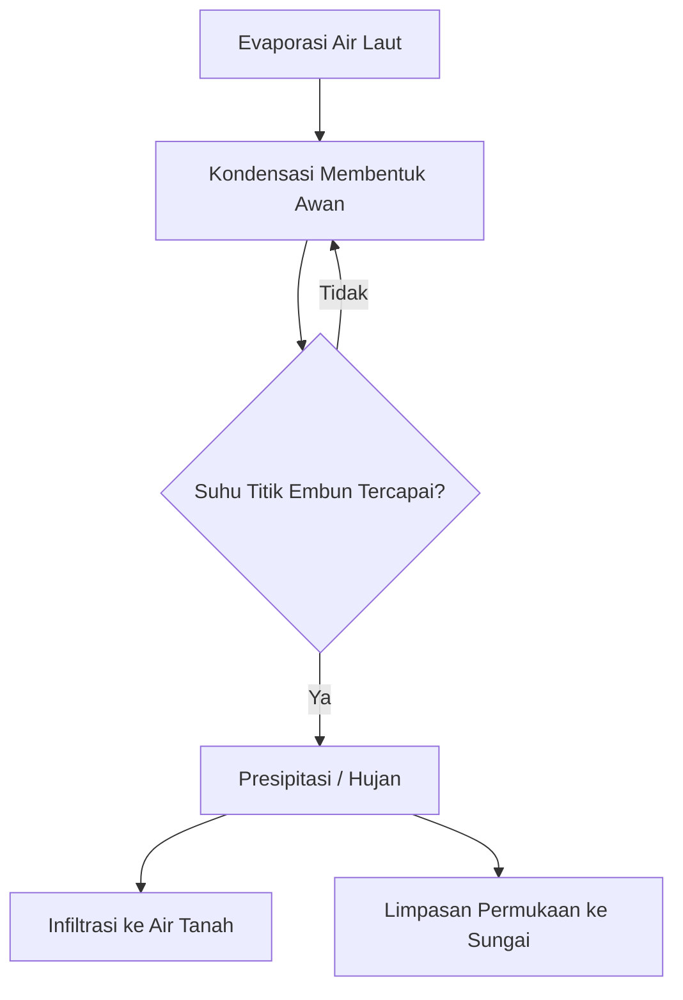

<!-- Single-file build of the kurikulum-merdeka-sma-ma skill for Gemini (Keahlian/Gems): the full skill plus all of its reference files in one Markdown file, because the Gemini uploader accepts one Markdown skill file but often rejects extra Markdown attachments. -->

# Kurikulum Merdeka SMA/MA (Fase E-F)

One single skill for Indonesian SMA/MA under Kurikulum Merdeka (Kemendikdasmen), Fase E (Kelas 10) and Fase F (Kelas 11-12) only. It carries five roles in one skill, so the work stays inside this level's rules from planning to export: (1) Modul Ajar, teaching modules and TP lists; (2) Stimulus & Ilustrasi, stimulus texts and visuals; (3) Asesmen, complete assessment packages and items; (4) Telaah & Validasi Butir Soal, independent item review; (5) Konverter Naskah & CBT, Kartu Soal, print scripts, and CBT exports. Do not import rules from other levels (PAUD & TK/RA, SD/MI, SMP/MTs, SMK/MAK); each level has its own merged skill with its own option counts, splits, and calibration.

Indonesia only, SMA/MA only. The skill is locked to Kurikulum Merdeka Fase E-F, AKM Kelas 11, TKA SMA, and Ujian Sekolah at this level. It does not apply to foreign tests such as SAT, IELTS, or TOEFL, or to general trivia quizzes. School packages at this level mirror the TKA formats; TKA scoring itself is centralized and uses IRT, so a school package imitates the formats, never the IRT scoring.

## Cara memakai skill ini

Route each task to one part of this skill, and read that part's reference file before doing detailed work:

| Tugas | Bagian | Berkas referensi |
| --- | --- | --- |
| Modul ajar, menurunkan CP menjadi TP dan ATP, LKPD, skenario intervensi dari hasil asesmen, instrumen refleksi | 1. Modul Ajar | [references/modul-ajar-kerangka-pembelajaran-mendalam.md](references/modul-ajar-kerangka-pembelajaran-mendalam.md) |
| Stimulus, wacana, tabel data, grafik, diagram, peta, ilustrasi untuk butir soal | 2. Stimulus & Ilustrasi | [references/stimulus-panduan-visual-dan-wacana.md](references/stimulus-panduan-visual-dan-wacana.md) |
| Paket asesmen, kisi-kisi CP-TP, butir soal, kunci dan penskoran, KKTP, tindak lanjut remedial dan pengayaan | 3. Asesmen | [references/asesmen-regulasi-dan-format-soal.md](references/asesmen-regulasi-dan-format-soal.md), [references/asesmen-kktp-solo-dan-tindak-lanjut.md](references/asesmen-kktp-solo-dan-tindak-lanjut.md) |
| Telaah butir soal yang sudah ada, bedah pengecoh, cek keaslian HOTS, analisis butir kuantitatif dari data uji coba | 4. Telaah & Validasi Butir Soal | [references/telaah-kartu-telaah-pusmendik.md](references/telaah-kartu-telaah-pusmendik.md) |
| Kartu Soal, Naskah Ujian siap cetak, berkas impor GIFT, Moodle XML, CSV, JSON untuk CBT/LMS | 5. Konverter Naskah & CBT | [references/konverter-spesifikasi-format-ekspor.md](references/konverter-spesifikasi-format-ekspor.md) |

The normal chain runs in order: Bagian 1 produces the TP list, Bagian 2 builds the stimulus set, Bagian 3 assembles the package, Bagian 4 reviews it independently, and Bagian 5 converts the final set. Each part can also be used on its own; when a task belongs to another part, say so and switch parts instead of improvising.

## Catatan status verifikasi sumber

The core framework claims in this skill have been checked against the primary documents: PPA Edisi Revisi 2025, Desain Pengembangan Soal AKM 2020, Buletin Asesmen Vol-1 2025, Permendikdasmen No. 1 Tahun 2026, and Naskah Akademik Pembelajaran Mendalam. The per-claim status and page citations live in the reference files. Three cautions apply across all five parts. First, the CP citation (SK Kepala BSKAP No. 046/H/KR/2025) has not been independently verified, and the telaah card content has not been independently checked against the official Pusmendik documents; the 27 percent group split and the 5 percent distractor criterion in Bagian 4 are classical test theory conventions used as working standards. Second, some rules are deliberately not regulation quotes: the dynamic MCMA scoring rule, the package defaults, and the formula-leak rule are practice rules or school-package design defaults, labelled as such wherever they appear. Third, before using any output for a high-stakes exam or a formal school document, check any rule you rely on in the official document.

## 1. Modul Ajar

This part works upstream of assessment: it turns a Capaian Pembelajaran (CP) into Tujuan Pembelajaran (TP), orders the TP into an Alur Tujuan Pembelajaran (ATP), and builds the learning experiences, worksheets, and formative checkpoints that make those TP reachable in class. Assessment results then flow back into this part as concrete intervention plans for the next meetings. It does not write test items, kisi-kisi, answer keys, or KKTP rubrics; those belong to Bagian 3. The 8 Dimensi Profil Lulusan, the stage model detail, and the reflection instruments live in [references/modul-ajar-kerangka-pembelajaran-mendalam.md](references/modul-ajar-kerangka-pembelajaran-mendalam.md).

Kapan bagian ini dipakai:

- The user asks for a modul ajar, a lesson plan, or a teaching scenario for an SMA/MA class (Fase E or Fase F).
- The user needs a Fase E or Fase F CP broken down into TP, or TP ordered into an ATP for a semester or a phase.
- The user wants learning activities built on Pembelajaran Mendalam (Memahami, Mengaplikasi, Merefleksi) and asks which of the 8 Dimensi Profil Lulusan a unit develops.
- The user needs an LKPD for Kelas 10-12 with differentiation by readiness level, for example a simplified version and a challenge version of the same task.
- The user has assessment results grouped by KKTP band and needs them turned into actual classroom activities for the next meetings, or asks for teacher or student reflection instruments.

Fase E and Fase F are not interchangeable, and a modul ajar must say which one it serves. Fase E (Kelas 10) states the subject's foundation breadth: TP stay close to the concepts, Mengaplikasi works on guided, well-structured cases, and Merefleksi asks for evaluation of a familiar case, aiming at secure Relasional understanding across the whole element set. Fase F (Kelas 11-12) deepens the same elements toward specialization: more variables, less familiar contexts, open data; TP can target Berpikir Abstrak yang Mendalam directly, Mengaplikasi uses authentic cases and real data sets, and Merefleksi includes defending a conclusion against counter-arguments. Fase F planning also keeps the TKA in view as the final summative context: the TP list should cover the CP elements the TKA samples, without turning lessons into TKA drilling.

Two modes of use. Standalone mode: the user asks only for teaching planning; deliver the modul ajar package and stop, without adding test items. Invoked mode: the workflow needs the upstream half of an assessment package, and the deliverable that matters most is the TP list: each TP as one measurable statement, tagged with its CP element, its position in the ATP, its target SOLO level, and the Dimensi Profil Lulusan it serves. That list feeds Bagian 3, which builds the kisi-kisi from it; if the TP list is vague, the items built on it will be vague too, so this handoff is the quality gate for the whole chain.

Workflow:

1. Read the CP: element, phase (E or F), competencies and content. If the user has not supplied the CP text or at least the subject, fase, and topic, ask first. Never invent CP wording and present it as official text; label a paraphrase as a paraphrase.
2. Derive TP: one verb, one content focus, one TP per statement, observable and checkable; usually two to five TP per meeting sequence.
3. Order the ATP from concrete to abstract and from single-aspect to integrated understanding, so the order itself scaffolds learning across meetings and across the E-to-F boundary when the plan spans both phases.
4. Map each TP to a target SOLO level and to one or two Dimensi Profil Lulusan. Use the Naskah Akademik Pembelajaran Mendalam mapping (Tabel 3.1, pp. 44-45): Memahami covers Unistruktural and Multistruktural together, Mengaplikasi is Relasional, Merefleksi is Berpikir Abstrak yang Mendalam, and Prastruktural is not a stage but the status "Belum Memahami". A TP that maps to no dimension and no SOLO level is probably filler; rewrite or drop it.
5. Design the learning experiences in three stages, stating for each what the teacher does, what the students do, and what product or answer shows the stage worked. Memahami: meet the phenomenon or text, connect prior knowledge, name key facts and concepts (Unistruktural moving to Multistruktural). Mengaplikasi: use the concept on a real case, data set, or problem with the parts working together (Relasional). Merefleksi: evaluate one's own reasoning, defend a conclusion, or transfer the concept to a new situation (Berpikir Abstrak yang Mendalam, the Naskah Akademik's term for the fifth SOLO level; "Extended Abstract" is Biggs & Collis's original English term).
6. Place formative checkpoints between stages: a short check tied to one TP (exit question, observation point, one LKPD section) whose only job is to catch a misconception before the sumatif does. The technique and instrument must stay aligned with the TP (Permendikdasmen No. 1 Tahun 2026, Pasal 8). State what evidence the checkpoint must produce; its item format and scoring belong to Bagian 3.
7. Plan differentiation before it is needed: for each main task, the simplified entry point (fewer variables, worked example, sentence starters) and the extension (extra variable, open data, transfer case). Differentiate content, process, and support; the KKTP expectation for the TP stays the same.
8. Hand off: close with the clean TP list for Bagian 3, plus the misconception list the checkpoints are watching for.

Output structure of a modul ajar, in order:

1. Identitas: school (placeholder when unknown), subject, fase and kelas, semester, time allocation, number of meetings.
2. CP and element, quoted or clearly labelled as paraphrased, with the source the user supplied.
3. TP list, numbered, one measurable statement each.
4. ATP diagram or numbered sequence showing the order across meetings and why that order.
5. Dimensi Profil Lulusan targets: which dimensions this unit develops and where each shows up in an activity, not just a list pasted at the top.
6. Learning experiences per meeting, in the three stages, with teacher activity, student activity, and the evidence each stage produces.
7. LKPD plan: the worksheet sections, which TP each section serves, and its simplified and challenge variants.
8. Formative checkpoints: placement, the TP checked, and the evidence expected.
9. Reflection instruments: the teacher reflection set and the student reflection set from the reference file, trimmed to the unit when the user wants a short version. The teacher set serves the process assessment of Permendikdasmen No. 1 Tahun 2026, Pasal 15-19, which includes teacher self-reflection at least once per semester.
10. Handoff block: the TP list and misconception watchlist, formatted so Bagian 3 can consume it directly.

When assessment results come back grouped by KKTP descriptive band, turn each band into a scenario a teacher can run next meeting, naming the activity, the material, the grouping, and the exit evidence. Perlu bimbingan (Prastruktural to Unistruktural): reteach the base concept in a smaller step with the simplified LKPD variant, a worked example completed together, and short guided practice with the teacher or a trained peer tutor; exit evidence is stating the concept and solving one guided case unaided. Cukup (Multistruktural): the parts are known but not connected, so run a connecting task (concept map, compare-two-cases, the standard LKPD with the linking section emphasised); exit evidence is explaining how two parts relate. Baik (Relasional): no reteaching; move to the next TP at full difficulty, with exit evidence from the next unit's first checkpoint. Sangat baik (Berpikir Abstrak yang Mendalam): a transfer or challenge task from the extension variant (new context, open data, small project); this group can also serve as peer tutors for the first group when the tutoring requires explaining and justifying, not just giving answers. Keep the grade rules of Bagian 3 intact while planning: remedial grades follow Prinsip 1, and formatif results never decide report grades or promotion. The scenarios change the teaching, not the grade policy.

Gotchas: do not write exam items inside a modul ajar; do not list all 8 Dimensi Profil Lulusan as targets for every unit (pick the one to three the activities genuinely develop); do not skip Merefleksi to save time; do not write TP with stacked verbs; do not flatten Fase E and Fase F into one depth.

## 2. Stimulus & Ilustrasi

This part supplies the raw material of Bagian 3 for Fase E-F: the stimulus texts students read and the visuals they must interpret. A weak stimulus caps every item built on it, so stimulus work comes before item writing, not after. Templates, curated source lists, and the specification format live in [references/stimulus-panduan-visual-dan-wacana.md](references/stimulus-panduan-visual-dan-wacana.md).

Kapan bagian ini dipakai:

- The user asks for a stimulus, wacana, reading passage, data table, chart, diagram, map, or illustration for an SMA/MA assessment item (Fase E or Fase F).
- The user has items or a kisi-kisi for Kelas 10-12 and needs the stimulus set built or repaired before the items can be finished.
- An existing stimulus fails review: too shallow to support the target cognitive level, or a visual that decorates instead of measuring.
- Bagian 3 invokes it during package assembly (see the two modes below).

The functionality test governs everything here: cover the stimulus up. If the item can still be answered correctly without reading it, the stimulus fails and gets rebuilt or cut. A functional visual holds data the student must extract, compare, or transform (a value on a curve, a stage in a cycle, a difference between two table rows); a functional text carries the facts, tension, or evidence the item reasons about. Name the key objects a student must read (the specific numbers, labels, arrows, or legend entries the answer depends on) and list them with the stimulus; if you cannot name them, the visual is decoration.

Two modes of use. Standalone mode: the user asks only for stimulus material; deliver the calibrated text or visual, its source or data note, and the list of key objects, then stop. Invoked mode: Bagian 3 calls this part after the kisi-kisi exists and before items are written; the input is the kisi-kisi rows (indicator, KKO, target Bloom and SOLO level, fase) and the output is one stimulus per item group, sized and pitched so the target level is reachable: a Relasional item needs a stimulus with parts that must be connected, and a Berpikir Abstrak yang Mendalam item needs one that supports transfer to a new case.

Calibrate the text to Fase E-F. Students at this level handle single texts, multi-text sets, and infographics, with complex sentences and contrast or cause-effect conjunctions across paragraphs. Two text families dominate, following the AKM and TKA pattern: teks informasi (exposition, report, procedure, data presentation) and teks fiksi (narrative, poetry, drama excerpt). Contexts follow the AKM frames: personal, sosial-budaya, and saintifik, kept realistic and Indonesian: disaster mitigation, local markets and prices, weather and seasons, public policy, national statistics.

Length calibration, with the scope stated precisely:

- Bahasa Indonesia for TKA: 250-300 words per passage (poetry excepted), sentences of 8-12 words. These figures are the verified text characteristics for the Bahasa Indonesia test subject in TKA SMA/MA/Sederajat and SMK/MAK (Buletin Asesmen Vol-1 2025, p. 12). They bind that subject and that test only; this level holds the one precisely scoped, verified length figure in the whole ecosystem, and current official documents set no word limits for other subjects.
- Other subjects at Fase E-F: use the same 250-300 word range as this skill's practical default for a single passage, adjusted to the item's demand; a data-dense stimulus (table plus short text) can be shorter because the reading load sits in the data. Label this as a practical default, never as an official rule.
- Multi-text sets with an infographic can run longer in total; a combined length of up to 700 words is source-reported from ANBK Kelas XI reporting. Treat it as a ceiling reference, not a target.
- One stimulus serves one item or a small graded set: in TKA, one stimulus serves 2-6 items (Buletin Asesmen Vol-1 2025, p. 11), with cognitive levels graded inside the set. Do not stretch one passage across a whole exam.

Write in standard Indonesian (EYD V). Produce visuals in this order, stopping at the first method that yields a functional, readable visual:

1. Render in code: Markdown tables for multi-variable data, Mermaid for flows and cycles, clean SVG for charts and subject diagrams. Code-rendered visuals are exact, editable, and print-safe, so they are the default. The reference file holds a Mermaid cycle template and a corrected SVG supply-demand template to adapt, not to ship unchanged.
2. Curate a real image when the item needs a real photo, map, or phenomenon that code cannot draw honestly (a satellite weather image, a landform photograph, a historical artefact). Search the curated sources in the reference file: Wikimedia Commons for open-licensed photos and diagrams, BMKG for weather and earthquake material, BPS for official statistics, BIG for Indonesian base maps. Cite the source under the visual, every time.
3. Write a [SPESIFIKASI ILUSTRASI] box when the visual is too complex to render and no suitable image exists: visual type, reference source or search query, key objects, mandatory labels, and the function the item depends on, precise enough for a teacher or illustrator to produce it. The exact block format is in the reference file.

Whichever method is used, the visual ships with axis labels, units, a legend where symbols or colours carry meaning, and a title or caption that tells the student what they are looking at. Visual types per subject:

- Ekonomi: supply and demand curves with a marked equilibrium, shifts drawn as new curves rather than arrows alone, elasticity comparisons, circular flow diagrams.
- Fisika: force and vector diagrams on inclined planes and pulleys, circuit sketches, wave and optics ray diagrams, motion graphs with labelled axes and units.
- Matematika: geometric figures with the given lengths and angles marked, coordinate grids, function graphs, nets of solids, statistical charts built from the item's own data table.
- Geografi: soil and rock layer cross-sections, plate subduction diagrams with movement arrows and depth scale, thematic maps, climate and population charts, hydrological cycle diagrams.
- IPA and Biologi: food webs, system diagrams (digestive, respiratory, plant transport), experiment setups where the variables must be read from the drawing.
- IPS and Sejarah: timelines, historical maps, artefact photographs from open collections, source excerpts paired with a visual record.

Data honesty: never present invented numbers as real statistics. When a chart or table uses plausible numbers created for the exercise, label them as simulated or example data ("Data simulasi untuk latihan") in the caption or source line. When real figures are used, name the real source (for example BPS with the table and year) so a teacher can check them. A stimulus that teaches a wrong fact fails even when the item built on it is well formed.

Gotchas: decoration fails (a stock photo beside a recall question adds nothing the item measures; cut it or rebuild the item so the answer lives in the image). Do not leak the tested formula into the stimulus; that is a practice rule of this skill, and no such prohibition appears in the Desain Pengembangan Soal AKM 2020, so never cite it as an official rule. Do not ship the reference templates unchanged with their example numbers. Do not use an internet image without its source line or with an unclear licence when an open source can supply an alternative. Keep the visual readable at print size: labels large enough, contrast clear, no meaning carried by colour alone.

## 3. Asesmen

This part designs assessment packages and test items for Fase E-F: identity, kisi-kisi, stimulus and items, answer key and scoring guide, KKTP rubric, remedial and enrichment follow-up, and a quality audit. Construction rules per format are in [references/asesmen-regulasi-dan-format-soal.md](references/asesmen-regulasi-dan-format-soal.md); scoring, KKTP, and follow-up detail is in [references/asesmen-kktp-solo-dan-tindak-lanjut.md](references/asesmen-kktp-solo-dan-tindak-lanjut.md).

Kapan bagian ini dipakai:

- The user asks for an assessment package (diagnostik, formatif, or sumatif) for SMA/MA, Fase E or Fase F.
- The user asks for items in TKA or Pusmendik formats, a CP-TP kisi-kisi matrix, KKTP rubrics, scoring guides, or remedial and enrichment plans for Kelas 10-12.
- The user asks for a CBT or LMS item-bank export of an SMA/MA package (the export itself is produced by Bagian 5).
- The user works with LOTS, MOTS, HOTS, Bloom levels, or the SOLO taxonomy for SMA/MA students.

Step 1, clarification gate. If the request is brief (a subject and a topic, nothing more), stop and ask before writing any item: (1) fase (E or F), kelas, and mata pelajaran; (2) jenis asesmen (diagnostik, formatif, or sumatif) and whether the result feeds a report card; (3) composition, how many items of each format, or confirmation to use the defaults below; (4) cognitive target, the default Fase E-F split or a custom split; (5) KKTP approach (Deskripsi Kriteria, Rubrik, Skala atau Interval Nilai, or Persentase); (6) whether a JSON or CSV export is needed. Skip the gate when the request already specifies these points or the user says to proceed with standard settings; in that case state the defaults used at the top of the package.

Step 2, Fase E-F defaults:

- PG always has 5 options (A-E) at this level: the AKM design ladder sets Kelas 10-12 at 5 options (Desain Pengembangan Soal AKM 2020, printed p. 4), and PG in TKA for SMA/MA/Sederajat uses 5 options (Buletin Asesmen Vol-1 2025, p. 12). Never use 3 or 4 options here.
- Default cognitive split LOTS:MOTS:HOTS = 20:50:30, derived from the verified AKM Numerasi distribution for Kelas 11 (Knowing 20 / Applying 50 / Reasoning 30; Desain Pengembangan Soal AKM 2020, printed p. 87). It is a school package design default, not an AKM or TKA quota.
- For Literasi-based packages, the verified Kelas 11 reading distribution is Menemukan Informasi 30%, Memahami 40%, Mengevaluasi dan Merefleksi 30% (Desain Pengembangan Soal AKM 2020, printed p. 20).
- Fase E (Kelas 10) builds the foundation breadth of the subject, so keep its items closer to guided application; Fase F (Kelas 11-12) deepens toward specialization and TKA readiness and carries the full HOTS and multi-text load.
- Write in standard Indonesian (EYD V), communicative and unambiguous. In the kisi-kisi, each PG item measures one operational verb (KKO); an essay item may measure more than one.

Step 3, stimulus. Every item that carries a stimulus must need it, and group items under a stimulus in small sets of 2-6 with cognitive levels graded inside the set (Buletin Asesmen Vol-1 2025, p. 11). Calibration, production order, and templates belong to Bagian 2; as a writing-practice rule, never leak the formula an item is testing into its stimulus, especially in numeracy and science items, and never present that rule as an AKM regulation.

Step 4, item formats and scoring. Supported formats, the full TKA set: PG (single answer, 5 options), PGK MCMA (multiple correct answers, checkbox), PGK Kategori (several statements, each judged in a binary category, 3 statements per item in TKA usage), Benar/Salah, Menjodohkan, Isian or Jawaban Singkat, Uraian, and Observasi or Unjuk Kerja for non-test assessment. Whichever format is chosen, the technique and instrument must stay aligned with the tujuan pembelajaran (Permendikdasmen No. 1 Tahun 2026, Pasal 8). Scoring rules that must not be improvised:

- PG: 1 for correct, 0 for wrong.
- PGK MCMA is dynamic. For sumatif and exams it is binary: 1 only when every correct option is chosen and no wrong option is chosen, otherwise 0. For formatif and diagnostik it is partial 2-1-0: 2 for a fully correct selection, 1 when some correct options are chosen with no wrong option, 0 when any wrong option is chosen. Never use free fractions such as 1/3 or 2/3. This dynamic rule is a practice rule from earlier item-writing guidance, labelled as such, not a PPA or TKA quotation.
- PGK Kategori: 1 point per statement judged correctly.
- Uraian Objektif (URO): list every keyword or step in the expected answer, 1 point per element present.
- Uraian Non-Objektif (URN): graded rubric built on SOLO levels, and the lowest rubric score is 0, never 1.

Step 5, cognitive levels, KKTP, and follow-up. Tag every item twice: a Bloom level (C1-C6, grouped as LOTS = C1-C2, MOTS = C3, HOTS = C4-C6) and, for essays and KKTP descriptions, a SOLO level (Prastruktural, Unistruktural, Multistruktural, Relasional, Berpikir Abstrak yang Mendalam). Berpikir Abstrak yang Mendalam is the term the Naskah Akademik Pembelajaran Mendalam uses for the fifth SOLO level (pp. 44-45); "Extended Abstract" is Biggs & Collis's original English term for the same level. The experience-stage map is: Memahami covers Unistruktural and Multistruktural, Mengaplikasi is Relasional, Merefleksi is Berpikir Abstrak yang Mendalam, and Prastruktural is the status "Belum Memahami" with no stage.

KKTP is descriptive, not one uniform passing number like the old KKM (PPA Edisi Revisi 2025, p. 64). Use the approach chosen at the gate: Deskripsi Kriteria (with the PPA's labels Perlu bimbingan, Cukup, Baik, Sangat baik, p. 64), Rubrik, Skala atau Interval Nilai, or Persentase of TP indicators mastered. The four approaches are named in PPA Edisi Revisi 2025, p. 48, and the PPA list is open, so another approach is allowed.

Post-remedial grades follow Prinsip 1, Mastery Learning, the principle this skill adopts: the recorded grade is the highest score the student achieves after remedial, and students who already passed must get an equal chance to improve their score too. The PPA sets no post-remedial grade formula at all: the word "remedial" appears only five times in the whole PPA, and its stated aim for remedial is raising achievement through guided relearning of the unmet criteria, not merely repairing the grade (p. 54). Prinsip 1 is therefore school policy, not a regulation quote, and the package must label it as such. Hard rule: diagnostik and formatif results never determine report grades, promotion, or graduation (formatif is not high-stakes, PPA Edisi Revisi 2025, p. 44).

Step 6, output package. Deliver these seven parts in order, plus the export when requested:

1. Identitas Asesmen: school (placeholder when unknown), fase and kelas, subject, assessment type, time allocation, item count.
2. Matriks Kisi-Kisi: item number, Elemen or CP, TP, core material, indicator with its KKO, cognitive level, item format.
3. Naskah Stimulus dan Butir Soal, grouped by format, each group with its work instructions.
4. Kunci Jawaban dan Pedoman Penskoran, including URO keyword lists and the SOLO rubric for URN.
5. Rubrik KKTP dan Pengolahan Nilai for the chosen approach.
6. Matriks Tindak Lanjut: remedial and enrichment actions per achievement band, differentiated by content, process, or product.
7. Catatan Telaah Mutu: the self-audit report from Step 7.
8. Optional export: JSON or CSV for a CBT or LMS, using the schema in the second reference file of this part. For Kartu Soal, print scripts, or GIFT and Moodle XML, hand the finished package to Bagian 5.

Step 7, mandatory self-audit. Run it before delivering, and print its result as part 7 of the package:

- Key distribution for PG: compute R = (number of PG items / 5 options) + 3. No key letter may appear more than R times. Example: 20 items with 5 options gives R = 7, so a key appearing 9 times must be rebalanced.
- Stimulus function test: remove each visual mentally. If the item is still answerable, the visual fails.
- Distractor and construction check: options homogeneous and similar in length, no "Semua jawaban di atas benar/salah", no double negatives, no item that depends on another item's answer, no formula leaked into a stimulus, URN rubric minimum is 0.
- Language and ethics check: standard Indonesian, no SARA content, no violence, no local or cultural bias that advantages one group of students.

The self-audit is the author's quick check; the independent second pass is Bagian 4, and the two must never be presented as each other.

Gotchas: do not use 3 or 4 options for PG at this level, in school packages or in TKA alike; do not use formatif or diagnostik results for report grades or promotion decisions; do not place the tested formula inside a numeracy or science stimulus; do not start a URN rubric at 1; do not present the MCMA dynamic rule or the package defaults as regulation; do not claim a school package reproduces TKA scoring (TKA is scored centrally with IRT; the package borrows its formats only).

## 4. Telaah & Validasi Butir Soal

This part reviews test items that already exist for Fase E-F. It does not write new packages; it acts as the independent reviewer: it checks items written by an AI, by a teacher, or by an MGMP team against the Pusmendik qualitative review card, gives every item a verdict with reasons, repairs weak distractors, checks that claimed HOTS items are genuinely HOTS, and, when trial results are available, runs the numbers on how each item actually performed. The checklists, formulas, and working standards live in [references/telaah-kartu-telaah-pusmendik.md](references/telaah-kartu-telaah-pusmendik.md); read that file before reviewing a set.

Kapan bagian ini dipakai:

- The user hands over existing SMA/MA items, a draft exam, or a question bank and asks for a review, a telaah, a validation, or a quality check.
- The user supplies trial or class score data (who answered what, or per-item correct counts) and asks for item analysis: difficulty, discrimination, or distractor performance.
- A package produced with Bagian 3 needs its second pass before it is used in class or uploaded to a CBT item bank.
- A teacher wants a second opinion on items from another source before adopting them for Kelas 10-12.

It does not apply to writing items from scratch, building a kisi-kisi, or setting KKTP; route those back to Bagian 3.

The independence rule. An author reviewing their own items in the same pass will miss their own blind spots, which is why this part exists separately from the Bagian 3 self-audit. Run the review as if the reviewer did not write the items; never let a review under this part silently replace the self-audit, and never present a self-audit as if it were this independent review; name which one a report is. Review the item as printed, not as intended: if the indicator, the key, or the scoring guide is missing, that absence is itself a finding; do not reconstruct what the author probably meant and pass the item on that basis. When reviewer and author disagree, the card decides: cite the code that fails (for example K3 or B1) instead of arguing taste.

Step 1, set up the review. Collect what the verdict will be judged against: the items, their keys, the kisi-kisi or indicator for each item, the item format, the fase and subject, and the scoring guide for essays. Items that arrive without a key or an indicator can still be reviewed for construction and language, but their Materi verdict is "cannot be confirmed" until the missing piece is supplied; say so in the report instead of guessing. Confirm the basic shape before anything else: PG items at this level carry 5 options (A-E); a 4-option PG item in an SMA/MA set is a construction finding on its own.

Step 2, qualitative review with the card. Work item by item through the review card in the reference file: for PG and PGK items, the Materi codes (M), Konstruksi codes (K), and Bahasa codes (B); for Uraian items, the U-M, U-K, and U-B codes, including whether a URO keyword list or a URN SOLO rubric is present and usable. Record a pass or fail per code, with a short note on any fail that quotes or points at the exact words in the item that cause it; a fail without a location is not actionable.

Step 3, HOTS authenticity check. At Fase E-F a large share of a set claims HOTS, and the most common fraud is a hard recall item wearing a HOTS label; sulit bukan berarti HOTS. For every item tagged C4-C6, run three questions. Novelty: is the stimulus or situation new to the student, or is it the worked example from the textbook with the numbers changed? A rehearsed procedure is C3 however heavy the arithmetic. Reasoning load: must the student select, connect, or judge information, or only execute one known procedure accurately? Difficulty from long computation, rare vocabulary, or an obscure fact is not HOTS. Answer path: could a student answer correctly by remembering a memorised pattern without reading the stimulus? If yes, the item is LOTS or MOTS in disguise. An item that fails the check keeps its verdict path through the card, but its cognitive tag is corrected in the report and the set's LOTS:MOTS:HOTS balance is recomputed against the Fase E-F default of 20:50:30; a set whose HOTS share collapses after the check is a set-level finding, not a footnote.

Step 4, verdict per item. Give every item exactly one verdict:

- Terima (accept): every applicable code passes. The item may enter the bank as is.
- Revisi (revise): the item measures the right thing but has a fixable defect: a weak distractor, uneven option lengths, a double negative, a missing rubric line, a wrong cognitive tag. State the fix, and supply the revised text in Step 5 or in the output.
- Tolak (reject): the item cannot be repaired by editing: it does not measure its indicator, it has more than one defensible key or no defensible key, its stimulus leaks the answer or the formula, or (after a trial) its discrimination index is negative. State which defect is fatal.

No set-level verdict replaces the per-item verdicts. A set can be "mostly sound" and still contain two items that must not be used.

Step 5, distractor surgery. Run this on every PG or PGK item whose distractors fail the card or the trial data, following this working standard: (1) diagnose each failing distractor and name the failure: too obvious, implausible, cueing the key (longer, more precise, or grammatically matching the stem while others do not), or non-homogeneous; (2) name the student misconception the replacement will target, the specific wrong idea a real Fase E-F student holds, such as reversing a cause and its effect, applying a formula to the wrong quantity, swapping two similar terms, stopping at the intermediate result of a multi-step problem, or reading a graph's axis in the wrong direction; a distractor without a named misconception behind it is decoration; (3) rewrite the distractor so it is exactly what a student with that misconception would produce or choose: correct method with one wrong step, right value with the wrong unit, the paired concept swapped in; (4) re-check the repaired set: five options homogeneous in kind and content, similar in length, ordered consistently (numbers ascending or chronological), no option giving away another, and the key not identifiable by form alone. Show the before and after text for every operated distractor, with the misconception named. Never change the key during surgery without flagging it as a key change and re-running the Materi codes; surgery touches distractors, and a broken stem or a wrong indicator is a revise or reject verdict, not a rewrite.

Step 6, quantitative analysis, when trial data exists. Only run this step when the user supplies response data from a real tryout or class administration; never invent performance numbers for items that have not been tried. Difficulty index P: the share of test takers who answered correctly, with bands and formula in the reference file. Discrimination index D: compare the top 27 percent and the bottom 27 percent of test takers by total score; this 27 percent split is a working standard of this part, taken from classical test theory convention. Distractor effectiveness: a distractor is functioning when at least 5 percent of the lower group chose it and the lower group chose it more than the upper group did; a distractor nobody chooses, or one the upper group prefers, is dead weight and goes to surgery. Verdicts from numbers: an item with negative D is rejected outright, because strong students fail it more than weak students do, which signals a wrong key or a misleading stem; an item with D in the revise band goes back to Step 2 and Step 5 with the data as evidence. Interpret P together with D, never alone: a hard item (low P) with strong D is a good HOTS item and stays; an easy item with near-zero D measures nothing and does not earn its place outside a diagnostic set.

Step 7, key-distribution check. For the PG items in the set, compute R = (number of PG items / 5 options) + 3, inherited from the Bagian 3 self-audit. No key letter may appear more than R times across A-E. If one letter exceeds R, rebalance by reordering options on items where the content allows it, and list every item whose options were reordered; reordering options is a change to the item, so note it in the report.

Output format, in this order:

1. Ringkasan Telaah: how many items were reviewed, by format, and the count per verdict (terima, revisi, tolak), plus any set-level problem such as a missing kisi-kisi, a failed key distribution, or a HOTS share that collapsed under the authenticity check.
2. Tabel Putusan per Butir: one row per item with its number, format, verdict, the card codes that failed, and a one-line reason.
3. Teks Revisi: the full revised text of every item marked revisi, including operated distractors shown before and after with their named misconceptions, corrected cognitive tags, and the revised scoring guide where an essay guide changed.
4. Hasil Analisis Kuantitatif, only when trial data was supplied: per item, P with its band, D with its band, and the distractor findings, each tied back to the verdict it supports.
5. Catatan Kunci: the R computation and any rebalancing done.

Write reasons in plain language a teacher can act on without opening the reference file. Codes support the reason; they do not replace it.

Gotchas: do not run quantitative analysis on invented data (no trial, no P and D); do not pass an item because its intention was good; do not soften a negative D; do not let a difficult item pass as HOTS on difficulty alone.

## 5. Konverter Naskah & CBT

This part packages a finished Fase E-F package into the formats schools and exam systems actually consume: Kartu Soal for administration files, a print-ready exam script, and import files for CBT and LMS platforms. Conversion is a packaging job, not an editing job: wording, keys, scoring, and cognitive tags come from the source package and leave unchanged. If something in the source is broken or missing, this part reports it back instead of repairing it silently. Format details, templates, and worked examples live in [references/konverter-spesifikasi-format-ekspor.md](references/konverter-spesifikasi-format-ekspor.md). It does not apply to writing or improving items; send that work to Bagian 3 for design and Bagian 4 for validation, and convert only after the set is final.

Kapan bagian ini dipakai:

- The user has a finished SMA/MA package from Bagian 3 (or an equivalent item set) and asks for Kartu Soal, a printable exam script, or an import file.
- The user asks for a bank soal in GIFT, Moodle XML, CSV, or JSON form, for example for a Moodle-based CBT or another LMS.
- The user wants the same Fase E-F item set in more than one delivery format at once.

Inputs required. Do not start converting until the input has:

1. Item set with stable numbering and one entry per item: stem, stimulus reference where used, options where the format has them.
2. A key for every objectively scored item, and a scoring guide or rubric for every Uraian item.
3. The scoring policy per format, above all the assessment type (diagnostik, formatif, or sumatif), because it decides how MCMA is encoded.
4. Identity data for the headers: school, subject, fase and kelas, semester, assessment type, time allocation.
5. Planning data for Kartu Soal: CP, TP, core material, and the indicator with its cognitive level per item.
6. Pembahasan per item when the target format carries it (JSON and CSV do; the printed student script never does).

If any of these are absent, list exactly what is missing and stop. A converted file with invented keys or guessed scoring is worse than no file.

Outputs, producing only the formats the user asked for:

- Kartu Soal: one card per item, holding identity, planning fields (CP, TP, material, indicator, Bloom and SOLO levels), the full item, its key, and its score weight or rubric. This is the administration and supervision record.
- Naskah Ujian: the student-facing print script. Header (kop) with school and exam identity, general instructions, items grouped by format with a short instruction per group, and a separate answer sheet layout for the objective sections, with five answer cells (A-E) per PG row. No keys, no pembahasan, no KKTP data anywhere in this document.
- GIFT: plain-text import for Moodle and compatible LMS, one block per item.
- Moodle XML: the same set as a well-formed XML quiz file with a category path that names kurikulum, fase, and cognitive grouping.
- CSV: one row per item with the flattened columns defined in the reference file, including pembahasan and the type-specific key columns.
- JSON: the Bagian 3 schema (metadata, stimulus, items) exactly as defined in [references/asesmen-kktp-solo-dan-tindak-lanjut.md](references/asesmen-kktp-solo-dan-tindak-lanjut.md), section 8. Do not invent a parallel JSON shape.

Scoring conversion rule. The source package's scoring policy governs. Fraction fields in GIFT and Moodle XML are only a transport encoding: they describe how the LMS should add up a response, they are not a new scoring policy, and they never override the policy written in the package.

- PG stays trivial everywhere: full credit for the key, zero for everything else.
- Sumatif MCMA is binary in the package (1 only when every correct option is chosen and no wrong option is chosen, otherwise 0). Encode it all-or-nothing in GIFT and Moodle XML: the correct options share +100 percent in total (each correct option carries 100 divided by the number of correct options), and every wrong option carries -100 percent, so choosing any wrong option cancels the credit from the correct ones. The LMS total for the item is then floored at zero: a response scores the item maximum only when its raw total reaches 100, and 0 otherwise. State this encoding and the floor rule in the export notes that accompany the file.
- Warning that must travel with every sumatif MCMA export: whether the encoding behaves as true all-or-nothing depends on the target LMS. Moodle's multiple-response grading, rounding of repeating fractions such as 33.33333, and negative-total handling differ between versions and question behaviours. Test-import one MCMA item, answer it three ways (fully correct, partially correct with no wrong pick, and correct plus one wrong pick), and confirm the grades are 1, 0, and 0 before importing the whole set.
- Formatif and diagnostik MCMA follow the package's partial 2-1-0 rule. Map it proportionally in the encoding: correct options share the full credit so a fully correct selection earns the maximum, a partial selection with no wrong option earns a proportional share, and any wrong option carries a penalty large enough to bring the total to zero. Say plainly in the export notes that this is a proportional approximation of 2-1-0, because an LMS computes per-option fractions and cannot reproduce the exact three-step scale; the teacher's grade processing still follows the package.
- PGK Kategori keeps its own rule, 1 point per statement judged correctly. Export each statement as its own scorable unit (its own GIFT or XML question, or its own CSV row group) instead of collapsing the item into one all-or-nothing question.
- URO keyword points and URN rubrics do not compress into option fractions. In CBT formats that cannot grade essays automatically, export Uraian as an essay question type with the scoring guide placed in the grader information field, and mark it as manually graded in the export notes.

Pre-export validation checklist. Run this pass before writing any output file, and report the result with the delivery:

- Every objectively scored item has exactly the key its format requires: one key for PG, a defined key set for MCMA, a category key per statement for PGK Kategori.
- Every Uraian item has its scoring guide or rubric attached; a URN rubric starts at 0.
- Option counts match this level: every PG item has exactly 5 options (A-E). A 3- or 4-option item in an SMA/MA package fails validation unless the source package states a deliberate, documented deviation.
- Every stimulus_id or stimulus reference in an item resolves to a stimulus that exists in the set, and every stimulus is used by at least one item.
- Item numbering is continuous, and the item count matches the identity data and the kisi-kisi.
- No leftover placeholders anywhere: no bracketed tokens such as [Nama Sekolah] in a file meant for direct use, no empty option, stem, or pembahasan fields. Placeholders are acceptable only in a template the user explicitly asked for.
- Bloom and SOLO tags are present on every row or record that carries those columns.
- The assessment type is recorded, so the MCMA encoding choice can be checked against it.

Any failure stops the export for the affected items. List the failures by item number and hand them back; do not guess a key, drop an item quietly, or fill a placeholder with invented data.

Gotchas: never change item content during conversion (a stem that looks wrong, a suspect key, or a weak distractor gets flagged back to the author or to Bagian 4, not fixed inside the export; a converter that edits silently destroys the audit trail). XML must be well-formed or the LMS rejects the whole file: escape ampersands, angle brackets, and quotes in text, or wrap question and answer text in CDATA sections, and never mix raw HTML into an unescaped text node; validate the file's structure before delivering it. GIFT has its own escaping: characters such as = ~ # { } and : inside answer text must be backslash-escaped, and an unescaped closing brace ends the answer block early. CSV quoting is strict: wrap any field containing a comma, a quote, or a line break in double quotes, double every quote inside such a field, write the file as UTF-8 so Indonesian text survives the round trip, and keep one row per item with no line breaks outside quoted fields. Keep keys and pembahasan out of student-facing output. One source, many outputs: generate every requested format from the same validated item set in the same pass, so the print script, the cards, and the CBT file can never drift into different versions of an item.


---

# Reference file: references/asesmen-kktp-solo-dan-tindak-lanjut.md

# KKTP, SOLO, dan Tindak Lanjut SMA/MA (Fase E-F)

Reference for Bagian 3 (Asesmen) of the kurikulum-merdeka-sma-ma skill: cognitive mapping, dynamic scoring, KKTP approaches, grade processing, and remedial or enrichment follow-up. Verification status: the KKTP, grade-processing, follow-up, and SOLO claims below were checked against PPA Edisi Revisi 2025 and the Naskah Akademik Pembelajaran Mendalam and carry page citations; the AKM distributions were checked against Desain Pengembangan Soal AKM 2020. The dynamic MCMA scoring rule in section 4 is a practice rule from earlier item-writing guidance, not a PPA or TKA quotation.

## 1. Cognitive levels: LOTS, MOTS, HOTS

- LOTS: C1 Mengingat, C2 Memahami.
- MOTS: C3 Menerapkan.
- HOTS: C4 Menganalisis, C5 Mengevaluasi, C6 Mencipta.
- AKM and TKA use parallel ladders. Literasi: L1 Access and Retrieve, L2 Interpret and Integrate, L3 Evaluate and Reflect. Numerasi: Knowing, Applying, Reasoning.
- Verified AKM distributions (Desain Pengembangan Soal AKM 2020). Numerasi Kelas 11, by cognitive level (printed p. 87): Knowing 20 / Applying 50 / Reasoning 30. Literasi Membaca Kelas 11 (printed p. 20): Menemukan Informasi 30, Memahami 40, Mengevaluasi dan Merefleksi 30.
- Default distribution for Fase E-F packages (PG items): LOTS:MOTS:HOTS = 20:50:30. This package default is derived from the verified AKM Numerasi Kelas 11 distribution above; it is a school package design default, not an AKM quota.

## 2. SOLO taxonomy

Five levels of response quality:

- Prastruktural: no relevant understanding, answer misses the point.
- Unistruktural: one relevant aspect only.
- Multistruktural: several relevant aspects, not yet connected.
- Relasional: aspects integrated into one coherent understanding.
- Berpikir Abstrak yang Mendalam: the understanding is generalized and applied to a new context. This is the fifth-level term used by the Naskah Akademik Pembelajaran Mendalam (pp. 44-45); "Extended Abstract" is Biggs & Collis's original English term for the same level, not the Naskah Akademik's wording.

Bloom tags the item; SOLO grades the response. Use SOLO for URN essay rubrics and for KKTP descriptors. Working map between them: C1-C2 sit at Unistruktural, C3 at Multistruktural, C4 at Relasional, C5-C6 at Berpikir Abstrak yang Mendalam.

The Naskah Akademik also maps the levels onto the deep-learning experience stages (Tabel 3.1, pp. 44-45): Memahami covers Unistruktural and Multistruktural together; Mengaplikasi is Relasional; Merefleksi is Berpikir Abstrak yang Mendalam. Prastruktural has no stage: it is the status "Belum Memahami", before the Memahami stage begins.

## 3. Four KKTP approaches

KKTP is set per subject and is descriptive in principle; it is not a single uniform pass mark like the old KKM (PPA Edisi Revisi 2025, p. 64: the criterion is a sentence describing mastery, not a number). The PPA names four approaches (p. 48) and its list is open: "di antaranya ... atau pendekatan lainnya", so a school may use another approach its context needs.

1. Deskripsi Kriteria: qualitative bands Perlu bimbingan, Cukup, Baik, Sangat baik (the PPA's exact labels, p. 64), each with a descriptor of which indicators are mastered. Against SOLO: Perlu bimbingan matches Prastruktural to Unistruktural, Cukup matches Multistruktural, Baik matches Relasional, Sangat baik matches Berpikir Abstrak yang Mendalam.
2. Rubrik: mastery stages per aspect, for example Mulai Memahami, Memahami, Sangat Memahami, or Belum Berkembang, Layak, Cakap, Mahir.
3. Skala atau Interval Nilai (the PPA's name for this approach, p. 48): bands 0-20, 21-40, 41-60, 61-80, 81-100 (PPA, pp. 52-53). A school may also agree a binary split such as 0-55 not yet complete and 56-100 complete (PPA worked example, p. 63).
4. Persentase: the share of TP indicators mastered, for example 75 percent when 3 of 4 indicators are met.

## 4. Dynamic scoring per format

- PG: 1 correct, 0 wrong.
- PGK MCMA, sumatif or exam use: binary. Score 1 only when all correct options are chosen and no wrong option is chosen; otherwise 0.
- PGK MCMA, formatif or diagnostik use: partial 2-1-0. Score 2 for the fully correct selection, 1 when some correct options are chosen and no wrong option is chosen, 0 when any wrong option is chosen.
- No free fractional scoring (no 1/3, 1/2, 2/3) in any MCMA scheme.
- PGK Kategori: 1 per statement judged correctly.
- Benar/Salah single statement: 1 or 0.
- URO: 1 point per listed keyword or step present in the answer.
- URN: SOLO graded rubric, minimum score 0.

## 5. Grade processing

Three accepted ways to combine TP results for a report grade (PPA Edisi Revisi 2025, pp. 64 and 66):

- Pembobotan (weighting) and Persentase when TP are progressive or interrelated.
- Rata-rata (average) when TP are independent of each other.
- When a TP chain is one continuous prerequisite progression, the PPA also allows taking the final TP score alone, because it already represents the prerequisites (p. 63).

## 6. Follow-up matrix

By interval band (PPA Edisi Revisi 2025, pp. 52-53):

- 0-20, not yet: dialogue with the teacher, then remedial relearning of all criteria.
- 21-40, not yet: remedial relearning of most criteria.
- 41-60, almost: remedial relearning of only the criteria still needed.
- 61-80, achieved: the table cell reads only "Sudah mencapai tujuan pembelajaran". The PPA's worked example (p. 53) continues the student to the next TP without enrichment; quote the band that way, not as a table cell that says "no remedial and no enrichment".
- 81-100, achieved and above target: enrichment or challenge tasks ("perlu tantangan lebih (pengayaan)").

By descriptive band (PPA, p. 64):

- Perlu bimbingan: intensive reinforcement.
- Cukup: strengthen the unmastered aspects before new material.
- Baik: ready for the next TP.
- Sangat baik: next TP, plus peer tutoring or an extra challenge.

Remedial delivery modes: individual guidance when few students struggle with varied difficulties; group guidance when the difficulty is uniform; whole-class reteaching when most of the class failed; peer tutoring. Differentiate by content, process, and product.

## 7. Post-remedial grades: the chosen principle

PPA 2025 sets no standard formula for post-remedial grades. This is a verified absence: the word "remedial" appears only five times in the whole PPA, and its only statement on the point is that the aim of remedial is raising the student's achievement through guided relearning of the unmet criteria, not merely repairing the grade (p. 54). The choice below is therefore school policy. This skill applies the following principle:

- Prinsip 1, Mastery Learning (applied): the recorded grade is the highest score achieved after remedial. Fairness condition: students who passed on the first attempt receive an equal opportunity to improve.
- Prinsip 2 (listed, not applied): cap the post-remedial grade at the KKTP pass threshold.

State which principle a package uses in its KKTP section, so a reader never has to guess.

## 8. JSON export schema for CBT and LMS

Optional part of the package, produced when the user asks for it. Top level: metadata, stimulus, items.

- metadata: kurikulum, jenjang, fase, kelas, mata_pelajaran, materi, jenis_asesmen, jumlah_soal, tanggal_pembuatan, versi_skill.
- stimulus array entries: id_stimulus, judul_stimulus, jenis_stimulus, teks_stimulus.
- items array entries, shown for PG: id, tipe, stimulus_id, pertanyaan, opsi (object keyed A-E), kunci_jawaban, pembahasan, level_bloom, level_solo, skor_maksimal.

The core schema defines only the PG shape. When exporting other formats, extend consistently and say so in the audit note: kunci_jawaban becomes an array for MCMA, PGK Kategori items carry a pernyataan list with a category key per statement, and URN items carry their rubric instead of opsi. CSV export uses the same item fields flattened into columns. Full delivery formats (Kartu Soal, print script, GIFT, Moodle XML) belong to Bagian 5 (Konverter Naskah & CBT).

## 9. Self-audit checklist

- Key distribution: R = (number of PG items / 5 options) + 3 caps how often any one key letter may appear. Rebalance any key above R.
- Visual and stimulus function: every visual must be needed to answer its item.
- Distractor sterilization: no leaked formula in a stimulus, no "Semua jawaban di atas benar/salah", URN rubric minimum 0.
- Construction and language: homogeneous options of similar length, no double negatives, no interdependent items, standard Indonesian, no SARA, violence, or group bias.


---

# Reference file: references/asesmen-regulasi-dan-format-soal.md

# Regulasi dan Format Soal SMA/MA (Fase E-F)

Reference for Bagian 3 (Asesmen) of the kurikulum-merdeka-sma-ma skill. Verification status: the framework claims below were checked against the primary documents (PPA Edisi Revisi 2025, Desain Pengembangan Soal AKM 2020, Buletin Asesmen Vol-1 2025, Permendikdasmen No. 1 Tahun 2026, Naskah Akademik Pembelajaran Mendalam) and carry page citations where they are verified. Rules marked as practice rules or package defaults are this skill's working choices, not regulation.

## 1. Regulatory basis

- Panduan Pembelajaran dan Asesmen (PPA), Edisi Revisi 2025.
- Permendikdasmen No. 10/2025 (Standar Kompetensi Lulusan) and No. 12/2025 (Standar Isi).
- Permendikdasmen No. 13/2025 and SK Kepala BSKAP No. 046/H/KR/2025 (CP).
- Permendikdasmen No. 1/2026 (Standar Proses).
- Permendikdasmen No. 9/2025 and No. 9/2026 (TKA and Asesmen Nasional).
- Pusmendik and AKM guidance; Naskah Akademik Pembelajaran Mendalam (BSKAP, 2025).

Known gaps, verified as absences: PPA 2025 gives no standard numeric formula for post-remedial grades (see the second reference file); the TKA guidance gives no manual MCMA scoring rule because TKA scoring is centralized with IRT; and the only verified stimulus length figure in the 2025 documents is the Bahasa Indonesia TKA text characteristic (see Bagian 2 (Stimulus & Ilustrasi) of this skill and its reference file).

## 2. Three assessment types at Fase E-F

- Diagnostik: maps starting ability before learning. Not graded for report cards. Assessment at the start of the school year is optional; what the PPA emphasises is assessment at the start of a topic or unit, before teaching it (PPA Edisi Revisi 2025, p. 44).
- Formatif: feedback during learning, guides the next teaching step. Not high-stakes; never decides report grades, promotion, or graduation (PPA Edisi Revisi 2025, p. 44).
- Sumatif: measures achievement at the end of a scope or period, and is the type that feeds report-card processing. At Fase F the final sumatif context is the TKA, whose formats this skill's packages mirror.

The CP-TP-ATP chain drives design: derive TP from CP, sequence them into an ATP, write the kisi-kisi from TP, and set KKTP per TP. Fase E CP (Kelas 10) covers the subject's foundation breadth; Fase F CP (Kelas 11-12) deepens the same elements toward specialization. Keep that depth difference visible in the TP and in the item demand.

## 3. Item formats and construction rules

### PG (Pilihan Ganda Sederhana)

- Exactly one correct key, and always 5 options (A-E) at this level. The AKM design ladder sets Kelas 10-12 at 5 options (Desain Pengembangan Soal AKM 2020, printed p. 4), and PG in TKA for SMA/MA/Sederajat uses 5 options (Buletin Asesmen Vol-1 2025, p. 12).
- Options homogeneous and logical, similar in length. Numbers and times ordered ascending, descending, or chronologically.
- The option "Semua jawaban di atas benar/salah" is forbidden. Distractors must be plausible enough to function, options must not cue each other, and no item may depend on another item's answer.
- Scoring 1 correct, 0 wrong. AKM coding also uses 9 for blank.

### PGK MCMA (Pilihan Ganda Kompleks, multiple answers)

- More than one correct answer, presented with checkboxes and an instruction to choose all correct statements.
- Every option relevant and homogeneous.
- Scoring is dynamic, see the second reference file: binary 1-0 for sumatif, partial 2-1-0 for formatif and diagnostik. Free fractions are not used. This is a practice rule from earlier item-writing guidance, not a PPA or TKA quotation; TKA itself is scored centrally with IRT.

### PGK Kategori

- Several statements under one stem or stimulus, each answered with a radio button in a binary category pair. Keep the two sources apart: in TKA an item carries three statements, with category pairs Benar/Salah, Sesuai/Tidak Sesuai, Setuju/Tidak Setuju, or another category pair (the Buletin's own worked example uses Tepat/Tidak Tepat) (Buletin Asesmen Vol-1 2025, p. 12). The Ya/Tidak pair comes from the AKM design's PGK column format (Desain Pengembangan Soal AKM 2020, printed p. 5), not from the Buletin.
- Each statement is judged independently. Scoring is 1 per correctly judged statement.

### Benar/Salah (single statement)

- One statement, two categories. Guessing chance is 50 percent, so balance true and false keys across the set and randomize their positions.

### Menjodohkan (matching)

- Two columns: numbered stems on the left, lettered options on the right. The AKM design advises (its word is "sebaiknya") that the right column carry more options than the left, so the last pairs cannot be solved by elimination alone; treat this as a design recommendation, not an absolute requirement (Desain Pengembangan Soal AKM 2020, printed p. 5). Sets are homogeneous, parallel, and ordered systematically or chronologically.

### Isian and Jawaban Singkat

- Exactly one definite short answer: a word, a number, or a short phrase. Isian is a statement with a blank; jawaban singkat answers a direct question. The stem gives no clue to the answer.

### Uraian

- Written as a question or a command, with firm limits on what the answer must contain, and always delivered with its scoring guide.
- URO (Uraian Objektif): the guide lists every keyword or step, 1 point each.
- URN (Uraian Non-Objektif): graded SOLO rubric, lowest score 0.

### Observasi and Unjuk Kerja

- The non-test family: observation, performance, plus self and peer assessment.
- Every instrument ships with a rubric or observation guide that describes strengths, points to improve, and concrete next steps.
- First choice for Seni Budaya and PJOK, ahead of written tests.

## 4. Stimulus and visual rules at Fase E-F

- A stimulus is functional or it fails: the item must be unanswerable, or materially harder, without reading it.
- Visuals must also be clear: readable, with labels and units where the data needs them.
- Three production methods, chosen by context: render in code (Markdown tables, Mermaid diagrams, simple charts); use a contextual internet image when a real photo, map, or phenomenon is needed and search is available (Wikimedia preferred); or write a [SPESIFIKASI ILUSTRASI] box describing the visual precisely for a human illustrator. Bagian 2 (Stimulus & Ilustrasi) of this skill owns the full calibration for this level.
- Single and multi-text stimuli are both normal at Fase E-F, with inter-paragraph conjunctions and contrast between texts. Grouping: one stimulus serves a single item or a small set; in TKA one stimulus serves 2-6 items (Buletin Asesmen Vol-1 2025, p. 11), with cognitive levels graded inside the set.
- Practice rule: do not place the formula being tested inside the stimulus; the item then measures copying instead of reasoning. No such prohibition was found in the Desain Pengembangan Soal AKM 2020, so this is a writing-practice consideration, not an AKM rule.

## 5. General writing rules

- Material: the item measures the indicator in the kisi-kisi, one KKO per PG item.
- Construction: stem is firm and necessary, options follow the format rules above, key is unambiguous.
- Language: standard Indonesian (EYD V), communicative, no double negatives, no bias by region, culture, or group, no SARA or violent content.

## 6. Working flow, kisi-kisi to item analysis

1. Analyze the CP and derive TP.
2. Build the kisi-kisi matrix.
3. Choose or write the stimulus.
4. Write items with keys and scoring guides.
5. Qualitative review and revision (the self-audit in SKILL.md Step 7; the independent second pass belongs to Bagian 4 (Telaah & Validasi Butir Soal)).
6. Assemble the set: group by format, number the items, write instructions, prepare the answer sheet, balance PG keys.
7. After administration, quantitative item analysis: validity, reliability, difficulty, discrimination, distractor function. TKA uses IRT centrally; a school package uses classical indices (see Bagian 4 (Telaah & Validasi Butir Soal)).


---

# Reference file: references/konverter-spesifikasi-format-ekspor.md

# Spesifikasi Format Ekspor SMA/MA (Fase E-F)

Scope: the Kartu Soal template, GIFT, Moodle XML, and CSV formats for Fase E-F packages, where every PG item has 5 options (A-E). One encoding choice is deliberate: the MCMA GIFT encoding below follows the scoring policy of Bagian 3 (Asesmen) (sumatif MCMA binary 1-0, formatif MCMA 2-1-0), so the LMS fraction fields act only as transport encoding. See Bagian 5 of SKILL.md, "Scoring conversion rule", before using any example here.

## 1. Kartu Soal: field structure

One card per item. A card holds everything a supervisor or reviewer needs to judge the item without opening another document.

Identity block:

- Satuan Pendidikan
- Mata Pelajaran
- Kurikulum or reference basis (for example Kurikulum Merdeka, CP per SK Kepala BSKAP 046/H/KR/2025, as named in the source package)
- Fase, Kelas, Semester
- Bentuk Soal
- Nomor Soal

Planning block:

- Capaian Pembelajaran (CP): the relevant element text from the package
- Tujuan Pembelajaran (TP)
- Materi Pokok
- Indikator Soal: the indicator sentence with its operational verb (KKO)
- Level Kognitif: Bloom level with its LOTS, MOTS, or HOTS group, plus the SOLO level where the package assigns one

Item and scoring block:

- Stimulus: full text or visual reference, exactly as the student sees it
- Rumusan Butir Soal: stem and options
- Kunci Jawaban: the key, or the key set for MCMA, or the per-statement keys for PGK Kategori
- Bobot Skor and Pedoman Penskoran: the item weight, the URO keyword list, or the URN rubric, copied from the package unchanged

## 2. Naskah Cetak: layout spec

The printed script is student-facing. Build it in this order:

1. Kop (header): school name and address line as given in the identity data, exam name and assessment type, subject, fase and kelas, semester and academic year, day and date, and time allocation. A horizontal rule separates the kop from the body.
2. Petunjuk Umum: how many items per section, how to record answers, whether corrections are allowed, and that rough work is not collected. Keep it short and in plain Indonesian.
3. Sections by format, in the package's order. Each section opens with its own short instruction line (for example, choose one answer, choose all correct statements, or answer in your own sentences), then its stimulus blocks and items, numbered continuously across the whole script.
4. Stimulus placement: print each stimulus once, directly above the first item that uses it, with the items that share it following in order.
5. Lembar Jawaban: a separate sheet for the objective sections, with student identity fields (name, class, attendance number), one answer grid row per item with five lettered cells (A-E) matching the 5-option items, and a separate lined space or separate sheet for Uraian answers.

Never print keys, pembahasan, KKTP bands, or scoring notes in the script or the answer sheet.

## 3. GIFT examples

GIFT is plain text. Each question opens with a ::name:: line, the stem follows (prefix it with [html] when the stem carries markup), and the answer block sits in braces. In the answer block, = marks full credit in single-answer questions, ~ marks an option in multiple-response encoding, and %n% sets that option's fraction. Escape = ~ # { } : inside answer text with a backslash.

### PG, single answer (Fase F, 5 options)

```text
::GEO-F-01-PG::[html]<p>Perhatikan data curah hujan wilayah X berikut. Faktor utama penyebab tingginya limpasan permukaan di wilayah tersebut adalah...</p>{
=Alih fungsi lahan resapan di hulu menjadi kawasan terbangun
~Tingginya laju evaporasi harian di kawasan pesisir
~Dominasi batuan gamping berpori tinggi di lereng tengah
~Rendahnya kemiringan lereng di sekitar muara sungai
~Tingginya kerapatan vegetasi hutan hujan tropis primer
}
```

### PGK MCMA, sumatif, harmonized all-or-nothing encoding

The item below has two correct options out of five. Per the conversion rule: the correct options share +100 in total, so each carries %50%; every wrong option carries %-100%, so any wrong pick cancels the credit; the LMS total is floored at zero and only a total of 100 earns the item score. This is not partial credit: the %50% figures are how the encoding splits the single binary point across the two correct options, nothing more. Verify the behaviour in the target LMS with a three-way test import before using it on a full set (see Bagian 5 in SKILL.md).

```text
::GEO-F-02-MCMA::[html]<p>Pilihlah DUA pernyataan yang tepat mengenai mitigasi struktural bencana gempa bumi!</p>{
~%50%Penerapan standar bangunan tahan gempa berbasis isolasi seismik
~%50%Pembangunan jalur evakuasi vertikal dan rambu titik kumpul aman
~%-100%Pembentukan kelompok siaga bencana berbasis kearifan lokal
~%-100%Simulasi evakuasi mandiri secara berkala di sekolah
~%-100%Penyusunan peta risiko bencana oleh warga kelurahan
}
```

For a formatif MCMA export, keep the same shape but state in the export notes that the encoding approximates the package's 2-1-0 scale proportionally, as Bagian 5 in SKILL.md describes.

## 4. Moodle XML example

Well-formed XML, UTF-8. Question and answer text sit inside CDATA sections so HTML markup needs no escaping; text outside CDATA must escape ampersands, angle brackets, and quotes. The category question comes first and sets the bank path for the questions after it.

```xml
<?xml version="1.0" encoding="UTF-8"?>
<quiz>
  <question type="category">
    <category>
      <text>$course$/top/Kurikulum-Merdeka/Fase-F/Geografi/HOTS-Relasional</text>
    </category>
  </question>
  <question type="multichoice">
    <name>
      <text>GEO-F-01-PG</text>
    </name>
    <questiontext format="html">
      <text><![CDATA[<p>Perhatikan data curah hujan wilayah X berikut. Faktor utama penyebab tingginya limpasan permukaan di wilayah tersebut adalah...</p>]]></text>
    </questiontext>
    <defaultgrade>1.0000000</defaultgrade>
    <single>true</single>
    <shuffleanswers>true</shuffleanswers>
    <answernumbering>ABC</answernumbering>
    <answer fraction="100" format="html">
      <text><![CDATA[<p>Alih fungsi lahan resapan di hulu menjadi kawasan terbangun</p>]]></text>
    </answer>
    <answer fraction="0" format="html">
      <text><![CDATA[<p>Tingginya laju evaporasi harian di kawasan pesisir</p>]]></text>
    </answer>
    <answer fraction="0" format="html">
      <text><![CDATA[<p>Dominasi batuan gamping berpori tinggi di lereng tengah</p>]]></text>
    </answer>
    <answer fraction="0" format="html">
      <text><![CDATA[<p>Rendahnya kemiringan lereng di sekitar muara sungai</p>]]></text>
    </answer>
    <answer fraction="0" format="html">
      <text><![CDATA[<p>Tingginya kerapatan vegetasi hutan hujan tropis primer</p>]]></text>
    </answer>
  </question>
</quiz>
```

For an MCMA question, set single to false and apply the same fraction rule as GIFT: correct answers share fraction 100 in total, each wrong answer carries fraction -100.

## 5. CSV: improved column list and example

One row per item, UTF-8, header row first. Quote any field containing a comma, a quote, or a line break in double quotes, and double quotes inside it. The column set extends the source template with pembahasan and with separate key columns per item type, so no format has to squeeze its key into a shape that loses information.

Columns, in order:

1. nomor: item number in the set.
2. bentuk_soal: PG, PGK_MCMA, PGK_KATEGORI, BENAR_SALAH, MENJODOHKAN, ISIAN, URAIAN_URO, or URAIAN_URN.
3. id_stimulus: stimulus identifier, empty when the item has none.
4. teks_stimulus: full stimulus text, empty when none.
5. pokok_soal: the stem or instruction for the item.
6. opsi_a to opsi_e: option texts. A Fase E-F PG item fills all five; leave trailing cells empty only for formats with fewer options, rather than deleting columns, so every row has the same shape.
7. kunci_jawaban: the single key for PG (one letter) and Benar/Salah (Benar or Salah). Empty for multi-key formats.
8. kunci_multi: for PGK MCMA, every correct letter separated by semicolons, for example A;C. Empty otherwise.
9. pernyataan_kunci: for PGK Kategori, the statements with their category keys as statement=key pairs separated by semicolons, for example Gempa tektonik disebabkan pergerakan lempeng=Benar;Tsunami selalu mengikuti gempa darat=Salah. Empty otherwise.
10. kunci_teks: for ISIAN, the accepted short answer; for MENJODOHKAN, the stem-to-option pairs; for URO, the keyword list. Empty otherwise.
11. pedoman_penskoran: the URN rubric or any scoring note the format needs, copied from the package.
12. pembahasan: the explanation of the key, for teacher-facing and LMS use. Never exported into the printed student script.
13. bobot_skor: the item's weight in the set's total.
14. skor_maksimal: the maximum score the item itself can earn (1 for PG, 2 for a formatif MCMA, the keyword count for URO, the rubric top for URN).
15. level_bloom: for example C4 (HOTS).
16. level_solo: for example Relasional; empty only when the package assigns none.
17. jenis_asesmen: diagnostik, formatif, or sumatif. Carried on every row so any later re-import can check the MCMA encoding against the policy.

Example row (PG, Fase F, with a stimulus and a pembahasan that contains a comma, hence the quoting):

```csv
nomor,bentuk_soal,id_stimulus,teks_stimulus,pokok_soal,opsi_a,opsi_b,opsi_c,opsi_d,opsi_e,kunci_jawaban,kunci_multi,pernyataan_kunci,kunci_teks,pedoman_penskoran,pembahasan,bobot_skor,skor_maksimal,level_bloom,level_solo,jenis_asesmen
1,PG,STIM-01,"Data curah hujan wilayah X menunjukkan intensitas tinggi selama tiga bulan terakhir, dengan limpasan permukaan meningkat di kawasan hulu.","Faktor utama penyebab tingginya limpasan permukaan di wilayah tersebut adalah...","Alih fungsi lahan resapan di hulu menjadi kawasan terbangun","Tingginya laju evaporasi harian di kawasan pesisir","Dominasi batuan gamping berpori tinggi di lereng tengah","Rendahnya kemiringan lereng di sekitar muara sungai","Tingginya kerapatan vegetasi hutan hujan tropis primer",A,,,,,"Lahan resapan yang beralih fungsi mengurangi infiltrasi, sehingga air hujan lebih banyak mengalir di permukaan.",1,1,"C4 (HOTS)",Relasional,sumatif
```


---

# Reference file: references/modul-ajar-kerangka-pembelajaran-mendalam.md

# Kerangka Pembelajaran Mendalam SMA/MA (Fase E-F)

Reference for Bagian 1 (Modul Ajar) of the kurikulum-merdeka-sma-ma skill: the 8 Dimensi Profil Lulusan, the three-stage learning experience model mapped to the SOLO taxonomy at Fase E-F depth, and the reflection instruments for teachers and students.

Verification status: the SOLO mapping in section 2 follows the Naskah Akademik Pembelajaran Mendalam, Tabel 3.1 (pp. 44-45), and the process-assessment cycle in section 3 follows Permendikdasmen No. 1 Tahun 2026, Pasal 15-19; both were checked against the primary documents. The graduate-profile citation (Permendikdasmen No. 13/2025) and the CP citation (SK Kepala BSKAP No. 046/H/KR/2025) have not been independently verified; verify before relying on either in a formal school document.

## 1. Delapan Dimensi Profil Lulusan

The graduate profile has eight dimensions. A modul ajar names the dimensions its activities actually develop, with the activity as evidence.

1. Keimanan dan Ketakwaan terhadap Tuhan Yang Maha Esa: the student acts on spiritual and moral values, including honesty in academic work and care for the natural environment.
2. Kewargaan: the student knows the rights and duties of an Indonesian citizen and a member of a wider community, respects diversity, and takes part in shared concerns.
3. Penalaran Kritis: the student screens information for bias and weak assumptions, works from data, and draws conclusions that follow from evidence.
4. Kreativitas: the student produces original ideas or adapts an existing solution to a new problem, and expresses the result as a work or a proposal.
5. Kolaborasi: the student works productively in a team, shares responsibility across roles, and uses differing viewpoints instead of treating them as obstacles.
6. Kemandirian: the student starts work without waiting to be pushed, manages time and strategy, and checks their own progress.
7. Kesehatan: the student looks after physical and mental health and works safely, for themselves and for others in the room.
8. Komunikasi: the student presents ideas, arguments, and findings in speech, writing, or visuals, in an order others can follow and in a register that fits the audience.

## 2. Learning experience stages mapped to SOLO, at Fase E-F depth

Pembelajaran Mendalam runs each unit through three experience stages. The stages carry three working principles: learning that is mindful (students know what they are doing and why), meaningful (connected to prior knowledge and real contexts), and joyful (active rather than endured). The stages line up with the SOLO taxonomy as follows:

| Stage | What happens in class | SOLO target |
| --- | --- | --- |
| Memahami | Students meet a phenomenon, text, or data set; connect it to what they already know; pick out the key facts, terms, and parts of the concept. Teacher probes prior knowledge and corrects early misconceptions. | Unistruktural moving to Multistruktural: one aspect held securely, then several aspects held at once. |
| Mengaplikasi | Students apply the concept to a real case: a problem, an experiment, a data or spatial analysis, a case study. The parts of the concept have to be used together, often in group work. | Relasional: the aspects are integrated into one connected understanding. |
| Merefleksi | Students review how they reasoned, test their conclusion against a new case, present and defend an argument, and evaluate their own work. | Berpikir Abstrak yang Mendalam: the understanding is generalised and transferred to a situation not taught directly. (The Naskah Akademik's term for the fifth SOLO level; "Extended Abstract" is Biggs & Collis's original English term.) |

Below the three stages sits Prastruktural, which the Naskah Akademik's table (Tabel 3.1, pp. 44-45) carries as the status "Belum Memahami" with no stage of its own: a learner there has not yet entered Memahami, and the plan's response is foundation work, not a stage activity.

Depth across the two phases: at Fase E the Mengaplikasi cases are guided and well-structured, and Merefleksi usually evaluates a familiar case. At Fase F the cases open up (real data, competing explanations, transfer to untaught contexts), and Merefleksi can require a defended position, which is also the response quality the TKA's highest literacy and numeracy levels sample.

Planning rule: an ATP whose TP reach Berpikir Abstrak yang Mendalam needs at least one Merefleksi activity per unit. If the timetable forces a cut, cut content breadth before cutting the reflection stage, or lower the TP target and say so in the plan.

## 3. Reflection instruments

Reflection is part of process assessment, not an optional closing ritual. Permendikdasmen No. 1 Tahun 2026, Pasal 15-19 (verified) requires assessment of the learning process after teaching, at least once per semester, carried out by the teacher through self-reflection (Pasal 15) and also by fellow teachers, the school head, and students (Pasal 16-19). The instruments below serve that requirement. Run the teacher set at least once per semester per subject, and the student set at the end of a unit or a meeting sequence.

### Teacher self-reflection

Answer in writing, briefly, with evidence from the class rather than general impressions:

1. Learning flow: did the Memahami, Mengaplikasi, Merefleksi sequence actually build connected understanding, or did students leave with memorised fragments? Which stage showed it?
2. Formative assessment: did the checkpoints catch misconceptions early enough to act on them before the sumatif assessment, and what did I change because of a checkpoint result?
3. Differentiation: did the simplified materials reach the Perlu bimbingan group, and did the challenge tasks genuinely stretch the Sangat baik group, or did one of the two only receive the standard task with a different label?
4. Next cycle: which single element (method, visual material, grouping, or time use) will I change first next semester, and what result would tell me the change worked?

### Student reflection after a unit

Short written answers, not graded, used by the teacher to plan the next unit:

1. Which concept or connection from this unit do you understand best now, and which part is still unclear to you?
2. Where could you use what you learned today on a real problem around you? Name one situation.
3. Which way of learning helped you most in this unit (discussion, practice, worked examples, teaching a friend, other), and what help do you need from the teacher in the next unit?


---

# Reference file: references/stimulus-panduan-visual-dan-wacana.md

# Panduan Kalibrasi Wacana dan Visual Fungsional SMA/MA (Fase E-F)

Reference for Bagian 2 (Stimulus & Ilustrasi) of the kurikulum-merdeka-sma-ma skill: Fase E-F calibration, ready-to-adapt visual templates, curated sources, and the illustration specification format.

Note on sources: the length figures below are practical defaults, not official rules, with one precisely scoped exception: the Bahasa Indonesia TKA passage and sentence figures are verified (Buletin Asesmen Vol-1 2025, p. 12), as section 1 explains. The SVG template's namespace is written clean, with no markup corruption.

## 1. Calibration for Fase E-F: what is verified and what is a default

Verified scope, stated precisely: a passage of 250-300 words (poetry excepted) and sentences of 8-12 words are the text characteristics for the Bahasa Indonesia test subject in TKA SMA/MA/Sederajat and SMK/MAK (Buletin Asesmen Vol-1 2025, p. 12). They bind that subject and that test, nothing else; do not quote them as a cross-subject rule.

Everything else in this section is this skill's own calibration default with no official source; the 2025 Kemendikdasmen documents set no official word-count or sentence-length limits for other subjects. Adjust the defaults to the class in front of you, and never present them as regulation.

| Use | Sentence length | Passage length | Typical text and visual character |
| --- | --- | --- | --- |
| Bahasa Indonesia, TKA (verified) | 8-12 words | 250-300 words, poetry excepted | Teks informasi and teks fiksi at full SMA reading load, complex sentences, inversions |
| Other subjects, Fase E-F (default) | About 8-12 words | About 250-300 words for a single passage; shorter when a table or chart carries the load | Complex sentences, contrast and cause-effect conjunctions across paragraphs, multi-text sets, infographics |
| Multi-text set with infographic (source-reported ceiling) | As above | Up to about 700 words combined | Two or three short texts plus one infographic, items graded across the set |

Grouping: one stimulus serves a single item or a small set; in TKA one stimulus serves 2-6 items (Buletin Asesmen Vol-1 2025, p. 11), with cognitive levels graded inside the set, typically opening at LOTS or MOTS and closing at HOTS.

## 2. Mermaid template: cycle diagram

For science processes, energy flows, supply chains, and the hydrological cycle. Adapt the node labels and the decision point to the item; every arrow the question depends on must be present.



## 3. SVG template: supply and demand curve (fixed)

For Economics curves, and as the structural pattern for any two-axis SVG (Physics graphs, Mathematics functions): axes with labels and units, dashed guide lines to the equilibrium values, values printed on both axes. The namespace below is exact and must stay exactly `http://www.w3.org/2000/svg` with no extra characters or link syntax inside it, or the file will not render. Change the curve data, the equilibrium values (here price 5.000 at quantity 400), and the axis titles to match the item before use.

```xml
<svg width="360" height="240" viewBox="0 0 360 240" xmlns="http://www.w3.org/2000/svg">
  <rect x="0" y="0" width="360" height="240" fill="#ffffff" stroke="#cbd5e1" />
  <line x1="50" y1="20" x2="50" y2="200" stroke="#0f172a" stroke-width="2" />
  <line x1="50" y1="200" x2="330" y2="200" stroke="#0f172a" stroke-width="2" />
  <text x="15" y="25" font-size="12" font-family="sans-serif" fill="#0f172a">P (Rp)</text>
  <text x="305" y="220" font-size="12" font-family="sans-serif" fill="#0f172a">Q (Unit)</text>
  <line x1="80" y1="50" x2="290" y2="180" stroke="#dc2626" stroke-width="2.5" />
  <text x="295" y="182" font-size="12" font-family="sans-serif" fill="#dc2626">D</text>
  <line x1="80" y1="180" x2="290" y2="50" stroke="#2563eb" stroke-width="2.5" />
  <text x="295" y="52" font-size="12" font-family="sans-serif" fill="#2563eb">S</text>
  <circle cx="185" cy="115" r="4" fill="#0f172a" />
  <line x1="50" y1="115" x2="185" y2="115" stroke="#64748b" stroke-dasharray="4,4" />
  <line x1="185" y1="115" x2="185" y2="200" stroke="#64748b" stroke-dasharray="4,4" />
  <text x="18" y="119" font-size="11" font-family="sans-serif" fill="#0f172a">5.000</text>
  <text x="175" y="216" font-size="11" font-family="sans-serif" fill="#0f172a">400</text>
</svg>
```

## 4. Curated sources for real images and data

Search these first when an item needs a real visual or real figures. Cite the source under the visual in every case.

- Wikimedia Commons (commons.wikimedia.org): open-licensed photographs of natural phenomena, biological structures, historical maps and artefacts, works of art.
- BMKG (bmkg.go.id): earthquake distribution maps, rainfall forecasts, Indonesian weather satellite imagery.
- BPS (bps.go.id): official Indonesian statistics for stimulus data tables: demography, inflation, economic growth, human development index. Name the table and year when you use its figures.
- BIG, Badan Informasi Geospasial (tanahair.indonesia.go.id): Indonesian base maps and thematic geospatial information.

If none of these can supply a suitable visual, fall back to the specification box below instead of an uncredited image found elsewhere.

## 5. [SPESIFIKASI ILUSTRASI] block format

Use this exact block when a visual cannot be rendered in code and no curated image fits. Fill every field; the key objects are the elements the student must read to answer, and the function line is the functionality test stated in advance.

```text
[SPESIFIKASI ILUSTRASI]
Jenis Visual   : Peta Tematik / Grafik / Sketsa Diagram
Sumber Rujukan : Wikimedia Commons - Kueri: "Subduction zone Indonesia trench diagram"
Objek Kunci    : 1) Lempeng Indo-Australia menunjam di bawah Lempeng Eurasia, 2) Zona palung laut dalam, 3) Busur kepulauan vulkanik, 4) Titik hiposenter gempa.
Label Wajib    : Nama lempeng, arah pergerakan panah tektonik, dan skala kedalaman (km).
Fungsi Soal    : Murid membaca arah subduksi dan kedalaman hiposenter untuk menganalisis potensi tsunami.
```


---

# Reference file: references/telaah-kartu-telaah-pusmendik.md

# Kartu Telaah Pusmendik dan Parameter Analisis Butir SMA/MA (Fase E-F)

Reference for Bagian 4 (Telaah & Validasi Butir Soal) of the kurikulum-merdeka-sma-ma skill: the qualitative review checklists and the quantitative parameters used in a review of Fase E-F items.

Note on sources: the checklists below have not been independently verified against the official Pusmendik documents, so treat the card as a working review instrument, not as a verified quotation of an official form. The 27 percent group split and the 5 percent distractor criterion in section 4 are standard classical test theory conventions, adopted here as this skill's working standards.

Level facts the card assumes: PG at Fase E-F has 5 options (A-E), the Fase E-F package default split is LOTS:MOTS:HOTS 20:50:30, and the key-distribution cap is R = (number of PG items / 5) + 3.

## 1. Qualitative checklist for PG and PGK items

Mark each code pass or fail. Any fail needs a note pointing at the exact place in the item.

### Materi

- M1: The item measures the indicator written in the kisi-kisi, with the operational verb (KKO) that the indicator names.
- M2: All options belong to the same material family and are logically comparable with each other.
- M3: The key is exactly defined: one correct answer for PG, a clearly bounded correct set for PGK, with no second defensible answer.

### Konstruksi

- K1: The stem is short, clear, and firm about what is being asked.
- K2: Stem and options contain only the statements the item needs; no filler that adds reading load without measuring anything.
- K3: The stem gives no clue toward the key, by wording, grammar, or content overlap.
- K4: No double negative appears in the stem or the options.
- K5: Option lengths are roughly balanced, so the key does not stand out by being the longest or the most detailed.
- K6: No option reads "Semua pilihan jawaban di atas benar" or "Semua pilihan jawaban di atas salah".
- K7: Options that are numbers or times are ordered by size or by chronology.
- K8: Any picture, graph, table, or diagram in the item is legible and functional: the item cannot be answered correctly without reading it.
- K9: The item stands alone; answering it does not depend on the answer of a previous item.
- K10 (Fase E-F): A PG item carries exactly 5 options (A-E), and a PGK Kategori item in TKA form carries three statements, each judged in one binary category pair.

### Bahasa

- B1: The item follows standard Indonesian usage (EYD V).
- B2: The language is communicative for Fase E-F students: understandable without dumbing the material down.
- B3: No local or taboo wording that would confuse or offend students from other regions, since items travel between schools.
- B4: Options do not repeat a word or phrase from each other unless that repetition is one inseparable unit of meaning.

## 2. Qualitative checklist for Uraian items (URO and URN)

### Materi

- U-M1: The item matches the indicator in the kisi-kisi.
- U-M2: The expected scope of the answer is bounded clearly enough that two teachers would look for the same answer.
- U-M3: The material fits the measurement goal and the fase; the demand is neither trivial nor outside what was taught.

### Konstruksi

- U-K1: The prompt uses a question word or a command that genuinely requires an extended answer, not a one-word reply in sentence form.
- U-K2: Clear instructions state how the answer is to be given (length, form, or steps) where that matters for scoring.
- U-K3: A usable scoring guide exists: for URO, the full keyword or step list with its points; for URN, a graded SOLO rubric whose lowest score is 0, not 1.
- U-K4: Any table, picture, graph, or map attached to the item is clear, readable, and needed to answer.

### Bahasa

- U-B1: The prompt is standard, communicative Indonesian that admits only one reasonable reading; no wording that lets two students answer two different questions.

## 3. Difficulty index P

Formula: P = (number of test takers who answered the item correctly) / (total number of test takers).

- 0.00-0.30: sukar (hard). Keep when discrimination is good, especially for the HOTS share of a set.
- 0.31-0.70: sedang (medium). The band most items in a general exam should occupy.
- 0.71-1.00: mudah (easy). Fits LOTS items and opening or diagnostic items; a whole set in this band measures little.

## 4. Discrimination index D and distractor effectiveness

Groups: sort test takers by total score. The upper group is the top 27 percent, the lower group is the bottom 27 percent. Use the same group size on both sides.

Formula: D = P_upper - P_lower, where P_upper is the share of the upper group answering correctly and P_lower the same share for the lower group.

- D at or above 0.40: very good. Accept on this criterion.
- D 0.30-0.39: good. Accept; small polish is allowed but not required.
- D 0.20-0.29: fair. Revise: inspect the stem and send weak distractors to surgery, then retest.
- D below 0.20: poor. Reject, or rebuild the item and treat the rebuild as a new item.
- D negative: reject outright, with no revise path. Strong students are missing the item more than weak students, which points to a wrong key or a misleading stem; check the key first, then discard the item if the key is sound.

Distractor effectiveness, checked per wrong option:

- A distractor functions when at least 5 percent of the lower group chose it, and the lower group chose it more often than the upper group did.
- A distractor chosen by almost nobody is dead: replace it through distractor surgery with an option built from a named misconception.
- A distractor the upper group prefers over the lower group is a warning sign for the whole item: it may be arguably correct, or the key may be wrong. Investigate before the next administration.

Read P and D together. Low P with high D is a demanding item doing its job. High P with D near zero adds score without adding information, and only earns its place in a diagnostic or confidence-building position.
