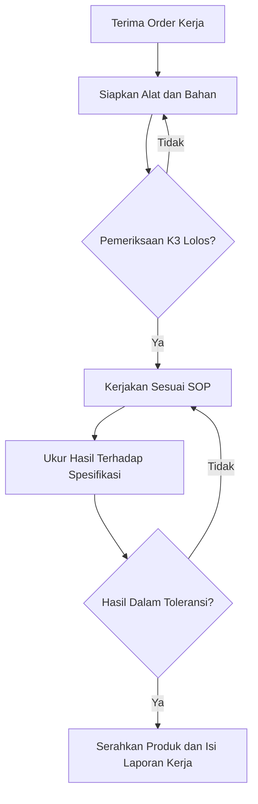

<!-- Single-file build of the kurikulum-merdeka-smk-mak skill for Gemini (Keahlian/Gems): the full skill plus all of its reference files in one Markdown file, because the Gemini uploader accepts one Markdown skill file but often rejects extra Markdown attachments. -->

# Kurikulum Merdeka SMK/MAK (Fase E-F)

One skill for Indonesian vocational schools (SMK/MAK) under Kurikulum Merdeka (Kemendikdasmen), Fase E (Kelas X) and Fase F (Kelas XI-XII), covering general subjects and vocational subjects (mapel kejuruan in a konsentrasi keahlian).
It holds all five roles of the assessment workflow in a single jenjang-locked file: (1) teaching modules, (2) stimulus and illustration, (3) assessment packages, (4) independent review and validation, and (5) conversion to print and CBT formats.
Because everything for this jenjang lives in one skill, no rule from another jenjang can leak in: PG here always has 5 options, the written cognitive split is 20:50:30, and practical performance assessment stands beside written items as an equal half of every package.
Indonesia only: Kurikulum Merdeka, Fase E-F, AKM, TKA, and Ujian Sekolah. It does not apply to foreign tests such as SAT, IELTS, or TOEFL, and not to general trivia quizzes.

## Cara memakai skill ini

Find the role for the task, read that section, and open its reference files before producing output.
The roles chain in order: a modul ajar produces the TP list, stimulus is built against the kisi-kisi, the assessment section assembles the package, telaah reviews it independently, and the konverter packages the final set.

| Tugas | Bagian | Berkas referensi |
| --- | --- | --- |
| Modul ajar, CP menjadi TP dan ATP, LKPD jobsheet, skenario kelas dari hasil asesmen | 1. Modul Ajar | [references/modul-ajar-kerangka-pembelajaran-mendalam.md](references/modul-ajar-kerangka-pembelajaran-mendalam.md) |
| Stimulus, dokumen kerja, gambar kerja, tabel data, visual fungsional | 2. Stimulus & Ilustrasi | [references/stimulus-panduan-visual-dan-wacana.md](references/stimulus-panduan-visual-dan-wacana.md) |
| Paket asesmen diagnostik, formatif, sumatif; butir tulis; tugas praktik dan rubrik unjuk kerja; KKTP dan tindak lanjut | 3. Asesmen | [references/asesmen-regulasi-dan-format-soal.md](references/asesmen-regulasi-dan-format-soal.md), [references/asesmen-kktp-solo-dan-tindak-lanjut.md](references/asesmen-kktp-solo-dan-tindak-lanjut.md) |
| Telaah butir soal dan rubrik praktik, bedah pengecoh, analisis butir kuantitatif | 4. Telaah & Validasi | [references/telaah-kartu-telaah-pusmendik.md](references/telaah-kartu-telaah-pusmendik.md) |
| Kartu Soal, Naskah Ujian cetak, Lembar Penilaian Praktik, ekspor GIFT, Moodle XML, CSV, JSON | 5. Konverter Naskah, Praktik & CBT | [references/konverter-spesifikasi-format-ekspor.md](references/konverter-spesifikasi-format-ekspor.md), [references/konverter-spesifikasi-cbt-xml-csv.md](references/konverter-spesifikasi-cbt-xml-csv.md) |

Verification status, stated once for the whole skill: the core framework claims have been checked against the primary documents: PPA Edisi Revisi 2025, Desain Pengembangan Soal AKM 2020, Buletin Asesmen Vol-1 2025, Permendikdasmen No. 1 Tahun 2026, and Naskah Akademik Pembelajaran Mendalam; per-claim status and page citations live in the reference files.
Rules that are deliberately not regulation quotes are labelled where they appear: the dynamic MCMA scoring rule (a practice rule from earlier item-writing guidance; TKA scoring itself is centralized and uses IRT), the package design defaults, and the stimulus length defaults.
Two things carry a weaker status and must be flagged wherever a formal document relies on them: the CP citation (SK Kepala BSKAP No. 046/H/KR/2025) has not been independently verified, and the telaah card content has not been independently checked against the official Pusmendik documents; the 27 percent group split and the 5 percent distractor criterion in section 4 are classical test theory conventions, adopted as this skill's working standards.
Before using a package for a high-stakes exam, check any rule you rely on in the official document.

## 1. Modul Ajar

This role works upstream of assessment: it turns a Capaian Pembelajaran (CP) into Tujuan Pembelajaran (TP), orders the TP into an Alur Tujuan Pembelajaran (ATP), and builds the learning experiences, jobsheets, and formative checkpoints that make those TP reachable in the classroom, the workshop, and the Teaching Factory unit.
It has two modes. Standalone mode: the user asks only for teaching planning; deliver the modul ajar package and stop, without adding test items.
Invoked mode: the deliverable that matters most is the TP list, each TP one measurable statement tagged with its CP element, its ATP position, its target SOLO level, the Dimensi Profil Lulusan it serves, and whether its evidence is written, practical, or both; section 3 builds the kisi-kisi and rubrics from it, so a vague TP list makes the whole chain vague.
Writing exam items or graded tasks inside a modul ajar is out of scope here; that is section 3's work.

Workflow:

1. Read the CP: element, phase (E or F), competencies and content. In vocational subjects the CP element names a competency of the konsentrasi keahlian; keep that wording intact. If the CP text (or at least subject, fase, and topic) is missing, ask before planning. Never invent CP wording and present it as official text; label paraphrases as paraphrases.
2. Derive TP: one verb, one content focus, one TP per statement, observable and checkable. For practical competencies the verb names the work performance (memasang, mengkalibrasi, mendiagnosis, menyajikan) together with the standard it must meet. Usually two to five TP per meeting sequence. Never stack verbs in one TP ("memahami dan menganalisis dan mengevaluasi"); split it.
3. Order the ATP: concrete to abstract, single-aspect to integrated, and in vocational subjects from guided basic operations toward independent complete jobs, so the order itself scaffolds learning.
4. Map each TP to a target SOLO level and one or two Dimensi Profil Lulusan. A TP that maps to neither is probably filler; rewrite or drop it. The mapping follows the Naskah Akademik Pembelajaran Mendalam (Tabel 3.1, pp. 44-45): Memahami covers Unistruktural and Multistruktural together, Mengaplikasi is Relasional, Merefleksi is Berpikir Abstrak yang Mendalam, and Prastruktural is not a stage but the status "Belum Memahami".
5. Design the three experience stages. Memahami: students meet the phenomenon, text, work drawing, or job specification and name the key facts, components, and safety requirements (SOLO: Unistruktural moving to Multistruktural). Mengaplikasi: students use the concept on a real case or carry out the job itself: a project, a workshop task against a specification, a Teaching Factory order (SOLO: Relasional). Merefleksi: students evaluate their own product and process, defend a quality judgement, diagnose what went wrong, or transfer the procedure to a new job variant (SOLO: Berpikir Abstrak yang Mendalam, the Naskah Akademik's term for the fifth SOLO level; "Extended Abstract" is Biggs & Collis's original English term). State for each stage what the teacher does, what the students do, and what product or answer shows the stage worked. Never skip Merefleksi to save time.
6. Place formative checkpoints between stages: a short check tied to one TP (an exit question, an observed work step, a measurement result, one jobsheet section) that catches a misconception or a faulty work habit before the sumatif does. The technique and instrument must stay aligned with the TP (Permendikdasmen No. 1 Tahun 2026, Pasal 8); the checkpoint's format, rubric, and scoring belong to section 3, here state only the evidence it must produce.
7. Plan differentiation before it is needed: a simplified entry point (fewer variables, a partly completed job, a worked example, guided first steps at the bench) and an extension (tighter tolerance, an open fault to diagnose, a real client order, a transfer job). Differentiate content, process, and support; never differentiate the KKTP expectation or the final grade standard.
8. Hand off: close with the clean TP list plus the misconception and work-habit watchlist the checkpoints watch for.

Output structure of a modul ajar, in order:

1. Identitas: school (placeholder when unknown), subject, konsentrasi keahlian, fase and kelas, semester, time allocation, meetings.
2. CP and element, quoted or labelled as paraphrased, with the source supplied.
3. TP list with evidence type per TP (written, practical, or both).
4. ATP sequence and why that order.
5. Dimensi Profil Lulusan targets, claimed only where an activity genuinely shows them (in vocational units Kesehatan carries workshop safety culture; Kolaborasi and Komunikasi carry teamwork and client-facing work); never claim all eight.
6. Learning experiences per meeting in the three stages, with teacher activity, student activity, and evidence.
7. LKPD plan in jobsheet form: aim, tools and materials, safety notes, work steps, observation or measurement table, conclusion questions, the TP each part serves, and simplified and challenge variants. Never drop the safety briefing from a practical plan; in this jenjang K3 is part of the competency, not an administrative extra.
8. Formative checkpoints: placement, TP checked, evidence expected.
9. Reflection instruments, teacher and student sets from the reference file; the teacher set serves the process assessment of Permendikdasmen No. 1 Tahun 2026, Pasal 15-19, which includes teacher self-reflection at least once per semester.
10. Handoff block: the TP list and the watchlist, formatted for section 3.

From assessment bands to classroom scenarios: when results come back grouped by KKTP descriptive band, turn each band into a runnable scenario (activity, material, grouping, exit evidence), not a table that repeats the bands.

- Perlu bimbingan (Prastruktural to Unistruktural): reteach or re-demonstrate in a smaller step, simplified jobsheet variant, worked example or guided first job, short supervised practice with the teacher or a trained peer tutor at the bench. Exit evidence: the student states the concept, names the safety requirements, and completes one guided job unaided.
- Cukup (Multistruktural): a connecting task: concept map, compare-two-cases, or the standard jobsheet with the linking and measurement sections emphasised. Exit evidence: the student explains how two parts relate and the product meets most of the specification.
- Baik (Relasional): no reteaching; move to the next TP at full difficulty against the full specification. Exit evidence comes from the next unit's first checkpoint.
- Sangat baik (Berpikir Abstrak yang Mendalam): a transfer or challenge task from the extension variant, or peer tutoring of the first group when tutoring requires explaining and justifying.

Keep section 3's grade rules intact while planning: remedial grades follow Prinsip 1, practical remedial repeats only the failed rubric aspects, and formatif results never decide report grades or promotion. The scenarios change the teaching, not the grade policy.

## 2. Stimulus & Ilustrasi

This role supplies the raw material of section 3: the stimulus texts, workplace documents, and visuals students must read or interpret. A weak stimulus caps every item built on it, so stimulus work comes before item writing.
Two modes. Standalone mode: deliver the calibrated text, document, or visual, its source or data note, and the list of key objects, then stop.
Invoked mode: section 3 calls this role after the kisi-kisi exists; the input is the kisi-kisi rows (indicator, KKO, target Bloom and SOLO level, subject, competency element) and the output is one stimulus per item group, pitched so the target level is reachable: a Relasional item needs parts that must be connected, a Berpikir Abstrak yang Mendalam item needs material that supports transfer to a new case or a fault not shown directly.

The functionality test governs everything: cover the stimulus up. If the item can still be answered correctly without reading it, the stimulus fails and gets rebuilt or cut.

- A functional visual holds data the student must extract, compare, or transform: a dimension on a work drawing, a value on a curve, a stage in a work flow.
- A functional document carries the facts, limits, or evidence the item reasons about: a tolerance in the SOP, a rating on the nameplate, a stock figure in the table.
- Name the key objects a student must read (the specific numbers, labels, dimensions, arrows, or legend entries the answer depends on) and list them with the stimulus. If you cannot name them, the visual is decoration.

For vocational subjects the default stimulus is an authentic document of the world of work, trimmed to what the item needs but never falsified:

- SOP and work instruction excerpts: numbered steps, warnings, and the one step or limit the item turns on.
- Gambar kerja (work drawings): orthographic views, sections, dimensions, and tolerances the student must read to choose, compute, or judge.
- Equipment manuals and nameplates: operating limits, maintenance intervals, ratings, and fault tables.
- Specification and data tables: material specifications, price and stock lists, measurement results, service schedules.
- Industry case studies: a short account of a real-shaped workplace problem (a rejected product batch, a recurring machine fault, a customer complaint) with the data needed to analyse it.

Safety is a working context, not decoration: where a document carries K3 warnings, protective-equipment requirements, or prohibition signs, keep them accurate and let items test them when the kisi-kisi targets safety. Never invent a safety limit; use the standard value the subject teaches or label the document as simulated.
For general subjects use the Fase E-F pattern: single and multi-text stimuli, informational and literary texts, inter-paragraph conjunctions, contrast between texts.
One stimulus serves one item or a small graded set (in TKA, one stimulus serves 2-6 items, Buletin Asesmen Vol-1 2025, p. 11); do not stretch one document across a whole exam.
Write in standard Indonesian (EYD V), keeping the trade's technical terms, in realistic Indonesian contexts: workshops and small industries, customer orders, local markets and prices, weather and seasons, national statistics.

Produce visuals in this order and stop at the first method that yields a functional, readable visual:

1. Render in code: Markdown tables for specification and multi-variable data, Mermaid for work flows, procedures, and cycles, clean SVG for charts, diagrams, and simplified technical sketches. Code-rendered visuals are exact, editable, and print-safe, so they are the default. The reference file holds a Mermaid production-flow template and a corrected SVG two-axis template to adapt, never to ship unchanged with their example numbers.
2. Curate a real image when the item needs a real photo, map, or phenomenon code cannot draw honestly: Wikimedia Commons (open-licensed photos and diagrams), BMKG (weather and earthquake material), BPS (official statistics), BIG (Indonesian base maps). Cite the source under the visual, every time; never use an image whose licence or origin is unclear when an open source can supply an alternative.
3. Write a [SPESIFIKASI ILUSTRASI] box when the visual is too complex to render and no suitable image exists; real gambar kerja with full dimensioning usually lands here. The box states the visual type, the views required, the key objects, the mandatory labels and dimensions, and the function the item depends on, precisely enough for a teacher or illustrator to produce it; the exact block format is in the reference file.

Whichever method is used, the visual ships with axis labels, units, tolerances where they carry meaning, a legend where symbols or colours carry meaning, and a title or caption. Keep it readable at print size: labels large enough, contrast clear, no meaning carried by colour alone.

Visual types per field cluster:

- Teknik (mesin, elektro, otomotif, bangunan): simplified work drawings and sections, wiring and circuit diagrams, measurement readouts (caliper, micrometer, multimeter scales), fault tables, assembly sequences.
- Teknologi informasi: network topologies, flowcharts and pseudocode blocks, interface screenshots described or redrawn, log excerpts, database tables.
- Bisnis dan perkantoran: invoices and receipts, stock and price tables, organisational charts, business letters and memos, sales charts.
- Agribisnis dan perikanan: growth and feed tables, pond or plot layouts, production cycles, quality grading charts.
- Pariwisata, kuliner, dan layanan: menus and costing tables, reservation documents, service flow diagrams, hygiene checklists.
- Mapel umum: supply and demand curves (Ekonomi), force and circuit diagrams (Fisika), geometric figures and function graphs (Matematika), thematic maps and cross-sections (Geografi), system diagrams (Biologi).

Data honesty: never present invented numbers as real statistics or real specifications. Label plausible numbers created for the exercise as simulated ("Data simulasi untuk latihan") in the caption or source line; when real figures are used, name the real source (for example BPS with the table and year). A stimulus that teaches a wrong fact, a wrong tolerance, or a wrong safety limit fails even when the item built on it is well formed.
Length calibration: the figures in the reference file are practical defaults, not official rules, with one precisely scoped exception: 250-300 words per passage and 8-12 words per sentence are the verified text characteristics for the Bahasa Indonesia test subject in TKA SMA/MA/Sederajat and SMK/MAK (Buletin Asesmen Vol-1 2025, p. 12), for that subject and test only. Current official documents set no word limits for other subjects, and vocational documents are calibrated by workplace realism, not by word counts.
Two more gotchas: never leak the tested formula or procedure into the stimulus (a practice rule of this skill; no such prohibition appears in the Desain Pengembangan Soal AKM 2020, so never cite it as an official rule), and a stock photo of a workshop beside a recall question measures nothing: cut it or rebuild the item so the answer lives in the document.

## 3. Asesmen

This role designs the assessment package: identity, kisi-kisi, stimulus and items, answer key and scoring guide, performance rubric, KKTP, remedial and enrichment follow-up, and a quality audit. It covers written items and practical performance assessment as two halves of the same package.

Step 1, clarification gate: if the request is brief (a subject and a topic, nothing more), stop and ask before writing any item:

1. Fase, kelas, mata pelajaran, and whether the subject is a general subject or a vocational subject (and if vocational, the konsentrasi keahlian and the competency element).
2. Jenis asesmen: diagnostik, formatif, or sumatif, and whether the result feeds a report card.
3. Composition: how much of the package is written items and how much is practical or performance assessment, or confirmation to use the defaults below.
4. Cognitive target: the default LOTS:MOTS:HOTS split for Fase E-F, or a custom split.
5. KKTP approach: Deskripsi Kriteria, Rubrik, Skala atau Interval Nilai, or Persentase (the four approaches named in PPA Edisi Revisi 2025, p. 48; the PPA list is open, so another approach is allowed).
6. Whether a JSON or CSV export is needed.

Skip the gate when the request already specifies these points, or when the user says to proceed with standard settings. In that case state the defaults you used at the top of the package.

Step 2, defaults for Fase E-F:

- PG always has 5 options (A-E) in this jenjang. The AKM design ladder sets Kelas 10-12 at 5 options (Desain Pengembangan Soal AKM 2020, printed p. 4), and PG in TKA for SMK/MAK also uses 5 options (Buletin Asesmen Vol-1 2025, p. 12).
- Written items: LOTS:MOTS:HOTS = 20:50:30. This split is derived from the verified AKM Numerasi cognitive distribution for Kelas 11 (Knowing/Applying/Reasoning = 20/50/30; Desain Pengembangan Soal AKM 2020, printed p. 87); it is a school package design default, not an AKM or TKA quota.
- Practical packages: apply the 20:50:30 split to the supporting-knowledge dimension (the written or oral questions around the task). The main score comes from the performance rubric in Step 3, never from the written split.
- Write in standard Indonesian (EYD V), communicative and unambiguous. In the kisi-kisi, each multiple-choice item measures one operational verb (KKO); an essay item may measure more than one.

Step 3, the vocational half: practical and performance assessment. What makes an SMK/MAK package different from a general-school package is this half; design it with the same rigour as the written half:

- The task is a real work task: produce, repair, assemble, configure, serve, or document something against a job specification, a work order, or a client brief, in the workshop, laboratory, studio, kitchen, or Teaching Factory unit.
- The rubric scores observable work criteria, at minimum: keselamatan kerja (K3) and correct use of protective equipment; urutan prosedur (the work steps in the right order, with the right tools); ketepatan hasil (the product or service meets the specification, tolerance, or standard given); waktu (completion inside the allocated time); and sikap kerja (orderliness, tool care, honesty in reporting results).
- Each rubric aspect carries descriptors for tuntas and belum tuntas, so two assessors watching the same performance reach the same judgement. State any critical rule the school applies, for example that a serious safety violation closes the attempt, as a rule of the package, not as a regulation quote.
- Support competency readiness: align task difficulty with the competency elements of the konsentrasi keahlian, keep a product portfolio (photos, job reports, logbooks) as assessment evidence, and let Teaching Factory orders serve as authentic task contexts. Frame certification-style language as school assessment practice; do not present specific LSP or BNSP rules, because no such rules are in this skill's sources.

Step 4, stimulus and visuals: every item that carries a stimulus must need it, under the functionality test of section 2, which holds the full production guidance for this jenjang. Group items under a stimulus in small sets (the TKA pattern is 2-6 items per stimulus, Buletin Asesmen Vol-1 2025, p. 11), with cognitive levels graded inside the set. Prefer visuals rendered in code when the data is structured; use a real internet image only when the context needs a real photo or phenomenon; when a visual is too complex to render and no suitable image exists, write a [SPESIFIKASI ILUSTRASI] box instead. As a writing-practice rule, never leak the formula or the work procedure an item is testing into its stimulus; the item then measures copying instead of reasoning. This is a practice consideration, not an AKM regulation.

Step 5, item formats and scoring. Supported written formats: PG (single answer), PGK MCMA (multiple correct answers, checkbox), PGK Kategori (several statements, each judged in a binary category), Benar/Salah, Menjodohkan, Isian or Jawaban Singkat, and Uraian. The non-test family is Unjuk Kerja (practical performance, Step 3), product assessment, and portfolio. Whichever format is chosen, the technique and instrument must stay aligned with the tujuan pembelajaran (Permendikdasmen No. 1 Tahun 2026, Pasal 8). Scoring rules that must not be improvised:

- PG: 1 for correct, 0 for wrong.
- PGK MCMA is dynamic (a practice rule carried from earlier item-writing guidance; full detail in the second reference file). For sumatif and exams it is binary: 1 only when every correct option is chosen and no wrong option is chosen, otherwise 0. For formatif and diagnostik it is partial 2-1-0: 2 for a fully correct selection, 1 when some correct options are chosen with no wrong option, 0 when any wrong option is chosen. Never use free fractions such as 1/3 or 2/3.
- PGK Kategori: 1 point per statement judged correctly.
- Uraian Objektif (URO): list every keyword or step in the expected answer, 1 point per element present.
- Uraian Non-Objektif (URN): graded rubric built on SOLO levels, and the lowest rubric score is 0, never 1.
- Unjuk Kerja: score per rubric aspect from the observed performance; never convert a rubric judgement into a guessed percentage without the descriptors.

Full construction rules per format are in the first reference file; the scoring and follow-up detail is in the second.

Step 6, cognitive levels, KKTP, and follow-up. Tag every written item twice: a Bloom level (C1-C6, grouped as LOTS = C1-C2, MOTS = C3, HOTS = C4-C6) and, for essays and KKTP descriptions, a SOLO level (Prastruktural, Unistruktural, Multistruktural, Relasional, Berpikir Abstrak yang Mendalam). Berpikir Abstrak yang Mendalam is the term the Naskah Akademik Pembelajaran Mendalam uses for the fifth SOLO level (pp. 44-45); "Extended Abstract" is Biggs & Collis's original English term for the same level.
KKTP is descriptive, not one uniform passing number like the old KKM (PPA Edisi Revisi 2025, p. 64). Use the approach chosen at the gate: Deskripsi Kriteria (Perlu bimbingan, Cukup, Baik, Sangat baik, the PPA's labels, p. 64), Rubrik, Skala atau Interval Nilai, or Persentase of TP indicators mastered.
For practical assessment, state KKTP as performance descriptors: per rubric aspect, what tuntas work looks like and what belum tuntas work looks like, so the pass decision rests on observed criteria, not on a bare number.
Post-remedial grades follow Prinsip 1, Mastery Learning, the principle this skill adopts: the recorded grade is the highest score the student achieves after remedial. Fairness condition: students who already passed must get an equal chance to improve their score too.
The PPA sets no post-remedial grade formula at all: the word "remedial" appears only five times in the whole PPA, and its stated aim for remedial is raising achievement through guided relearning of the unmet criteria, not merely repairing the grade (p. 54). Prinsip 1 is therefore school policy, not a regulation quote, and the package must label it as such.
For practical remedial, the student repeats the failed aspects of the task under guidance, not necessarily the whole job. Hard rule: diagnostik and formatif results never determine report grades, promotion, or graduation (PPA Edisi Revisi 2025, p. 44).

Step 7, output package. Deliver these parts in order, plus the export when requested:

1. Identitas Asesmen: school (placeholder when unknown), fase and kelas, subject and konsentrasi keahlian where relevant, assessment type, time allocation, item and task count.
2. Matriks Kisi-Kisi: item or task number, Elemen or CP, TP, core material or competency element, indicator with its KKO, cognitive level, format.
3. Naskah Stimulus dan Butir Soal, grouped by format, each group with its work instructions; for practical tasks, the work order, specification, tools and materials list, time limit, and safety notes.
4. Kunci Jawaban dan Pedoman Penskoran, including URO keyword lists, the SOLO rubric for URN, and the full performance rubric for Unjuk Kerja.
5. Rubrik KKTP dan Pengolahan Nilai for the chosen approach, including the per-aspect performance descriptors for practical work.
6. Matriks Tindak Lanjut: remedial and enrichment actions per achievement band, differentiated by content, process, or product; for practical work, which task aspects are repeated or extended.
7. Catatan Telaah Mutu: the self-audit report from Step 8.
8. Optional export: JSON or CSV for a CBT or LMS, using the schema in the second reference file; section 5 produces the full delivery set.

Step 8, mandatory self-audit. Run the audit before delivering, and print its result as part 7 of the package:

- Key distribution for PG: compute R = (number of PG items / number of options) + 3. No key letter may appear more than R times. Example: 20 items with 5 options gives R = 7, so a key appearing 9 times must be rebalanced.
- Stimulus function test: remove each visual or document mentally. If the item is still answerable, the stimulus fails.
- Distractor and construction check: options homogeneous and similar in length, no "Semua jawaban di atas benar/salah", no double negatives, no item that depends on another item's answer, no formula or procedure leaked into a stimulus, URN rubric minimum is 0.
- Practical check: every rubric aspect is observable during the performance, safety (K3) is scored rather than assumed, the specification the product is judged against is printed in the package, and the time limit is realistic for the task.
- Language and ethics check: standard Indonesian, no SARA content, no violence, no local or cultural bias that advantages one group of students.

Closing gotchas: do not import rules from other jenjang (in SMK/MAK, PG has 5 options and the written split is 20:50:30, whatever a lower-jenjang package used); do not score practical work with a written-test mindset, because a performance is judged against the rubric's work criteria and the job specification, not against a classmate's result; do not present certification-body rules as if they were in this skill's sources; and never present the practice rules and defaults of this section as regulation.

## 4. Telaah & Validasi

This role reviews assessment material that already exists for SMK/MAK Fase E-F: written items and practical assessment rubrics written by an AI, by a teacher, or by an MGMP team. It does not write new packages; section 3 does that.
It also does not apply to writing items or rubrics from scratch, building a kisi-kisi, or setting KKTP; route those back to section 3.
Read the reference file before reviewing a set: it holds the checklists, formulas, and working standards.

The independence rule: an author reviewing their own items in the same pass will miss their own blind spots, which is why this role exists separately from section 3's self-audit.

- The self-audit is the author's quick check before delivery. This role is the second, deeper pass, run as if the reviewer did not write the items.
- Never let a review under this role silently replace the self-audit, and never present a self-audit as if it were this independent review. Name which one a report is.
- Review the item or rubric as printed, not as intended. If the indicator, the key, the specification, or the scoring guide is missing, that absence is itself a finding; do not reconstruct what the author probably meant and pass the item on that basis.
- When the reviewer and the author disagree, the card decides: cite the code that fails (for example K3, B1, or P2) instead of arguing taste.

Step 1, set up the review: collect what the verdict will be judged against: the items, their keys, the kisi-kisi or indicator for each item, the item format, the fase and subject, and the scoring guide for essays. For a practical task, collect the work order, the job specification the product is judged against, the tools and time allowed, and the rubric.
Items that arrive without a key or an indicator can still be reviewed for construction and language, but their Materi verdict is "cannot be confirmed" until the missing piece is supplied. A rubric that arrives without its job specification cannot be confirmed either. Say so in the report instead of guessing.

Step 2, qualitative review with the card in the reference file, item by item:

- PG and PGK items: the Materi codes (M), Konstruksi codes (K), and Bahasa codes (B). In this jenjang, also confirm the option count is 5 (A-E); a 4-option PG item in an SMK/MAK set is a construction finding, not a style choice.
- Uraian items: the U-M, U-K, and U-B codes, including whether a URO keyword list or a URN SOLO rubric is present and usable.

Record a pass or fail per code, with a short note on any fail that quotes or points at the exact words in the item that cause it. A fail without a location is not actionable.

Step 3, review the practical rubric through the P codes in the reference file:

- Criterion clarity: each aspect (keselamatan kerja/K3, urutan prosedur, ketepatan hasil, waktu, sikap kerja) is defined by observable descriptors, with tuntas and belum tuntas stated per aspect.
- Observability: an assessor can see or measure every scored behaviour during the performance; nothing is scored on impression alone.
- Specification link: ketepatan hasil points at the printed job specification (dimensions, tolerances, service standard), so the judgement is checkable after the fact.
- Safety coverage: K3 is present as a scored aspect, the critical safety rule of the task is stated, and the rubric says what happens when it is violated.
- Fairness of conditions: the tools, materials, and time the rubric assumes match what students actually get.

Give the rubric the same verdict scale as items (Step 4). A rubric whose aspects cannot be observed, or that omits safety on a hazardous task, is Tolak until rebuilt; a rubric with one vague descriptor is Revisi, and the report supplies the sharpened descriptor text.

Step 4, verdict per item and per rubric. Give every item and every rubric exactly one verdict:

- Terima (accept): every applicable code passes. The item or rubric may enter the bank as is.
- Revisi (revise): it measures the right thing but has a fixable defect: a weak distractor, uneven option lengths, a double negative, a missing rubric line, a vague performance descriptor. State the fix, and supply the revised text in Step 5 or in the output.
- Tolak (reject): it cannot be repaired by editing: it does not measure its indicator, it has more than one defensible key or no defensible key, its stimulus leaks the answer or the procedure, its rubric scores what cannot be observed, or (after a trial) its discrimination index is negative. State which defect is fatal.

No set-level verdict replaces the per-item verdicts. A set can be "mostly sound" and still contain two items that must not be used.

Step 5, distractor surgery. Run this on every PG or PGK item whose distractors fail the card or the trial data. This procedure is a working standard of this skill:

1. Diagnose each failing distractor and name the failure: too obvious (no plausible path leads to it), implausible (outside the topic or absurd on its face), cueing the key (longer, more precise, or grammatically matching the stem while others do not), or non-homogeneous (different kind, unit, or category from the key).
2. Name the student misconception the replacement will target: the specific wrong idea a real student holds, such as swapping two procedure steps, reading a measurement scale one division off, applying a formula to the wrong quantity, or confusing two similar components or terms. A distractor without a named misconception behind it is decoration.
3. Rewrite the distractor so it is exactly what a student with that misconception would produce or choose: correct method with one wrong step, right value with the wrong unit, the paired concept swapped in.
4. Re-check the repaired set: options homogeneous in kind and content, similar in length, ordered consistently (numbers ascending or chronological), no option giving away another, and the key not identifiable by form alone.

Show the before and after text for every operated distractor, with the misconception named. Never change the key during surgery without flagging it as a key change and re-running the Materi codes. Surgery touches distractors only; a broken stem or a wrong indicator is a revise or reject verdict with the reason stated.

Step 6, quantitative analysis, when trial data exists. Only run this step when the user supplies response data from a real tryout or class administration of written items. Never invent performance numbers for items that have not been tried, and do not fabricate observation statistics for practical tasks either; rubric quality is judged by the P codes and, where the school ran one, by an inter-assessor agreement check the user supplies.

- Difficulty index P: the share of test takers who answered correctly. Bands and formula are in the reference file.
- Discrimination index D: compare the top 27 percent and the bottom 27 percent of test takers by total score. This 27 percent split is this skill's working standard, taken from classical test theory convention.
- Distractor effectiveness: a distractor is functioning when at least 5 percent of the lower group chose it and the lower group chose it more than the upper group did. A distractor nobody chooses, or one the upper group prefers, is dead weight and goes to surgery.
- Verdicts from numbers: an item with negative D is rejected outright, because strong students fail it more than weak students do, which signals a wrong key or a misleading stem. An item with D in the revise band goes back to Step 2 and Step 5 with the data as evidence.

Interpret P together with D, never alone. A hard item (low P) with strong D is a good HOTS item and stays; an easy item with near-zero D measures nothing and does not earn its place outside a diagnostic set. Do not soften a negative D; it always means reject, however elegant the item looks.

Step 7, key-distribution check: for the PG items in the set, compute R = (number of PG items / number of options) + 3, inherited from section 3's self-audit. With 5 options, 20 PG items give R = 7. No key letter may appear more than R times. If one letter exceeds R, rebalance by reordering options on items where the content allows it, and list every item whose options were reordered. Reordering options is a change to the item: note it in the report.

Output format. Deliver the review in this order:

1. Ringkasan Telaah: how many items and rubrics were reviewed, by format, and the count per verdict (terima, revisi, tolak), plus any set-level problem such as a missing kisi-kisi, a missing job specification, or a failed key distribution.
2. Tabel Putusan per Butir: one row per item or rubric with its number, format, verdict, the card codes that failed, and a one-line reason.
3. Teks Revisi: the full revised text of every item marked revisi, including operated distractors shown before and after with their named misconceptions, the revised scoring guide where an essay guide changed, and the sharpened descriptors where a rubric changed.
4. Hasil Analisis Kuantitatif, only when trial data was supplied: per item, P with its band, D with its band, and the distractor findings, each tied back to the verdict it supports.
5. Catatan Kunci: the R computation and any rebalancing done.

Write reasons in plain language a teacher can act on without opening the reference file. Codes support the reason; they do not replace it.
Closing gotchas: do not run quantitative analysis on invented data (no trial, no P and D); do not pass an item because its intention was good; do not pass a practical rubric that leaves safety unscored on a hazardous task, or whose result aspect names no specification to judge against.

## 5. Konverter Naskah, Praktik & CBT

This role packages a finished package from section 3 into the formats schools and exam systems actually consume: Kartu Soal for administration files, a print-ready exam script, a print-ready practical assessment sheet for performance tasks, and import files for CBT and LMS platforms.
Conversion is a packaging job, not an editing job. Wording, keys, scoring, rubrics, and cognitive tags come from the source package and leave unchanged. If something in the source is broken or missing, this role reports it back instead of repairing it silently; a converter that edits silently destroys the audit trail between the validated set and the delivered file.
Format details, templates, and worked examples live in the two reference files: [references/konverter-spesifikasi-format-ekspor.md](references/konverter-spesifikasi-format-ekspor.md) (Kartu Soal, the print layouts, the Lembar Penilaian Praktik, and GIFT) and [references/konverter-spesifikasi-cbt-xml-csv.md](references/konverter-spesifikasi-cbt-xml-csv.md) (Moodle XML and CSV).
This role does not apply to writing or improving items, tasks, or rubrics. Send that work to section 3 for design and to section 4 for validation; convert only after the set is final.

Inputs required. Do not start converting until the input has:

1. Item set with stable numbering and one entry per item: stem, stimulus reference where used, options where the format has them. In this jenjang PG and MCMA items carry 5 options (A-E).
2. A key for every objectively scored item, and a scoring guide or rubric for every Uraian item.
3. For every practical task: the work order or task brief, the job specification, the tools and materials list, the time limit, and the performance rubric with its aspects and descriptors.
4. The scoring policy per format, above all the assessment type (diagnostik, formatif, or sumatif), because it decides how MCMA is encoded.
5. Identity data for the headers: school, subject, konsentrasi keahlian where relevant, fase and kelas, semester, assessment type, time allocation.
6. Planning data for Kartu Soal: CP, TP, core material or competency element, and the indicator with its cognitive level per item.
7. Pembahasan per item when the target format carries it (JSON and CSV do; the printed student script never does).

If any of these are absent, list exactly what is missing and stop. A converted file with invented keys or guessed scoring is worse than no file.

Outputs. Produce only the formats the user asked for:

- Kartu Soal: one card per item, holding identity, planning fields (CP, TP, material or competency element, indicator, Bloom and SOLO levels), the full item, its key, and its score weight or rubric. For a practical task, the card holds the work order, specification, and rubric instead of options and a key. This is the administration and supervision record.
- Naskah Ujian: the student-facing print script for the written sections. Header (kop) with school and exam identity, general instructions, items grouped by format with a short instruction per group, and a separate answer sheet layout for the objective sections. No keys, no pembahasan, no KKTP data anywhere in this document.
- Lembar Penilaian Praktik: the assessor-facing print sheet for a performance task, one per student per task. Identity fields, the task and specification summary, the time record (start, finish, duration), one row per rubric aspect with its descriptors and a score or judgement column, a notes column for observed events (skipped steps, safety incidents), the critical-rule outcome where the package declares one, and the assessor's name and signature line. The layout spec is in the first reference file.
- GIFT: plain-text import for Moodle and compatible LMS, one block per item.
- Moodle XML: the same set as a well-formed XML quiz file with a category path that names kurikulum, fase, and cognitive grouping.
- CSV: one row per item with the flattened columns defined in the second reference file, including pembahasan and the type-specific key columns.
- JSON: the schema defined in section 8 of [references/asesmen-kktp-solo-dan-tindak-lanjut.md](references/asesmen-kktp-solo-dan-tindak-lanjut.md) (metadata, stimulus, items), including the practical-task entry shape. Do not invent a parallel JSON shape.

Practical tasks do not convert into GIFT, Moodle XML, or CSV question rows; an LMS cannot observe a performance. In a mixed delivery, the written items go to the CBT files and the practical tasks go to the Lembar Penilaian Praktik, and the export notes state that split explicitly.

Scoring conversion rule: the source package's scoring policy governs. Fraction fields in GIFT and Moodle XML are only a transport encoding: they describe how the LMS should add up a response, they are not a new scoring policy, and they never override the policy written in the package.

- PG stays trivial everywhere: full credit for the key, zero for everything else.
- Sumatif MCMA is binary in the package (1 only when every correct option is chosen and no wrong option is chosen, otherwise 0). Encode it all-or-nothing in GIFT and Moodle XML: the correct options share +100 percent in total (each correct option carries 100 divided by the number of correct options), and every wrong option carries -100 percent, so choosing any wrong option cancels the credit from the correct ones. The LMS total for the item is then floored at zero: a response scores the item maximum only when its raw total reaches 100, and 0 otherwise. State this encoding and the floor rule in the export notes that accompany the file.
- Warning that must travel with every sumatif MCMA export: whether the encoding behaves as true all-or-nothing depends on the target LMS. Moodle's multiple-response grading, rounding of repeating fractions such as 33.33333, and negative-total handling differ between versions and question behaviours. Test-import one MCMA item, answer it three ways (fully correct, partially correct with no wrong pick, and correct plus one wrong pick), and confirm the grades are 1, 0, and 0 before importing the whole set.
- Formatif and diagnostik MCMA follow the package's partial 2-1-0 rule. Map it proportionally in the encoding: correct options share the full credit so a fully correct selection earns the maximum, a partial selection with no wrong option earns a proportional share, and any wrong option carries a penalty large enough to bring the total to zero. Say plainly in the export notes that this is a proportional approximation of 2-1-0, because an LMS computes per-option fractions and cannot reproduce the exact three-step scale; the teacher's grade processing still follows the package.
- PGK Kategori keeps its own rule, 1 point per statement judged correctly. Export each statement as its own scorable unit (its own GIFT or XML question, or its own CSV row group) instead of collapsing the item into one all-or-nothing question.
- URO keyword points and URN rubrics do not compress into option fractions. In CBT formats that cannot grade essays automatically, export Uraian as an essay question type with the scoring guide placed in the grader information field, and mark it as manually graded in the export notes.
- Performance rubric scores are never encoded into CBT fractions. They travel only on the Lembar Penilaian Praktik and, when the school records them digitally, as the aspect scores exactly as the assessor entered them.

Pre-export validation checklist. Run this pass before writing any output file, and report the result with the delivery:

- Every objectively scored item has exactly the key its format requires: one key for PG, a defined key set for MCMA, a category key per statement for PGK Kategori.
- Every Uraian item has its scoring guide or rubric attached; a URN rubric starts at 0.
- Option counts match this jenjang: 5 options (A-E) for every PG and MCMA item, unless the source package states a deliberate deviation. A 4-option item in an SMK/MAK set is a validation failure to report, not to pad silently.
- Every practical task has its work order, specification, tools and materials list, time limit, and rubric; every rubric aspect has tuntas and belum tuntas descriptors, and the safety aspect is present where the task is hazardous.
- Every stimulus_id or stimulus reference in an item resolves to a stimulus that exists in the set, and every stimulus is used by at least one item.
- Item and task numbering is continuous, and the counts match the identity data and the kisi-kisi.
- No leftover placeholders anywhere: no bracketed tokens such as [Nama Sekolah] in a file meant for direct use, no empty option, stem, or pembahasan fields. Placeholders are acceptable only in a template the user explicitly asked for.
- Bloom and SOLO tags are present on every row or record that carries those columns.
- The assessment type is recorded, so the MCMA encoding choice can be checked against it.

Any failure stops the export for the affected items. List the failures by item number and hand them back; do not guess a key, drop an item quietly, or fill a placeholder with invented data.

Format gotchas:

- Never change item content during conversion. A stem that looks wrong, a suspect key, a weak distractor, or a vague rubric descriptor gets flagged back to the author or the review role, not fixed inside the export.
- XML must be well-formed or the LMS rejects the whole file. Escape ampersands, angle brackets, and quotes in text, or wrap question and answer text in CDATA sections; never mix raw HTML into an unescaped text node. Validate the file's structure before delivering it.
- GIFT has its own escaping: characters such as = ~ # { } and : inside answer text must be backslash-escaped, and an unescaped closing brace ends the answer block early.
- CSV quoting is strict. Wrap any field containing a comma, a quote, or a line break in double quotes, and double every quote inside such a field. Write the file as UTF-8 so Indonesian text survives the round trip, and keep one row per item with no line breaks outside quoted fields.
- Keep keys and pembahasan out of student-facing output. The Naskah Ujian and its answer sheet contain no key material; keys live in Kartu Soal, the scoring guide, and the CBT files only. The Lembar Penilaian Praktik is assessor-facing: it may carry the rubric and specification, but it is never handed to students as their task sheet; the student receives the work order without the descriptors.
- One source, many outputs: generate every requested format from the same validated item set in the same pass, so the print script, the cards, the practical sheets, and the CBT file can never drift into different versions of an item.


---

# Reference file: references/asesmen-kktp-solo-dan-tindak-lanjut.md

# KKTP, SOLO, dan Tindak Lanjut SMK/MAK

Reference for the asesmen_smk_mak skill: cognitive mapping, dynamic scoring, KKTP approaches including performance descriptors for practical work, grade processing, and remedial or enrichment follow-up. Verification status: the KKTP, grade-processing, follow-up, and SOLO claims below were checked against PPA Edisi Revisi 2025 and the Naskah Akademik Pembelajaran Mendalam and carry page citations; the AKM distributions were checked against Desain Pengembangan Soal AKM 2020. The dynamic MCMA scoring rule in section 4 is a practice rule from earlier item-writing guidance, not a PPA or TKA quotation.

## 1. Cognitive levels: LOTS, MOTS, HOTS

- LOTS: C1 Mengingat, C2 Memahami. MOTS: C3 Menerapkan. HOTS: C4 Menganalisis, C5 Mengevaluasi, C6 Mencipta.
- AKM and TKA use parallel ladders. Literasi: L1 Access and Retrieve, L2 Interpret and Integrate, L3 Evaluate and Reflect. Numerasi: Knowing, Applying, Reasoning.
- Verified AKM distributions (Desain Pengembangan Soal AKM 2020). Numerasi, by cognitive level (printed p. 87): Kelas 11 Knowing 20 / Applying 50 / Reasoning 30. Literasi Membaca (printed p. 20): Menemukan Informasi 30, Memahami 40, Mengevaluasi dan Merefleksi 30 for Kelas 11.
- Default distribution for this jenjang (written PG items): 20:50:30 for LOTS:MOTS:HOTS, derived from the verified AKM Numerasi Kelas 11 distribution above. It is a school package design default, not an AKM quota. In a practical package it governs only the supporting-knowledge questions; the performance score comes from the rubric.

## 2. SOLO taxonomy

Five levels of response quality:

- Prastruktural: no relevant understanding, answer misses the point.
- Unistruktural: one relevant aspect only.
- Multistruktural: several relevant aspects, not yet connected.
- Relasional: aspects integrated into one coherent understanding.
- Berpikir Abstrak yang Mendalam: the understanding is generalized and applied to a new context. This is the fifth-level term used by the Naskah Akademik Pembelajaran Mendalam (pp. 44-45); "Extended Abstract" is Biggs & Collis's original English term for the same level, not the Naskah Akademik's wording.

Bloom tags the item; SOLO grades the response. Use SOLO for URN essay rubrics and for KKTP descriptors. Working map between them: C1-C2 sit at Unistruktural, C3 at Multistruktural, C4 at Relasional, C5-C6 at Berpikir Abstrak yang Mendalam. For practical work, read the same ladder in performance terms: a Multistruktural performance completes the steps as separate actions, a Relasional performance connects them into a controlled process, and a Berpikir Abstrak yang Mendalam performance adapts the procedure to a fault or a specification change not rehearsed before.

The Naskah Akademik also maps the levels onto the deep-learning experience stages (Tabel 3.1, pp. 44-45): Memahami covers Unistruktural and Multistruktural together; Mengaplikasi is Relasional; Merefleksi is Berpikir Abstrak yang Mendalam. Prastruktural has no stage: it is the status "Belum Memahami", before the Memahami stage begins.

## 3. Four KKTP approaches

KKTP is set per subject and is descriptive in principle; it is not a single uniform pass mark like the old KKM (PPA Edisi Revisi 2025, p. 64: the criterion is a sentence describing mastery, not a number). The PPA names four approaches (p. 48) and its list is open: "di antaranya ... atau pendekatan lainnya", so a school may use another approach its context needs.

1. Deskripsi Kriteria: qualitative bands Perlu bimbingan, Cukup, Baik, Sangat baik (the PPA's exact labels, p. 64), each with a descriptor of which indicators are mastered. Against SOLO: Perlu bimbingan matches Prastruktural to Unistruktural, Cukup matches Multistruktural, Baik matches Relasional, Sangat baik matches Berpikir Abstrak yang Mendalam.
2. Rubrik: mastery stages per aspect, for example Mulai Memahami, Memahami, Sangat Memahami, or Belum Berkembang, Layak, Cakap, Mahir. This is the natural approach for Unjuk Kerja: one row per work aspect.
3. Skala atau Interval Nilai (the PPA's name for this approach, p. 48): bands 0-20, 21-40, 41-60, 61-80, 81-100 (PPA, pp. 52-53). A school may also agree a binary split such as 0-55 not yet complete and 56-100 complete (PPA worked example, p. 63).
4. Persentase: the share of TP indicators mastered, for example 75 percent when 3 of 4 indicators are met.

For practical assessment, whichever approach is chosen, KKTP is stated as performance description: per rubric aspect (keselamatan kerja/K3, urutan prosedur, ketepatan hasil, waktu, sikap kerja), a sentence describing tuntas work and a sentence describing belum tuntas work. Example shape for ketepatan hasil: tuntas means the finished product meets every dimension and tolerance in the job specification; belum tuntas means at least one measured dimension falls outside tolerance. The pass decision then reads off observed criteria aspect by aspect, and a student can be tuntas on procedure while still belum tuntas on result accuracy.

## 4. Dynamic scoring per format

- PG: 1 correct, 0 wrong.
- PGK MCMA, sumatif or exam use: binary. Score 1 only when all correct options are chosen and no wrong option is chosen; otherwise 0.
- PGK MCMA, formatif or diagnostik use: partial 2-1-0. Score 2 for the fully correct selection, 1 when some correct options are chosen and no wrong option is chosen, 0 when any wrong option is chosen.
- No free fractional scoring (no 1/3, 1/2, 2/3) in any MCMA scheme.
- PGK Kategori: 1 per statement judged correctly.
- Benar/Salah single statement: 1 or 0.
- URO: 1 point per listed keyword or step present in the answer.
- URN: SOLO graded rubric, minimum score 0.
- Unjuk Kerja: score per rubric aspect against its descriptors. Combine aspects only by the weighting the package states; a strong product does not silently cancel a failed safety aspect when the package declares safety critical.

## 5. Grade processing

Three accepted ways to combine TP results for a report grade (PPA Edisi Revisi 2025, pp. 64 and 66):

- Pembobotan (weighting) and Persentase when TP are progressive or interrelated.
- Rata-rata (average) when TP are independent of each other.
- When a TP chain is one continuous prerequisite progression, the PPA also allows taking the final TP score alone, because it already represents the prerequisites (p. 63).

In vocational subjects the written and practical components of one TP are combined by the weighting stated in the package (for example in the school's KSP); state the weights in the KKTP section so the combination is auditable.

## 6. Follow-up matrix

By interval band (PPA Edisi Revisi 2025, pp. 52-53):

- 0-20, not yet: dialogue with the teacher, then remedial relearning of all criteria.
- 21-40, not yet: remedial relearning of most criteria.
- 41-60, almost: remedial relearning of only the criteria still needed.
- 61-80, achieved: the table cell reads only "Sudah mencapai tujuan pembelajaran". The PPA's worked example (p. 53) continues the student to the next TP without enrichment; quote the band that way, not as a table cell that says "no remedial and no enrichment".
- 81-100, achieved and above target: enrichment or challenge tasks ("perlu tantangan lebih (pengayaan)").

By descriptive band (PPA, p. 64):

- Perlu bimbingan: intensive reinforcement.
- Cukup: strengthen the unmastered aspects before new material.
- Baik: ready for the next TP.
- Sangat baik: next TP, plus peer tutoring or an extra challenge.

For practical work, remedial means guided repetition of the failed aspects only: re-run the out-of-tolerance operation, re-do the skipped procedure step, or repeat the service sequence, with the assessor watching the same rubric aspects. Enrichment means a harder job: tighter tolerance, a fault to diagnose, a real Teaching Factory order, or supervising a peer's setup. Remedial delivery modes: individual guidance when few students struggle with varied difficulties; group guidance when the difficulty is uniform; whole-class reteaching when most of the class failed; peer tutoring. Differentiate by content, process, and product.

## 7. Post-remedial grades: the chosen principle

PPA 2025 sets no standard formula for post-remedial grades. This is a verified absence: the word "remedial" appears only five times in the whole PPA, and its only statement on the point is that the aim of remedial is raising the student's achievement through guided relearning of the unmet criteria, not merely repairing the grade (p. 54). The choice below is therefore school policy. This skill applies the following principle:

- Prinsip 1, Mastery Learning (applied): the recorded grade is the highest score achieved after remedial. Fairness condition: students who passed on the first attempt receive an equal opportunity to improve.
- Prinsip 2 (listed, not applied): cap the post-remedial grade at the KKTP pass threshold.

State which principle a package uses in its KKTP section, so a reader never has to guess. For a repeated practical task, the same principle applies to the new rubric judgement.

## 8. JSON export schema for CBT and LMS

Optional part of the package, produced when the user asks for it. Top level: metadata, stimulus, items.

- metadata: kurikulum, jenjang (SMK/MAK), fase, kelas, mata_pelajaran, konsentrasi_keahlian where relevant, materi, jenis_asesmen, jumlah_soal, tanggal_pembuatan, versi_skill.
- stimulus array entries: id_stimulus, judul_stimulus, jenis_stimulus, teks_stimulus.
- items array entries, shown for PG: id, tipe, stimulus_id, pertanyaan, opsi (object keyed A-E in this jenjang), kunci_jawaban, pembahasan, level_bloom, level_solo, skor_maksimal.

The core schema defines the PG shape and the practical-task shape: a task entry carries tipe Unjuk Kerja with perintah_kerja, spesifikasi, alat_bahan, batas_waktu, and its rubrik aspects instead of opsi. When exporting other written formats, extend consistently and say so in the audit note: kunci_jawaban becomes an array for MCMA, PGK Kategori items carry a pernyataan list with a category key per statement, and URN items carry their rubric instead of opsi. CSV export uses the same item fields flattened into columns. The konverter-smk-mak skill produces the full delivery formats from this schema.

## 9. Self-audit checklist

- Key distribution: R = (number of PG items / number of options) + 3 caps how often any one key letter may appear. With 5 options, 20 PG items give R = 7. Rebalance any key above R.
- Visual and stimulus function: every visual or document must be needed to answer its item.
- Distractor sterilization: no leaked formula or procedure in a stimulus, no "Semua jawaban di atas benar/salah", URN rubric minimum 0.
- Practical rubric: every aspect observable, safety (K3) scored, specification printed, time limit realistic, tuntas and belum tuntas descriptors present per aspect.
- Construction and language: homogeneous options of similar length, no double negatives, no interdependent items, standard Indonesian, no SARA, violence, or group bias.


---

# Reference file: references/asesmen-regulasi-dan-format-soal.md

# Regulasi dan Format Soal SMK/MAK

Reference for the asesmen_smk_mak skill, filtered to Fase E-F (Kelas X-XII). Verification status: the framework claims below were checked against the primary documents (PPA Edisi Revisi 2025, Desain Pengembangan Soal AKM 2020, Buletin Asesmen Vol-1 2025, Permendikdasmen No. 1 Tahun 2026, Naskah Akademik Pembelajaran Mendalam) and carry page citations where they are verified. Rules marked as practice rules or package defaults are this skill's working choices, not regulation.

## 1. Regulatory basis

- Panduan Pembelajaran dan Asesmen (PPA), Edisi Revisi 2025.
- Permendikdasmen No. 10/2025 (Standar Kompetensi Lulusan) and No. 12/2025 (Standar Isi).
- Permendikdasmen No. 13/2025 and SK Kepala BSKAP No. 046/H/KR/2025 (CP).
- Permendikdasmen No. 1/2026 (Standar Proses).
- Permendikdasmen No. 9/2025 and No. 9/2026 (TKA and Asesmen Nasional).
- Pusmendik and AKM guidance; Naskah Akademik Pembelajaran Mendalam (BSKAP, 2025).

Known gaps, verified as absences: PPA 2025 gives no standard numeric formula for post-remedial grades (see the second reference file); the TKA guidance gives no manual MCMA scoring rule because TKA scoring is centralized with IRT; and the 2025 documents give no standard stimulus word-count table for every subject.

## 2. Three assessment types

- Diagnostik: maps starting ability before learning, including readiness for workshop practice. Not graded for report cards. Assessment at the start of the school year is optional; what the PPA emphasises is assessment at the start of a topic or unit, before teaching it (PPA Edisi Revisi 2025, p. 44).
- Formatif: feedback during learning, guides the next teaching step. Not high-stakes; never decides report grades, promotion, or graduation (PPA Edisi Revisi 2025, p. 44).
- Sumatif: measures achievement at the end of a scope or period, and is the type that feeds report-card processing. In vocational subjects it normally combines written items with a performance task.

The CP-TP-ATP chain drives design: derive TP from CP, sequence them into an ATP, write the kisi-kisi from TP, and set KKTP per TP. For vocational subjects, the CP element names the competency the task must show, so the kisi-kisi row for a practical task cites the same element as the written rows around it.

## 3. Item formats and construction rules

### PG (Pilihan Ganda Sederhana)

- Exactly one correct key, with 5 options (A-E). Option counts follow the AKM design ladder (Desain Pengembangan Soal AKM 2020, printed p. 4): Kelas 10-12 use 5 options. PG in TKA for SMK/MAK also uses 5 options (Buletin Asesmen Vol-1 2025, p. 12). The 20:50:30 written split in SKILL.md is a school package design default derived from the AKM Numerasi distribution, not an AKM or TKA quota.
- Options homogeneous and logical, similar in length. Numbers, measurements, and times ordered ascending, descending, or chronologically.
- The option "Semua jawaban di atas benar/salah" is forbidden. Distractors must be plausible enough to function, options must not cue each other, and no item may depend on another item's answer.
- Scoring 1 correct, 0 wrong. AKM coding also uses 9 for blank.

### PGK MCMA (Pilihan Ganda Kompleks, multiple answers)

- More than one correct answer, presented with checkboxes and an instruction to choose all correct statements.
- Every option relevant and homogeneous.
- Scoring is dynamic, see the second reference file: binary 1-0 for sumatif, partial 2-1-0 for formatif and diagnostik. Free fractions are not used. This rule is a practice rule from earlier item-writing guidance, not a PPA or TKA quotation.

### PGK Kategori

- Several statements under one stem or stimulus, each answered with a radio button in a binary category pair. Keep the two sources apart: in TKA an item carries three statements, with category pairs Benar/Salah, Sesuai/Tidak Sesuai, Setuju/Tidak Setuju, or another category pair (the Buletin's own worked example uses Tepat/Tidak Tepat) (Buletin Asesmen Vol-1 2025, p. 12). The Ya/Tidak pair comes from the AKM design's PGK column format (Desain Pengembangan Soal AKM 2020, printed p. 5), not from the Buletin.
- Each statement is judged independently. Scoring is 1 per correctly judged statement.

### Benar/Salah (single statement)

- One statement, two categories. Guessing chance is 50 percent, so balance true and false keys across the set and randomize their positions.

### Menjodohkan (matching)

- Two columns: numbered stems on the left, lettered options on the right. The AKM design advises (its word is "sebaiknya") that the right column carry more options than the left, so the last pairs cannot be solved by elimination alone; treat this as a design recommendation, not an absolute requirement (Desain Pengembangan Soal AKM 2020, printed p. 5). Sets are homogeneous, parallel, and ordered systematically or chronologically. A natural vocational use is matching tools, components, or fault symptoms to their functions or causes.

### Isian and Jawaban Singkat

- Exactly one definite short answer: a word, a number with its unit, or a short phrase. Isian is a statement with a blank; jawaban singkat answers a direct question. The stem gives no clue to the answer. For measurement answers, state the accepted unit and tolerance in the key.

### Uraian

- Written as a question or a command, with firm limits on what the answer must contain, and always delivered with its scoring guide.
- URO (Uraian Objektif): the guide lists every keyword or step, 1 point each.
- URN (Uraian Non-Objektif): graded SOLO rubric, lowest score 0.

### Unjuk Kerja, product, and portfolio assessment

- The non-test family for this jenjang: practical performance on a work task, assessment of the finished product or service, and portfolio review of accumulated evidence (job reports, logbooks, product photos, Teaching Factory order records).
- Every instrument ships with a rubric whose aspects are observable during the work: keselamatan kerja (K3), urutan prosedur, ketepatan hasil against the printed specification, waktu, and sikap kerja. Each aspect carries tuntas and belum tuntas descriptors.
- State the safety rule of the package explicitly (for example, which violations stop the attempt) as a package rule. Do not attribute it to a certification body; this skill's sources contain no LSP or BNSP rule set.

## 4. Stimulus and visual rules

- A stimulus is functional or it fails: the item must be unanswerable, or materially harder, without reading it.
- Vocational stimulus is workplace material: SOP excerpts, gambar kerja (work drawings with dimensions and tolerances), equipment manuals, specification tables, work orders, and industry case studies. General-subject stimulus follows the Fase E-F pattern: single and multi-text sets, informational and literary texts, contrast between texts.
- Visuals must also be clear: readable, with labels, units, and tolerances where the data needs them. A dimension or unit the answer depends on must be printed, never implied.
- Three production methods, chosen by context: render in code (Markdown tables, Mermaid diagrams for procedures and work flows, simple charts, technical sketches); use a contextual internet image when a real photo or phenomenon is needed and search is available (Wikimedia preferred); or write a [SPESIFIKASI ILUSTRASI] box describing the visual precisely for a human illustrator. The stimulus-smk-mak skill holds the full production guidance.
- Practice rule: do not place the formula or the work procedure being tested inside the stimulus; the item then measures copying instead of reasoning. No such prohibition was found in the Desain Pengembangan Soal AKM 2020, so this is a writing-practice consideration, not an AKM rule.
- Scope the one verified length figure precisely: a passage of 250-300 words with sentences of 8-12 words is the text characteristic for the Bahasa Indonesia test subject in TKA SMA/MA/Sederajat and SMK/MAK (Buletin Asesmen Vol-1 2025, p. 12); it does not set a length for other subjects. Vocational documents are calibrated by workplace realism (a real SOP excerpt length), not by that figure. A multi-text length of up to 700 words with an infographic is source-reported from ANBK Kelas XI reporting.
- Grouping: one stimulus serves a single item or a small set; in TKA one stimulus serves 2-6 items (Buletin Asesmen Vol-1 2025, p. 11), with cognitive levels graded inside the set.

## 5. General writing rules

- Material: the item measures the indicator in the kisi-kisi, one KKO per PG item.
- Construction: stem is firm and necessary, options follow the format rules above, key is unambiguous.
- Language: standard Indonesian (EYD V), communicative, no double negatives, no bias by region, culture, or group, no SARA or violent content. Technical terms follow the subject's trade usage; gloss a term only when the item does not test that term.

## 6. Working flow, kisi-kisi to item analysis

1. Analyze the CP and derive TP.
2. Build the kisi-kisi matrix, written rows and practical rows together.
3. Choose or write the stimulus; for practical tasks, write the work order and specification.
4. Write items with keys and scoring guides; write the performance rubric with the task.
5. Qualitative review and revision (the self-audit in SKILL.md Step 8; the telaah-smk-mak skill runs the independent second pass).
6. Assemble the set: group by format, number the items, write instructions, prepare the answer sheet, balance PG keys.
7. After administration, quantitative item analysis for written items: validity, reliability, difficulty, discrimination, distractor function. TKA uses IRT centrally.


---

# Reference file: references/konverter-spesifikasi-cbt-xml-csv.md

# Spesifikasi CBT: Moodle XML dan CSV SMK/MAK

Reference for the konverter_smk_mak skill: the Moodle XML and CSV export formats for SMK/MAK Fase E-F (5 options, A-E). Kartu Soal, the print layouts, the Lembar Penilaian Praktik, and GIFT live in the companion reference file, spesifikasi-format-ekspor.md. The MCMA fraction encoding below follows the core skill's scoring policy (sumatif MCMA binary 1-0, formatif MCMA 2-1-0); LMS fraction fields are transport encoding only. See SKILL.md, "Scoring conversion rule", before using any example here.

## 1. Moodle XML example

Well-formed XML, UTF-8. Question and answer text sit inside CDATA sections so HTML markup needs no escaping; text outside CDATA must escape ampersands, angle brackets, and quotes. The category question comes first and sets the bank path for the questions after it.

```xml
<?xml version="1.0" encoding="UTF-8"?>
<quiz>
  <question type="category">
    <category>
      <text>$course$/top/Kurikulum-Merdeka/Fase-F/Teknik/MOTS-Multistruktural</text>
    </category>
  </question>
  <question type="multichoice">
    <name>
      <text>SMK-F-03-PG</text>
    </name>
    <questiontext format="html">
      <text><![CDATA[<p>Hasil pengukuran jangka sorong (ketelitian 0,05 mm) menunjukkan skala utama 24 mm dan garis skala nonius yang berimpit adalah garis ke-7. Hasil pengukuran tersebut adalah...</p>]]></text>
    </questiontext>
    <defaultgrade>1.0000000</defaultgrade>
    <single>true</single>
    <shuffleanswers>true</shuffleanswers>
    <answernumbering>ABC</answernumbering>
    <answer fraction="100" format="html">
      <text><![CDATA[<p>24,35 mm</p>]]></text>
    </answer>
    <answer fraction="0" format="html">
      <text><![CDATA[<p>24,07 mm</p>]]></text>
    </answer>
    <answer fraction="0" format="html">
      <text><![CDATA[<p>24,70 mm</p>]]></text>
    </answer>
    <answer fraction="0" format="html">
      <text><![CDATA[<p>23,35 mm</p>]]></text>
    </answer>
    <answer fraction="0" format="html">
      <text><![CDATA[<p>24,53 mm</p>]]></text>
    </answer>
  </question>
</quiz>
```

For an MCMA question, set single to false and apply the same fraction rule as GIFT: correct answers share fraction 100 in total, each wrong answer carries fraction -100.

## 2. CSV: improved column list and example

One row per item, UTF-8, header row first. Quote any field containing a comma, a quote, or a line break in double quotes, and double quotes inside it. The column set extends the source template with pembahasan and with separate key columns per item type, so no format has to squeeze its key into a shape that loses information. Practical tasks are not CSV question rows; they export through the JSON schema's task shape or stay on the printed Lembar Penilaian Praktik.

Columns, in order:

1. nomor: item number in the set.
2. bentuk_soal: PG, PGK_MCMA, PGK_KATEGORI, BENAR_SALAH, MENJODOHKAN, ISIAN, URAIAN_URO, or URAIAN_URN.
3. id_stimulus: stimulus identifier, empty when the item has none.
4. teks_stimulus: full stimulus text, empty when none.
5. pokok_soal: the stem or instruction for the item.
6. opsi_a to opsi_e: option texts. In this jenjang all five are filled for PG and MCMA items; leave a cell empty only where the item format has no options, rather than deleting columns, so every row has the same shape.
7. kunci_jawaban: the single key for PG (one letter) and Benar/Salah (Benar or Salah). Empty for multi-key formats.
8. kunci_multi: for PGK MCMA, every correct letter separated by semicolons, for example A;C. Empty otherwise.
9. pernyataan_kunci: for PGK Kategori, the statements with their category keys as statement=key pairs separated by semicolons, for example Pintu darurat bengkel harus bebas hambatan=Benar;APAR boleh disimpan di dekat sumber panas=Salah. Empty otherwise.
10. kunci_teks: for ISIAN, the accepted short answer; for MENJODOHKAN, the stem-to-option pairs; for URO, the keyword list. Empty otherwise.
11. pedoman_penskoran: the URN rubric or any scoring note the format needs, copied from the package.
12. pembahasan: the explanation of the key, for teacher-facing and LMS use. Never exported into the printed student script.
13. bobot_skor: the item's weight in the set's total.
14. skor_maksimal: the maximum score the item itself can earn (1 for PG, 2 for a formatif MCMA, the keyword count for URO, the rubric top for URN).
15. level_bloom: for example C3 (MOTS).
16. level_solo: for example Multistruktural; empty only when the package assigns none.
17. jenis_asesmen: diagnostik, formatif, or sumatif. Carried on every row so any later re-import can check the MCMA encoding against the policy.

Example row (PG, SMK/MAK, no stimulus, a pembahasan that contains a comma, hence the quoting):

```csv
nomor,bentuk_soal,id_stimulus,teks_stimulus,pokok_soal,opsi_a,opsi_b,opsi_c,opsi_d,opsi_e,kunci_jawaban,kunci_multi,pernyataan_kunci,kunci_teks,pedoman_penskoran,pembahasan,bobot_skor,skor_maksimal,level_bloom,level_solo,jenis_asesmen
1,PG,,,"Sebelum mengoperasikan mesin bubut untuk pekerjaan pembubutan rata, tindakan keselamatan kerja yang wajib dilakukan operator adalah...","Memeriksa kondisi mesin, memakai kacamata pelindung, dan memastikan benda kerja terjepit kuat pada cekam","Menyalakan mesin terlebih dahulu agar putaran stabil sebelum benda kerja dipasang pada cekam","Memakai sarung tangan kain agar tangan tidak licin saat memegang benda kerja yang berputar","Mengatur putaran spindel setinggi mungkin agar proses pemotongan selesai lebih cepat","Membersihkan tatal dengan tangan saat mesin masih berputar agar area kerja tetap bersih",A,,,,,"Pemeriksaan mesin, alat pelindung diri, dan penjepitan benda kerja adalah urutan keselamatan awal sebelum mesin dijalankan, sedangkan pilihan lain justru melanggar kaidah K3 bengkel.",1,1,"C3 (MOTS)",Multistruktural,sumatif
```


---

# Reference file: references/konverter-spesifikasi-format-ekspor.md

# Spesifikasi Format Ekspor SMK/MAK

Scope: the Kartu Soal template, the Naskah Ujian layout, the Lembar Penilaian Praktik layout, GIFT, Moodle XML, and CSV formats, for SMK/MAK Fase E-F where written items carry 5 options (A-E). One encoding choice is deliberate: the MCMA GIFT encoding below follows the core skill's scoring policy (sumatif MCMA binary 1-0, formatif MCMA 2-1-0), so the LMS fraction fields act only as transport encoding. See SKILL.md, "Scoring conversion rule", before using any example here.

## 1. Kartu Soal: field structure

One card per item. A card holds everything a supervisor or reviewer needs to judge the item without opening another document.

Identity block:

- Satuan Pendidikan
- Mata Pelajaran
- Konsentrasi Keahlian (for vocational subjects)
- Kurikulum or reference basis (for example Kurikulum Merdeka, CP per SK Kepala BSKAP 046/H/KR/2025, as named in the source package)
- Fase, Kelas, Semester
- Bentuk Soal dan Nomor Soal

Planning block:

- Capaian Pembelajaran (CP): the relevant element text from the package
- Tujuan Pembelajaran (TP)
- Materi Pokok or Elemen Kompetensi
- Indikator Soal: the indicator sentence with its operational verb (KKO)
- Level Kognitif: Bloom level with its LOTS, MOTS, or HOTS group, plus the SOLO level where the package assigns one

Item and scoring block:

- Stimulus: full text or visual reference, exactly as the student sees it
- Rumusan Butir Soal: stem and options
- Kunci Jawaban: the key, or the key set for MCMA, or the per-statement keys for PGK Kategori
- Bobot Skor and Pedoman Penskoran: the item weight, the URO keyword list, or the URN rubric, copied from the package unchanged

Practical task card variant: for an Unjuk Kerja task, the item and scoring block is replaced by the work order (perintah kerja), the job specification, the tools and materials list, the time limit, and the full performance rubric with its aspects and descriptors. There is no key on a task card; the specification and rubric are its scoring truth.

## 2. Naskah Cetak: layout spec

The printed script is student-facing and covers the written sections. Build it in this order:

1. Kop (header): school name and address line as given in the identity data, exam name and assessment type, subject, fase and kelas, semester and academic year, day and date, and time allocation. A horizontal rule separates the kop from the body.
2. Petunjuk Umum: how many items per section, how to record answers, whether corrections are allowed, and that rough work is not collected. Keep it short and in plain Indonesian.
3. Sections by format, in the package's order. Each section opens with its own short instruction line (for example, choose one answer, choose all correct statements, or answer in your own sentences), then its stimulus blocks and items, numbered continuously across the whole script.
4. Stimulus placement: print each stimulus once, directly above the first item that uses it, with the items that share it following in order. Workplace documents (SOP excerpts, specification tables, work drawings) print at full readability; a drawing that shrinks below readable size moves to an A3 attachment page, never to a smaller font.
5. Lembar Jawaban: a separate sheet for the objective sections, with student identity fields (name, class, attendance number), one answer grid row per item, five lettered cells (A-E) per row, and a separate lined space or separate sheet for Uraian answers.

Practical tasks are not printed in the Naskah Ujian. The student receives the work order sheet (task, specification, tools, time, safety notes, without rubric descriptors), and the assessor works from the Lembar Penilaian Praktik in section 3.

Never print keys, pembahasan, KKTP bands, or scoring notes in the script or the answer sheet.

## 3. Lembar Penilaian Praktik: layout spec

The practical assessment sheet is assessor-facing, one sheet per student per task. Build it in this order:

1. Kop and identity: school, subject, konsentrasi keahlian, fase and kelas, task name, date; then the student's name, NIS, and class.
2. Task summary: work order number or title, the job specification in brief (the dimensions, tolerances, or service standard the result is judged against), tools and materials issued, and the time limit.
3. Time record: start time, finish time, and duration, filled in during the session.
4. Aspect table, one row per rubric aspect, with columns: Aspek | Deskriptor Tuntas | Deskriptor Belum Tuntas | Skor | Catatan Pengamatan. Default aspect rows, copied from the package's rubric unchanged: Keselamatan Kerja (K3), Urutan Prosedur, Ketepatan Hasil, Waktu, Sikap Kerja. The notes column records observed events as they happen: a skipped step, a measurement repeated, a safety incident.
5. Critical rule line: where the package declares a critical rule (for example, a serious safety violation stops the attempt), print the rule and a met/not-met tick box. Copy the rule from the package; never invent one at conversion time.
6. Judgement and closing: total or per-aspect judgement (tuntas or belum tuntas per aspect, as the package's KKTP states), the follow-up consequence the package prescribes (which aspects are repeated in remedial), and the assessor's name and signature line.

Print the sheet on one or two pages per student; descriptors must stay at readable size, so a long rubric goes to two pages rather than a smaller font.

## 4. GIFT examples

GIFT is plain text. Each question opens with a ::name:: line, the stem follows (prefix it with [html] when the stem carries markup), and the answer block sits in braces. In the answer block, = marks full credit in single-answer questions, ~ marks an option in multiple-response encoding, and %n% sets that option's fraction. Escape = ~ # { } : inside answer text with a backslash.

### PG, single answer (SMK/MAK, 5 options)

```text
::SMK-F-01-PG::[html]<p>Sebelum mengoperasikan mesin bubut untuk pekerjaan pembubutan rata, tindakan keselamatan kerja yang wajib dilakukan operator adalah...</p>{
=Memeriksa kondisi mesin, memakai kacamata pelindung, dan memastikan benda kerja terjepit kuat pada cekam
~Menyalakan mesin terlebih dahulu agar putaran stabil sebelum benda kerja dipasang pada cekam
~Memakai sarung tangan kain agar tangan tidak licin saat memegang benda kerja yang berputar
~Mengatur putaran spindel setinggi mungkin agar proses pemotongan selesai lebih cepat
~Membersihkan tatal dengan tangan saat mesin masih berputar agar area kerja tetap bersih
}
```

### PGK MCMA, sumatif, harmonized all-or-nothing encoding

The item below has two correct options out of five. Per the conversion rule: the correct options share +100 in total, so each carries %50%; every wrong option carries %-100%, so any wrong pick cancels the credit; the LMS total is floored at zero and only a total of 100 earns the item score. This is not partial credit: the %50% figures are how the encoding splits the single binary point across the two correct options, nothing more. Verify the behaviour in the target LMS with a three-way test import before using it on a full set (see SKILL.md).

```text
::SMK-F-02-MCMA::[html]<p>Pilihlah DUA tindakan yang wajib dilakukan pada pemeriksaan awal kendaraan sebelum perawatan berkala dimulai!</p>{
~%50%Memeriksa level oli mesin dan kondisi aki sesuai lembar pemeriksaan
~%50%Memastikan kendaraan terparkir di permukaan rata, rem parkir terpasang, dan roda terganjal
~%-100%Menguras oli mesin sebelum memeriksa riwayat servis kendaraan
~%-100%Memanaskan mesin pada putaran tinggi selama 15 menit sebelum pemeriksaan
~%-100%Melepas terminal aki sebelum memeriksa tekanan angin ban
}
```

For a formatif MCMA export, keep the same shape but state in the export notes that the encoding approximates the package's 2-1-0 scale proportionally, as SKILL.md describes.


---

# Reference file: references/modul-ajar-kerangka-pembelajaran-mendalam.md

# Kerangka Pembelajaran Mendalam SMK/MAK

Reference for the modul_ajar_smk_mak skill, filtered to Fase E-F: the 8 Dimensi Profil Lulusan, the three-stage learning experience model mapped to the SOLO taxonomy with its vocational carrying forms, and the reflection instruments for teachers and students.

Verification status: the SOLO mapping in section 2 follows the Naskah Akademik Pembelajaran Mendalam, Tabel 3.1 (pp. 44-45), and the process-assessment cycle in section 3 follows Permendikdasmen No. 1 Tahun 2026, Pasal 15-19; both were checked against the primary documents. The graduate-profile citation (Permendikdasmen No. 13/2025) and the CP citation (SK Kepala BSKAP No. 046/H/KR/2025) have not been independently verified; verify before relying on either in a formal school document.

## 1. Delapan Dimensi Profil Lulusan

The graduate profile has eight dimensions. A modul ajar names the dimensions its activities actually develop, with the activity as evidence.

1. Keimanan dan Ketakwaan terhadap Tuhan Yang Maha Esa: the student acts on spiritual and moral values, including honesty in academic work, honest measurement and reporting of job results, and care for the natural environment.
2. Kewargaan: the student knows the rights and duties of an Indonesian citizen and a member of a wider community, respects diversity, and takes part in shared concerns.
3. Penalaran Kritis: the student screens information for bias and weak assumptions, works from data and measurements, and draws conclusions that follow from evidence, for example when diagnosing a fault.
4. Kreativitas: the student produces original ideas or adapts an existing solution to a new problem, and expresses the result as a work, a product, or a proposal.
5. Kolaborasi: the student works productively in a team, shares responsibility across roles in a production or service team, and uses differing viewpoints instead of treating them as obstacles.
6. Kemandirian: the student starts work without waiting to be pushed, manages time and strategy against a job deadline, and checks their own progress and product quality.
7. Kesehatan: the student looks after physical and mental health and works safely, for themselves and for others in the room; in a workshop this dimension is where keselamatan kerja (K3) culture lives.
8. Komunikasi: the student presents ideas, arguments, job reports, and findings in speech, writing, or visuals, in an order others can follow and in a register that fits the audience, including a client or a supervisor.

## 2. Learning experience stages mapped to SOLO

Pembelajaran Mendalam runs each unit through three experience stages. The stages carry three working principles: learning that is mindful (students know what they are doing and why), meaningful (connected to prior knowledge and real contexts, in this jenjang the world of work), and joyful (active rather than endured). The stages line up with the SOLO taxonomy as follows:

| Stage | What happens in class | Vocational carrying form | SOLO target |
| --- | --- | --- | --- |
| Memahami | Students meet a phenomenon, text, data set, work drawing, or job specification; connect it to what they already know; pick out the key facts, components, terms, and safety requirements. Teacher probes prior knowledge and corrects early misconceptions. | Reading a gambar kerja, identifying components on a real unit, a safety briefing with the actual protective equipment. | Unistruktural moving to Multistruktural: one aspect held securely, then several aspects held at once. |
| Mengaplikasi | Students apply the concept to a real case or carry out the job itself: a project, a workshop task against a specification, a Teaching Factory order. The parts of the concept have to be used together, often in team work. | A complete job from work order to finished product or service, judged against the specification. | Relasional: the aspects are integrated into one connected understanding. |
| Merefleksi | Students review how they reasoned and worked, test their conclusion or product against a new case, present and defend a quality judgement, and evaluate their own work. | Quality review of the finished job, fault-diagnosis discussion, adapting the procedure to a variant job or a tighter tolerance. | Berpikir Abstrak yang Mendalam: the understanding is generalised and transferred to a situation not taught directly. (The Naskah Akademik's term for the fifth SOLO level; "Extended Abstract" is Biggs & Collis's original English term.) |

Below the three stages sits Prastruktural, which the Naskah Akademik's table (Tabel 3.1, pp. 44-45) carries as the status "Belum Memahami" with no stage of its own: a learner there has not yet entered Memahami, and the plan's response is foundation work, not a stage activity.

Planning rule: an ATP whose TP reach Berpikir Abstrak yang Mendalam needs at least one Merefleksi activity per unit. If the timetable forces a cut, cut content breadth before cutting the reflection stage, or lower the TP target and say so in the plan.

## 3. Reflection instruments

Reflection is part of process assessment, not an optional closing ritual. Permendikdasmen No. 1 Tahun 2026, Pasal 15-19 (verified) requires assessment of the learning process after teaching, at least once per semester, carried out by the teacher through self-reflection (Pasal 15) and also by fellow teachers, the school head, and students (Pasal 16-19). The instruments below serve that requirement. Run the teacher set at least once per semester per subject, and the student set at the end of a unit or a meeting sequence.

### Teacher self-reflection

Answer in writing, briefly, with evidence from the class rather than general impressions:

1. Learning flow: did the Memahami, Mengaplikasi, Merefleksi sequence actually build connected understanding and controlled workmanship, or did students leave with memorised fragments and copied steps? Which stage showed it?
2. Formative assessment: did the checkpoints catch misconceptions and faulty work habits early enough to act on them before the sumatif assessment, and what did I change because of a checkpoint result?
3. Differentiation: did the simplified jobsheets reach the Perlu bimbingan group, and did the challenge jobs genuinely stretch the Sangat baik group, or did one of the two only receive the standard task with a different label?
4. Workshop conditions: were tools, materials, and safety supervision sufficient for the standard I assessed against, and what single condition (equipment, material, grouping, or time use) will I change first next semester?

### Student reflection after a unit

Short written answers, not graded, used by the teacher to plan the next unit:

1. Which concept, connection, or work skill from this unit do you command best now, and which part is still unclear or still clumsy in your hands?
2. Where could you use what you learned today on a real job, at an internship, or on a problem around you? Name one situation.
3. Which way of learning helped you most in this unit (demonstration, guided practice, independent job, discussion, teaching a friend, other), and what help do you need from the teacher in the next unit?


---

# Reference file: references/stimulus-panduan-visual-dan-wacana.md

# Panduan Kalibrasi Wacana dan Visual SMK/MAK

Reference for the stimulus_smk_mak skill, filtered to Fase E-F: calibration for general-subject texts and for workplace documents, ready-to-adapt visual templates, curated sources, and the illustration specification format.

Note on sources: the length figures below are practical defaults, not official rules, with one precisely scoped exception: the Fase E-F passage and sentence figures are verified for the Bahasa Indonesia test subject in TKA SMA/MA/Sederajat and SMK/MAK (Buletin Asesmen Vol-1 2025, p. 12), as section 1 explains. The SVG template's namespace is written clean, with no markup corruption.

## 1. Calibration: practical house defaults, not official rules

The 2025 Kemendikdasmen documents set no official word-count or sentence-length limits for most subjects. The figures in this table are therefore working defaults this skill uses to pitch a stimulus at roughly the right reading load for Fase E-F. Adjust them to the class in front of you, and never present them as regulation.

| Stimulus kind | Sentence length (default) | Length (default) | Character |
| --- | --- | --- | --- |
| General-subject text, Fase E-F | About 8-12 words (verified only for the TKA Bahasa Indonesia test subject) | 250-300 words for the TKA Bahasa Indonesia test subject (verified scope); the same range is this skill's practical default for other general subjects; up to 700 words for multi-text with infographic (source-reported) | Complex sentences, contrast and cause-effect conjunctions across paragraphs, multi-text sets, infographics |
| SOP or work instruction excerpt | Short imperative steps, one action per step | Only the steps the item set needs, typically 5-12 steps plus warnings | Numbered steps, standard K3 warnings, the tested step or limit present but not highlighted |
| Gambar kerja or technical sketch | n/a | One drawing per item set | Views and sections as the item needs, dimensions and tolerances printed, scale stated |
| Specification or data table | n/a | 4-10 rows the item can actually use | Real-shaped values with units; simulated data labelled as simulated |
| Industry case study | About 8-12 words | Around 150-300 words plus its data table | A workplace problem with actors, constraints, and the numbers needed to analyse it |

Verified scope, stated precisely: the 250-300 word passage length and the 8-12 word sentence length are the text characteristics for the Bahasa Indonesia test subject in TKA SMA/MA/Sederajat and SMK/MAK (Buletin Asesmen Vol-1 2025, p. 12). They bind that subject and that test, nothing else; do not quote them as a general Fase E-F or cross-subject rule. The up-to-700-words multi-text figure is source-reported from ANBK Kelas XI reporting. Workplace documents are calibrated differently: an SOP excerpt is as long as the real procedure step range it covers, and a work drawing is complete when every dimension the item needs is printed. Every other figure in this table is this skill's own calibration default with no official source.

## 2. Mermaid template: production or service flow

For work procedures, production flows, service sequences, and cycles. Adapt the node labels and the decision point to the item; every arrow and every decision the question depends on must be present.



## 3. SVG template: two-axis chart (fixed namespace)

As the structural pattern for any two-axis SVG (Economics curves, Physics graphs, Mathematics functions, production charts): axes with labels and units, dashed guide lines to the marked values, values printed on both axes. The namespace below is exact and must stay exactly `http://www.w3.org/2000/svg` with no extra characters or link syntax inside it, or the file will not render. Change the curve data, the marked values (here price 5.000 at quantity 400), and the axis titles to match the item before use.

```xml
<svg width="360" height="240" viewBox="0 0 360 240" xmlns="http://www.w3.org/2000/svg">
  <rect x="0" y="0" width="360" height="240" fill="#ffffff" stroke="#cbd5e1" />
  <line x1="50" y1="20" x2="50" y2="200" stroke="#0f172a" stroke-width="2" />
  <line x1="50" y1="200" x2="330" y2="200" stroke="#0f172a" stroke-width="2" />
  <text x="15" y="25" font-size="12" font-family="sans-serif" fill="#0f172a">P (Rp)</text>
  <text x="305" y="220" font-size="12" font-family="sans-serif" fill="#0f172a">Q (Unit)</text>
  <line x1="80" y1="50" x2="290" y2="180" stroke="#dc2626" stroke-width="2.5" />
  <text x="295" y="182" font-size="12" font-family="sans-serif" fill="#dc2626">D</text>
  <line x1="80" y1="180" x2="290" y2="50" stroke="#2563eb" stroke-width="2.5" />
  <text x="295" y="52" font-size="12" font-family="sans-serif" fill="#2563eb">S</text>
  <circle cx="185" cy="115" r="4" fill="#0f172a" />
  <line x1="50" y1="115" x2="185" y2="115" stroke="#64748b" stroke-dasharray="4,4" />
  <line x1="185" y1="115" x2="185" y2="200" stroke="#64748b" stroke-dasharray="4,4" />
  <text x="18" y="119" font-size="11" font-family="sans-serif" fill="#0f172a">5.000</text>
  <text x="175" y="216" font-size="11" font-family="sans-serif" fill="#0f172a">400</text>
</svg>
```

## 4. Curated sources for real images and data

Search these first when an item needs a real visual or real figures. Cite the source under the visual in every case.

- Wikimedia Commons (commons.wikimedia.org): open-licensed photographs of machines and components, natural phenomena, biological structures, historical maps and artefacts, works of art.
- BMKG (bmkg.go.id): earthquake distribution maps, rainfall forecasts, Indonesian weather satellite imagery.
- BPS (bps.go.id): official Indonesian statistics for stimulus data tables: demography, inflation, economic growth, human development index. Name the table and year when you use its figures.
- BIG, Badan Informasi Geospasial (tanahair.indonesia.go.id): Indonesian base maps and thematic geospatial information.

For equipment-specific material (a particular machine's nameplate or manual), prefer a specification box built from the values the subject teaches over an uncredited image found elsewhere; label simulated values as simulated.

If none of these can supply a suitable visual, fall back to the specification box below instead of an uncredited image found elsewhere.

## 5. [SPESIFIKASI ILUSTRASI] block format

Use this exact block when a visual cannot be rendered in code and no curated image fits. Fill every field; the key objects are the elements the student must read to answer, and the function line is the functionality test stated in advance. Full gambar kerja almost always uses this block, because examination printing must reproduce every dimension exactly.

```text
[SPESIFIKASI ILUSTRASI]
Jenis Visual   : Gambar Kerja / Tampak dan Potongan
Sumber Rujukan : Digambar ulang oleh guru dari contoh benda kerja pada jobsheet praktik
Objek Kunci    : 1) Tampak depan poros bertingkat, 2) Diameter luar 40 mm dan 25 mm, 3) Panjang total 120 mm, 4) Toleransi diameter ±0,05 mm.
Label Wajib    : Semua ukuran dalam mm, garis sumbu, simbol toleransi, dan skala gambar.
Fungsi Soal    : Murid membaca diameter dan toleransi untuk menentukan urutan pengerjaan dan alat ukur yang tepat.
```


---

# Reference file: references/telaah-kartu-telaah-pusmendik.md

# Kartu Telaah Pusmendik dan Parameter Analisis Butir SMK/MAK

Reference for the telaah_smk_mak skill: the qualitative review checklists for written items, the review checklist for practical assessment rubrics, and the quantitative parameters used in a review.

Note on sources: the checklists below have not been independently verified against the official Pusmendik documents, so treat the card as a working review instrument, not as a verified quotation of an official form. The 27 percent group split and the 5 percent distractor criterion in section 5 are standard classical test theory conventions, adopted here as this skill's working standards. The P codes in section 3 are this skill's own review standard for vocational performance rubrics, built on the work criteria the asesmen-smk-mak skill uses.

## 1. Qualitative checklist for PG and PGK items

Mark each code pass or fail. Any fail needs a note pointing at the exact place in the item.

### Materi

- M1: The item measures the indicator written in the kisi-kisi, with the operational verb (KKO) that the indicator names.
- M2: All options belong to the same material family and are logically comparable with each other.
- M3: The key is exactly defined: one correct answer for PG, a clearly bounded correct set for PGK, with no second defensible answer.

### Konstruksi

- K1: The stem is short, clear, and firm about what is being asked.
- K2: Stem and options contain only the statements the item needs; no filler that adds reading load without measuring anything.
- K3: The stem gives no clue toward the key, by wording, grammar, or content overlap.
- K4: No double negative appears in the stem or the options.
- K5: Option lengths are roughly balanced, so the key does not stand out by being the longest or the most detailed.
- K6: No option reads "Semua pilihan jawaban di atas benar" or "Semua pilihan jawaban di atas salah".
- K7: Options that are numbers, measurements, or times are ordered by size or by chronology, with units stated consistently.
- K8: Any picture, work drawing, graph, table, or diagram in the item is legible and functional: the item cannot be answered correctly without reading it, and every dimension or value the answer depends on is printed.
- K9: The item stands alone; answering it does not depend on the answer of a previous item.
- K10 (jenjang rule): A PG item in this jenjang carries 5 options (A-E), following the AKM design ladder for Kelas 10-12 (Desain Pengembangan Soal AKM 2020, printed p. 4) and the TKA pattern for SMK/MAK (Buletin Asesmen Vol-1 2025, p. 12). A 4-option PG item fails this code.

### Bahasa

- B1: The item follows standard Indonesian usage (EYD V).
- B2: The language is communicative for Fase E-F students: understandable without dumbing the material down; trade terms are used as the subject uses them.
- B3: No local or taboo wording that would confuse or offend students from other regions, since items travel between schools.
- B4: Options do not repeat a word or phrase from each other unless that repetition is one inseparable unit of meaning.

## 2. Qualitative checklist for Uraian items (URO and URN)

### Materi

- U-M1: The item matches the indicator in the kisi-kisi.
- U-M2: The expected scope of the answer is bounded clearly enough that two teachers would look for the same answer.
- U-M3: The material fits the measurement goal and the students' phase; the demand is neither trivial nor outside what was taught.

### Konstruksi

- U-K1: The prompt uses a question word or a command that genuinely requires an extended answer, not a one-word reply in sentence form.
- U-K2: Clear instructions state how the answer is to be given (length, form, or steps) where that matters for scoring.
- U-K3: A usable scoring guide exists: for URO, the full keyword or step list with its points; for URN, a graded SOLO rubric whose lowest score is 0, not 1.
- U-K4: Any table, picture, work drawing, graph, or map attached to the item is clear, readable, and needed to answer.

### Bahasa

- U-B1: The prompt is standard, communicative Indonesian that admits only one reasonable reading; no wording that lets two students answer two different questions.

## 3. Review checklist for practical assessment rubrics (Unjuk Kerja)

Mark each code pass or fail, with the failing descriptor quoted.

- P1 Criterion clarity: every aspect is defined by descriptors a reader can apply without asking the author. The aspect set covers, at minimum, keselamatan kerja (K3), urutan prosedur, ketepatan hasil, waktu, and sikap kerja, or the rubric states why an aspect does not apply to this task.
- P2 Tuntas descriptors: each aspect states what tuntas work looks like and what belum tuntas work looks like, so the pass decision per aspect reads off the descriptors (the KKTP form for practical work).
- P3 Observability: every scored behaviour can be seen, heard, or measured during the performance or read off the finished product. An aspect that can only be judged by impression ("works neatly" with no observable anchor) fails.
- P4 Specification link: ketepatan hasil names the job specification it is judged against (dimensions, tolerances, quantities, or a service standard), and that specification is printed in the task package the student receives.
- P5 Safety (K3) coverage: safety is a scored aspect, not a preamble. The rubric names the protective equipment and the critical safety rule of the task, and states the consequence of a serious violation (for example, the attempt stops) as the package's rule.
- P6 Procedure checkability: urutan prosedur lists the steps in order, or points at the SOP the order follows, so a skipped or swapped step is a recordable event, not a debate.
- P7 Conditions fairness: the tools, materials, machine condition, and time limit the rubric assumes are the ones students actually receive; a rubric written for equipment the school does not have fails.
- P8 Score combination: the rubric states how aspect scores combine (weights or a per-aspect pass rule) and whether a failed critical aspect can or cannot be compensated by other aspects. Silence on this point fails.

## 4. Difficulty index P

Formula: P = (number of test takers who answered the item correctly) / (total number of test takers).

- 0.00-0.30: sukar (hard). Keep when discrimination is good, especially for the HOTS share of a set.
- 0.31-0.70: sedang (medium). The band most items in a general exam should occupy.
- 0.71-1.00: mudah (easy). Fits LOTS items and opening or diagnostic items; a whole set in this band measures little.

## 5. Discrimination index D and distractor effectiveness

Groups: sort test takers by total score. The upper group is the top 27 percent, the lower group is the bottom 27 percent. Use the same group size on both sides.

Formula: D = P_upper - P_lower, where P_upper is the share of the upper group answering correctly and P_lower the same share for the lower group.

- D at or above 0.40: very good. Accept on this criterion.
- D 0.30-0.39: good. Accept; small polish is allowed but not required.
- D 0.20-0.29: fair. Revise: inspect the stem and send weak distractors to surgery, then retest.
- D below 0.20: poor. Reject, or rebuild the item and treat the rebuild as a new item.
- D negative: reject outright, with no revise path. Strong students are missing the item more than weak students, which points to a wrong key or a misleading stem; check the key first, then discard the item if the key is sound.

Distractor effectiveness, checked per wrong option:

- A distractor functions when at least 5 percent of the lower group chose it, and the lower group chose it more often than the upper group did.
- A distractor chosen by almost nobody is dead: replace it through distractor surgery with an option built from a named misconception.
- A distractor the upper group prefers over the lower group is a warning sign for the whole item: it may be arguably correct, or the key may be wrong. Investigate before the next administration.

Read P and D together. Low P with high D is a demanding item doing its job. High P with D near zero adds score without adding information, and only earns its place in a diagnostic or confidence-building position.

## 6. Key-distribution check

For the PG items in the set, compute R = (number of PG items / number of options) + 3. In this jenjang the option count is 5, so 20 PG items give R = 7 and 25 PG items give R = 8. No key letter may appear more than R times; rebalance by reordering options where the content allows, and list every reordered item in the review report.
