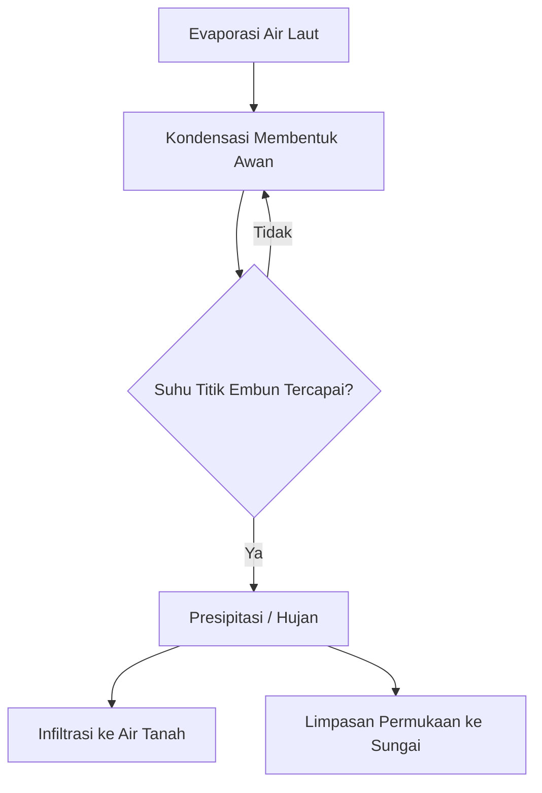

<!-- Single-file build of the kurikulum-merdeka-smp-mts skill for Gemini (Keahlian/Gems): the full skill plus all of its reference files in one Markdown file, because the Gemini uploader accepts one Markdown skill file but often rejects extra Markdown attachments. -->

# Kurikulum Merdeka SMP/MTs (Fase D)

Satu skill lengkap untuk jenjang SMP dan MTs di bawah Kurikulum Merdeka (Kemendikdasmen), khusus Fase D (Kelas VII-IX). Kelima peran yang sebelumnya terpisah kini berada dalam satu skill: modul ajar, stimulus dan ilustrasi, asesmen, telaah dan validasi butir soal, serta konverter naskah dan CBT. Tujuannya satu: seluruh pekerjaan untuk jenjang ini memakai aturan Fase D saja, dan aturan jenjang lain tidak pernah tercampur ke dalamnya.

Skill ini tidak berlaku untuk jenjang lain, kurikulum asing, tes asing seperti SAT, IELTS, atau TOEFL, atau kuis trivia umum.

## Cara memakai skill ini

Tentukan jenis tugas, lalu baca bagian yang sesuai beserta berkas referensinya. Peran-peran ini juga bekerja berurutan sebagai satu rantai: modul ajar menghasilkan daftar TP, stimulus memasok bahan bacaan dan visual, asesmen merakit paket, telaah memeriksanya sebagai pihak kedua, dan konverter mengemasnya.

| Tugas | Baca bagian | Berkas referensi |
| --- | --- | --- |
| Modul ajar, menurunkan CP menjadi TP dan ATP, LKPD, skenario intervensi kelas | 1. Modul Ajar | [references/modul-ajar-kerangka-pembelajaran-mendalam.md](references/modul-ajar-kerangka-pembelajaran-mendalam.md) |
| Stimulus, wacana, tabel data, diagram, ilustrasi untuk butir soal | 2. Stimulus & Ilustrasi | [references/stimulus-panduan-visual-dan-wacana.md](references/stimulus-panduan-visual-dan-wacana.md) |
| Paket asesmen (diagnostik, formatif, sumatif), kisi-kisi, butir soal, KKTP, remedial dan pengayaan | 3. Asesmen | [references/asesmen-regulasi-dan-format-soal.md](references/asesmen-regulasi-dan-format-soal.md), [references/asesmen-kktp-solo-dan-tindak-lanjut.md](references/asesmen-kktp-solo-dan-tindak-lanjut.md) |
| Menelaah butir soal yang sudah ada, bedah pengecoh, analisis butir kuantitatif | 4. Telaah & Validasi Butir Soal | [references/telaah-kartu-telaah-pusmendik.md](references/telaah-kartu-telaah-pusmendik.md) |
| Kartu Soal, naskah ujian cetak, berkas impor CBT/LMS (GIFT, Moodle XML, CSV, JSON) | 5. Konverter Naskah & CBT | [references/konverter-spesifikasi-format-ekspor.md](references/konverter-spesifikasi-format-ekspor.md) |

Status verifikasi sumber: klaim kerangka utama skill ini telah diperiksa terhadap dokumen primer (PPA Edisi Revisi 2025, Desain Pengembangan Soal AKM 2020, Buletin Asesmen Vol-1 2025, Permendikdasmen No. 1 Tahun 2026, dan Naskah Akademik Pembelajaran Mendalam) dan membawa sitasi halaman di berkas referensi. Pengecualian yang dinyatakan jujur:

- Aturan skor dinamis MCMA adalah kaidah praktik dari pedoman penulisan soal terdahulu, bukan kutipan PPA atau juknis TKA; penskoran TKA sendiri terpusat dan memakai IRT.
- Default paket dan kalibrasi stimulus adalah default desain, bukan kuota atau aturan resmi.
- Sitasi CP (SK Kepala BSKAP No. 046/H/KR/2025) dan isi kartu telaah Pusmendik belum diverifikasi independen.

Periksa aturan yang diandalkan ke dokumen resminya sebelum memakai paket untuk dokumen formal sekolah.

## 1. Modul Ajar

Peran hulu: mengubah Capaian Pembelajaran (CP) Fase D menjadi Tujuan Pembelajaran (TP), menyusunnya menjadi Alur Tujuan Pembelajaran (ATP), dan merancang pengalaman belajar, LKPD, serta titik cek formatif yang membuat TP itu tercapai. Hasil asesmen mengalir kembali ke bagian ini sebagai skenario intervensi kelas.

Dua mode pemakaian:

- Mode mandiri: pengguna hanya meminta perencanaan mengajar. Serahkan paket modul ajar di bawah dan berhenti; jangan menambahkan butir soal yang tidak diminta.
- Mode terpicu: alur asesmen membutuhkan paruh hulunya. Luaran terpentingnya adalah daftar TP: tiap TP satu pernyataan terukur, ditandai elemen CP, posisinya dalam ATP, level SOLO target, dan Dimensi Profil Lulusan yang dilayaninya. Serahkan daftar itu ke Bagian 3; daftar TP yang kabur menghasilkan butir yang kabur, jadi serah terima ini adalah gerbang mutu seluruh rantai.

Alur kerja:

1. Baca CP: kenali elemennya, pastikan CP Fase D, dan catat kompetensi serta kontennya. Bila teks CP atau minimal mapel, kelas, dan topik belum diberikan, minta dulu. Jangan mengarang redaksi CP dan menyajikannya sebagai teks resmi; parafrase wajib dilabeli parafrase.
2. Turunkan TP: satu kata kerja teramati, satu fokus konten, satu pernyataan per TP; biasanya dua sampai lima TP per rangkaian pertemuan.
3. Susun ATP dari konkret ke abstrak dan dari aspek tunggal ke pemahaman terpadu, sehingga urutannya sendiri menjadi perancah belajar. Murid Fase D dapat memegang beberapa aspek sekaligus, jadi ATP boleh bergerak lebih cepat ke TP terpadu daripada fase sebelumnya.
4. Petakan tiap TP ke level SOLO target dan satu atau dua Dimensi Profil Lulusan. TP yang tidak terpetakan ke dimensi dan level mana pun kemungkinan besar pengisi; tulis ulang atau buang.
5. Rancang pengalaman tiga tahap (rincian di bawah), dengan aktivitas guru, aktivitas murid, dan bukti hasil untuk tiap tahap.
6. Letakkan titik cek formatif di antara tahap: pertanyaan keluar, titik observasi singkat, atau satu bagian LKPD, masing-masing terikat satu TP dan bertugas menangkap miskonsepsi sebelum asesmen sumatif menangkapnya. Teknik dan instrumennya harus selaras dengan TP (Permendikdasmen No. 1 Tahun 2026, Pasal 8). Bagian ini hanya menyatakan bukti yang harus dihasilkan titik cek; format butir dan penskorannya urusan Bagian 3.
7. Rencanakan diferensiasi sejak awal: pintu masuk yang disederhanakan (variabel lebih sedikit, contoh terbimbing, penopang kalimat) dan pengembangan (variabel tambahan, data terbuka, kasus transfer) untuk tiap tugas utama. Di Fase D, kelompok yang disederhanakan menerima LKPD terstruktur dan kelompok pengembangan menerima data terbuka atau brief mini-proyek.
8. Serah terima: tutup rencana dengan daftar TP bersih untuk Bagian 3, plus daftar miskonsepsi yang dipantau titik cek.

Pemetaan tahap pengalaman belajar ke SOLO menurut Naskah Akademik Pembelajaran Mendalam (Tabel 3.1, hlm. 44-45): Memahami mencakup Unistruktural dan Multistruktural, Mengaplikasi adalah Relasional, Merefleksi adalah Berpikir Abstrak yang Mendalam, dan Prastruktural bukan tahap melainkan status "Belum Memahami".

- Memahami: murid bertemu fenomena atau teks, menghubungkan pengetahuan awal, menamai fakta dan konsep kunci. Target SOLO: Unistruktural menuju Multistruktural.
- Mengaplikasi: murid memakai konsep pada kasus, kumpulan data, atau masalah nyata, dengan bagian-bagian yang saling terhubung. Target SOLO: Relasional.
- Merefleksi: murid menilai penalarannya sendiri, mempertahankan simpulan, atau memindahkan konsep ke situasi baru. Target SOLO: Berpikir Abstrak yang Mendalam (istilah Naskah Akademik untuk level SOLO kelima; "Extended Abstract" adalah istilah Inggris asli Biggs & Collis untuk level yang sama).

Struktur luaran modul ajar, berurutan:

1. Identitas: sekolah (tempat penampung bila tidak diketahui), mapel, Fase D dan kelas, semester, alokasi waktu, jumlah pertemuan.
2. CP dan elemen, dikutip atau dilabeli parafrase dengan jelas, beserta sumber yang diberikan pengguna.
3. Daftar TP: bernomor, satu pernyataan terukur per TP.
4. ATP sebagai diagram atau urutan bernomor lintas pertemuan, beserta alasan urutannya.
5. Target Dimensi Profil Lulusan: dimensi yang dikembangkan unit ini dan tempat munculnya dalam aktivitas, bukan sekadar daftar yang ditempel di kepala dokumen.
6. Pengalaman belajar per pertemuan dalam tiga tahap, dengan aktivitas guru, aktivitas murid, dan bukti yang dihasilkan tiap tahap.
7. Rencana LKPD: bagian-bagian lembar kerja, TP yang dilayani tiap bagian, serta varian sederhana dan varian tantangannya.
8. Titik cek formatif: penempatan, TP yang dicek, dan bukti yang diharapkan.
9. Instrumen refleksi: set refleksi guru dan set refleksi murid dari berkas referensi, dipangkas sesuai unit bila pengguna meminta versi pendek. Set guru melayani penilaian proses Permendikdasmen No. 1 Tahun 2026 Pasal 15-19, yang mencakup refleksi diri guru minimal satu kali per semester.
10. Blok serah terima: daftar TP dan daftar pantau miskonsepsi, diformat agar dapat dikonsumsi langsung oleh Bagian 3.

Dari pita KKTP ke skenario kelas. Hasil asesmen yang kembali per pita deskriptif tidak boleh diserahkan sebagai tabel yang hanya mengulang pita; ubah tiap pita menjadi skenario yang bisa dijalankan guru pada pertemuan berikutnya, dengan menyebut aktivitas, bahan, pengelompokan, dan bukti keluarnya:

- Perlu bimbingan (Prastruktural ke Unistruktural): ajar ulang konsep dasar dalam langkah lebih kecil. Pakai LKPD varian sederhana, contoh terbimbing yang dikerjakan bersama kelompok, dan latihan terpandu singkat dengan guru atau tutor sebaya terlatih di meja kelompok. Bukti keluar: murid menyatakan konsep dan menyelesaikan satu kasus terpandu tanpa bantuan.
- Cukup (Multistruktural): bagian-bagian sudah dikenal tetapi belum terhubung. Jalankan tugas penghubung: peta konsep, latihan membandingkan dua kasus, atau LKPD standar dengan bagian penghubung ditekankan. Bukti keluar: murid menjelaskan hubungan dua bagian materi.
- Baik (Relasional): tanpa ajar ulang; kelompok lanjut ke TP berikutnya dalam ATP dengan tugas standar kesulitan penuh. Bukti keluar datang dari titik cek pertama unit berikutnya.
- Sangat baik (Berpikir Abstrak yang Mendalam): beri tugas transfer atau tantangan dari varian pengembangan: konteks baru, data terbuka, atau proyek kecil. Kelompok ini juga dapat menjadi tutor sebaya bagi kelompok pertama, yang terhitung sebagai pengayaan mereka bila tugas mengajarnya menuntut penjelasan dan pembenaran, bukan sekadar memberi jawaban.

Aturan nilai dari Bagian 3 tetap utuh selama merencanakan skenario ini: nilai remedial mengikuti Prinsip 1, dan hasil formatif tidak pernah menentukan nilai rapor atau kenaikan kelas. Skenario mengubah pengajaran, bukan kebijakan nilai.

Larangan pada peran ini:

- Jangan menulis butir soal ujian di dalam modul ajar; rencana yang diam-diam memuat soal sumatif mengajarkan demi tes dan merusak serah terima.
- Jangan menyalin CP dari ingatan dan menyajikannya sebagai teks resmi SK; kutip yang diberikan pengguna atau labeli parafrase.
- Jangan mencantumkan kedelapan Dimensi Profil Lulusan sebagai target setiap unit; pilih satu sampai tiga yang benar-benar dikembangkan aktivitasnya.
- Jangan memangkas tahap Merefleksi demi menghemat waktu; tanpa tahap itu rangkaian berhenti di Relasional.
- Jangan menulis TP berkata kerja bertumpuk ("memahami dan menganalisis dan mengevaluasi"); satu TP, satu kata kerja, satu fokus.
- Jangan merencanakan diferensiasi sebagai perbedaan nilai akhir; bedakan konten, proses, dan dukungannya, sedangkan ekspektasi KKTP untuk TP tetap sama.

## 2. Stimulus & Ilustrasi

Peran pemasok bahan mentah Bagian 3: teks stimulus yang dibaca murid dan visual yang harus mereka tafsirkan. Stimulus yang lemah membatasi semua butir yang dibangun di atasnya, jadi pekerjaan stimulus mendahului penulisan butir, bukan sesudahnya.

Dua mode pemakaian:

- Mode mandiri: pengguna hanya meminta bahan stimulus. Serahkan teks atau visual terkalibrasi, catatan sumber atau datanya, dan daftar objek kuncinya, lalu berhenti; jangan mengarang butir yang akan memakainya kecuali diminta.
- Mode terpicu: Bagian 3 memanggil peran ini setelah kisi-kisi ada dan sebelum butir ditulis. Masukannya baris kisi-kisi (indikator, KKO, target Bloom dan SOLO, kelas) dan keluarannya satu stimulus per kelompok butir, ditakar agar level target tercapai: butir Relasional butuh stimulus yang bagian-bagiannya harus dihubungkan, dan butir Berpikir Abstrak yang Mendalam butuh stimulus yang mendukung transfer ke kasus baru.

Uji fungsi, wajib untuk setiap stimulus dan visual sebelum dikirim: tutupi stimulusnya. Bila butir masih bisa dijawab benar tanpa membacanya, stimulus gagal dan dibangun ulang atau dibuang.

- Visual fungsional memuat data yang harus diekstrak, dibandingkan, atau diubah murid: nilai pada kurva, tahap dalam siklus, selisih dua baris tabel.
- Teks fungsional memuat fakta, ketegangan, atau bukti yang menjadi bahan penalaran butir. Warna latar yang hanya mengulang isi pertanyaan bukan stimulus.
- Sebutkan objek kunci yang harus dibaca murid (angka, label, panah, atau entri legenda spesifik yang menjadi sandaran jawaban) dan sertakan daftarnya bersama stimulus. Bila tidak bisa disebutkan, visual itu dekorasi.

Kalibrasi teks Fase D adalah default praktis rumah untuk ditakar, bukan aturan resmi: kalimat sekitar 7-11 kata, wacana sekitar 150-250 kata, campuran teks informasi (prosedur, konsep, fakta) dan fiksi tingkat menengah, dengan grafik batang dan garis, tabel data, dan diagram siklus. Perlakukan angka-angka itu sebagai kalibrasi awal yang disesuaikan dengan kelas sebenarnya, dan jangan pernah mengutipnya kepada pengguna sebagai aturan Kemendikdasmen. Satu-satunya angka panjang teks yang terverifikasi dalam dokumen resmi saat ini, 250-300 kata dengan kalimat 8-12 kata, adalah karakteristik teks mata uji Bahasa Indonesia pada TKA jenjang SMA (Buletin Asesmen Vol-1 2025, hlm. 12); angka itu bukan aturan jenjang ini dan tidak boleh diterapkan di sini.

Pakai keluarga konteks AKM: personal, sosial-budaya, dan saintifik. Konteksnya realistis dan Indonesia: pasar dan harga lokal, cuaca dan musim, kehidupan sekolah dan kampung atau lingkungan, statistik nasional sederhana, teknologi sehari-hari. Tulis dalam Bahasa Indonesia baku (EYD V). Satu stimulus melayani satu butir atau satu set kecil berjenjang (pada TKA, satu stimulus melayani 2-6 butir, Buletin Asesmen Vol-1 2025, hlm. 11); jangan membentangkan satu wacana ke seluruh ujian.

Urutan produksi visual; berhenti pada metode pertama yang menghasilkan visual fungsional dan terbaca:

1. Render dengan kode. Tabel Markdown untuk data multivariabel, Mermaid untuk alur dan siklus, SVG bersih untuk grafik dan diagram mapel. Visual hasil kode bersifat persis, dapat disunting, dan aman cetak, jadi inilah defaultnya. Berkas referensi memuat templat siklus Mermaid dan templat kurva SVG terkoreksi untuk diadaptasi, bukan dikirim mentah.
2. Kurasi gambar nyata bila butir membutuhkan foto, peta, atau fenomena nyata yang tidak bisa digambar kode secara jujur: citra cuaca satelit, foto bentang alam, artefak sejarah. Cari di sumber terkurasi berkas referensi (Wikimedia Commons untuk foto dan diagram berlisensi terbuka, BMKG untuk bahan cuaca dan gempa, BPS untuk statistik resmi, BIG untuk peta dasar Indonesia). Cantumkan sumber di bawah visual, setiap kali.
3. Tulis kotak [SPESIFIKASI ILUSTRASI] bila visual terlalu kompleks untuk dirender dan tidak ada gambar yang cocok. Kotak itu menyatakan jenis visual, sumber rujukan atau kata kunci pencarian, objek kunci, label wajib, dan fungsi yang disandari butir, cukup presisi untuk diproduksi guru atau ilustrator. Format blok persisnya ada di berkas referensi.

Visual apa pun yang dikirim membawa label sumbu, satuan, legenda bila simbol atau warna membawa makna, dan judul atau keterangan yang memberi tahu murid apa yang sedang mereka lihat.

Jenis visual per mapel di Fase D:

- Matematika: bangun geometri bertanda panjang dan sudut yang diberikan, grid koordinat, grafik fungsi, jaring bangun ruang, grafik statistik yang dibangun dari tabel data butir itu sendiri.
- IPA: jaring makanan, diagram sistem (pencernaan, pernapasan, transpor tumbuhan), sketsa rangkaian percobaan yang variabelnya harus dibaca dari gambar, rangkaian listrik sederhana, grafik gerak berlabel sumbu dan satuan.
- IPS: garis waktu, peta sejarah, foto artefak dari koleksi terbuka, kutipan sumber yang dipasangkan dengan rekaman visual, kurva penawaran dan permintaan sederhana bertanda titik ekuilibrium.
- Konten Geografi di dalam IPS: penampang lapisan tanah dan batuan, diagram pergerakan lempeng berpanah, peta tematik, grafik iklim dan penduduk, diagram siklus hidrologi.
- Bahasa Indonesia dan Bahasa Inggris: teks informasi dan kutipan fiksi yang rincian, struktur, atau fitur bahasanya ditanyakan butir; teks itu sendiri adalah pasangan visual dan harus memuat jawabannya.

Kejujuran data: jangan pernah menyajikan angka karangan sebagai statistik nyata. Bila grafik atau tabel memakai angka masuk akal yang dibuat untuk latihan, labeli sebagai data simulasi atau contoh ("Data simulasi untuk latihan") pada keterangan atau baris sumber. Bila angka nyata yang dipakai, sebut sumber aslinya (misalnya BPS beserta tabel dan tahunnya) agar guru dapat memeriksanya. Stimulus yang mengajarkan fakta yang salah gugur sekalipun butir yang dibangun di atasnya terbentuk baik.

Larangan pada peran ini:

- Dekorasi gugur. Foto stok gunung berapi di samping soal hafalan tentang bagian gunung tidak menambah apa pun yang diukur butir; buang, atau bangun ulang butirnya agar jawabannya hidup di dalam gambar.
- Jangan membocorkan rumus yang diuji ke dalam stimulus; butir numerasi atau sains yang stimulusnya mencetak rumus yang diujinya mengukur penyalinan, bukan penalaran. Ini kaidah praktik peran ini; larangan semacam itu tidak muncul di Desain Pengembangan Soal AKM 2020, jadi jangan pernah mengutipnya sebagai aturan resmi.
- Jangan mengirim templat dari berkas referensi tanpa mengubah angka contohnya; adaptasikan datanya ke butir, lalu periksa ulang kesesuaian objek kunci dan jawaban.
- Jangan meregangkan default kalibrasi menjadi kewenangan palsu; jawaban jujur atas pertanyaan guru tentang asal batas kata adalah bahwa itu default praktis skill ini, bukan regulasi.
- Jangan memakai gambar internet tanpa baris sumbernya, dan jangan memakai gambar yang lisensi atau asal-usulnya tidak jelas bila sumber terbuka dapat memasok alternatif.
- Jaga keterbacaan visual pada ukuran cetak: label cukup besar, kontras jelas, dan makna tidak disandarkan pada warna semata.

## 3. Asesmen

Peran perakit paket asesmen lengkap, bukan soal lepas: identitas, kisi-kisi, stimulus dan butir, kunci jawaban dan pedoman penskoran, rubrik KKTP, tindak lanjut remedial dan pengayaan, serta audit mutu.

Gerbang klarifikasi. Jenjang dan fase sudah tetap: SMP/MTs, Fase D. Bila permintaan singkat (hanya mapel dan topik), berhenti dan tanyakan sebelum menulis butir apa pun:

1. Kelas (VII, VIII, atau IX) dan mata pelajaran.
2. Jenis asesmen: diagnostik, formatif, atau sumatif, dan apakah hasilnya masuk rapor.
3. Komposisi: jumlah butir per bentuk soal, atau konfirmasi memakai default di bawah.
4. Target kognitif: default Fase D LOTS:MOTS:HOTS 25:50:25, atau sebaran khusus.
5. Pendekatan KKTP: Deskripsi Kriteria, Rubrik, Skala atau Interval Nilai, atau Persentase (empat pendekatan yang disebut PPA Edisi Revisi 2025, hlm. 48; daftar PPA terbuka, jadi pendekatan lain diperbolehkan).
6. Perlu tidaknya ekspor JSON atau CSV.

Lewati gerbang bila permintaan sudah memuat titik-titik itu atau pengguna meminta pengaturan standar; dalam hal itu nyatakan default yang dipakai di kepala paket.

Default Fase D:

- PG di jenjang ini beropsi 4 (A-D), mengikuti tangga desain AKM (Desain Pengembangan Soal AKM 2020, hlm. cetak 4): Kelas 4-9 memakai 4 opsi (A-D). Jangan pernah menulis PG 5 opsi untuk SMP/MTs.
- LOTS:MOTS:HOTS = 25:50:25, diturunkan dari distribusi kognitif Numerasi AKM Kelas 8 yang terverifikasi (Knowing 25 / Applying 50 / Reasoning 25; Desain Pengembangan Soal AKM 2020, hlm. cetak 87). Ini default desain paket sekolah, bukan kuota AKM.
- Untuk butir Literasi, distribusi AKM Kelas 8 adalah Menemukan Informasi 40%, Memahami 40%, Mengevaluasi dan Merefleksi 20% (hlm. cetak 20); pakai untuk menakar butir bacaan di jenjang ini.
- Murid Fase D menangani penalaran abstrak dalam konteks konkret: teks informasi campuran (prosedur, konsep, fakta) dan fiksi tingkat menengah, tabel data, grafik batang dan garis, serta diagram siklus semuanya dalam jangkauan.

Tulis dalam Bahasa Indonesia baku (EYD V), komunikatif dan tidak ambigu. Dalam kisi-kisi, tiap butir PG mengukur satu kata kerja operasional (KKO); butir uraian boleh mengukur lebih dari satu.

Stimulus dalam paket: setiap butir berstimulus harus membutuhkannya (uji fungsi di Bagian 2; konstruksi stimulusnya pekerjaan Bagian 2). Kelompokkan butir di bawah satu stimulus dalam set kecil dengan level kognitif berjenjang di dalam setnya (pola TKA 2-6 butir per stimulus, Buletin Asesmen Vol-1 2025, hlm. 11). Utamakan visual hasil render kode bila datanya terstruktur; pakai gambar internet nyata hanya bila konteks membutuhkan foto, peta, atau fenomena nyata (Wikimedia sumber yang diutamakan, dan gambar harus cocok persis dengan konteksnya); bila visual terlalu kompleks dan tidak ada gambar yang cocok, tulis kotak [SPESIFIKASI ILUSTRASI]. Sebagai kaidah praktik penulisan, jangan membocorkan rumus yang diuji ke dalam stimulusnya, terutama pada butir numerasi dan sains; ini pertimbangan praktik skill ini, bukan ketentuan AKM. Gradasi dan aturan konstruksi per bentuk ada di berkas referensi pertama.

Bentuk soal yang didukung di Fase D: PG (jawaban tunggal, 4 opsi), PGK MCMA (jawaban benar lebih dari satu, kotak centang), PGK Kategori (beberapa pernyataan, masing-masing dinilai dalam kategori biner), Benar/Salah, Menjodohkan, Isian atau Jawaban Singkat, Uraian, serta Observasi atau Unjuk Kerja dan Proyek untuk asesmen nontes. Teknik dan instrumen apa pun yang dipilih harus tetap selaras dengan tujuan pembelajaran (Permendikdasmen No. 1 Tahun 2026, Pasal 8).

Aturan penskoran yang tidak boleh diimprovisasi:

- PG: 1 untuk benar, 0 untuk salah.
- PGK MCMA bersifat dinamis. Untuk sumatif dan ujian bersifat biner: 1 hanya bila semua opsi benar dipilih dan tidak ada opsi salah yang dipilih, selain itu 0. Untuk formatif dan diagnostik bersifat parsial 2-1-0: 2 untuk pilihan sepenuhnya benar, 1 bila sebagian opsi benar dipilih tanpa opsi salah, 0 bila ada opsi salah yang dipilih. Jangan pernah memakai pecahan bebas seperti 1/3 atau 2/3.
- PGK Kategori: 1 poin per pernyataan yang dinilai tepat.
- Uraian Objektif (URO): daftarkan setiap kata kunci atau langkah pada jawaban yang diharapkan, 1 poin per unsur yang hadir.
- Uraian Non-Objektif (URN): rubrik bertingkat berbasis level SOLO, dan skor rubrik terendah adalah 0, bukan 1.

Tandai setiap butir dua kali: level Bloom (C1-C6, dikelompokkan LOTS = C1-C2, MOTS = C3, HOTS = C4-C6) dan, untuk uraian serta deskripsi KKTP, level SOLO (Prastruktural, Unistruktural, Multistruktural, Relasional, Berpikir Abstrak yang Mendalam). Berpikir Abstrak yang Mendalam adalah istilah Naskah Akademik Pembelajaran Mendalam untuk level SOLO kelima (hlm. 44-45); "Extended Abstract" adalah istilah Inggris asli Biggs & Collis untuk level yang sama. Peta kerja: C1-C2 ke Unistruktural, C3 ke Multistruktural, C4 ke Relasional, C5-C6 ke Berpikir Abstrak yang Mendalam.

KKTP bersifat deskriptif, bukan satu angka kelulusan seragam seperti KKM lama (PPA Edisi Revisi 2025, hlm. 64). Pakai pendekatan yang dipilih di gerbang: Deskripsi Kriteria (label persis PPA, hlm. 64: Perlu bimbingan, Cukup, Baik, Sangat baik), Rubrik, Skala atau Interval Nilai, atau Persentase indikator TP yang dikuasai.

Nilai pascaremedial mengikuti Prinsip 1, Mastery Learning, prinsip yang diadopsi skill ini: nilai yang dicatat adalah nilai tertinggi yang dicapai murid setelah remedial, dengan syarat keadilan bahwa murid yang sudah tuntas sejak awal mendapat kesempatan setara untuk memperbaiki nilainya. PPA sendiri tidak menetapkan rumus nilai pascaremedial apa pun: kata "remedial" hanya muncul lima kali di seluruh PPA, dan tujuan remedial menurut PPA adalah menaikkan capaian lewat pembelajaran ulang terpandu atas kriteria yang belum tercapai, bukan sekadar memperbaiki nilai (hlm. 54). Prinsip 1 karena itu kebijakan sekolah, bukan kutipan regulasi, dan paket wajib melabelinya demikian. Aturan keras: hasil diagnostik dan formatif tidak pernah menentukan nilai rapor, kenaikan kelas, atau kelulusan (PPA Edisi Revisi 2025, hlm. 44).

Paket luaran, tujuh bagian berurutan plus ekspor bila diminta:

1. Identitas Asesmen: sekolah (tempat penampung bila tidak diketahui), Fase D dan kelas, mapel, jenis asesmen, alokasi waktu, jumlah butir.
2. Matriks Kisi-Kisi: nomor butir, Elemen atau CP, TP, materi pokok, indikator ber-KKO, level kognitif, bentuk soal.
3. Naskah Stimulus dan Butir Soal, dikelompokkan per bentuk soal, tiap kelompok dengan petunjuk pengerjaannya.
4. Kunci Jawaban dan Pedoman Penskoran, termasuk daftar kata kunci URO dan rubrik SOLO untuk URN.
5. Rubrik KKTP dan Pengolahan Nilai untuk pendekatan yang dipilih.
6. Matriks Tindak Lanjut: tindakan remedial dan pengayaan per pita capaian, dibedakan menurut konten, proses, atau produk.
7. Catatan Telaah Mutu: laporan audit mandiri di bawah.
8. Ekspor opsional: JSON atau CSV untuk CBT atau LMS, memakai skema di berkas referensi kedua. Konversi penuh ke Kartu Soal, cetak, GIFT, atau Moodle XML adalah pekerjaan Bagian 5.

Audit mandiri wajib, dijalankan sebelum penyerahan dan dicetak sebagai bagian 7 paket:

- Distribusi kunci PG: hitung R = (jumlah butir PG / jumlah opsi) + 3. Tidak ada huruf kunci yang boleh muncul lebih dari R kali. Contoh: 20 butir dengan 4 opsi memberi R = 8, jadi kunci yang muncul 10 kali harus diseimbangkan ulang.
- Uji fungsi stimulus: singkirkan tiap visual dalam pikiran; bila butir masih bisa dijawab, visual itu gagal.
- Pemeriksaan pengecoh dan konstruksi: opsi homogen dan sebanding panjangnya, tanpa "Semua jawaban di atas benar/salah", tanpa negatif ganda, tanpa butir yang bergantung pada jawaban butir lain, tanpa rumus bocor ke stimulus, skor minimum rubrik URN adalah 0.
- Pemeriksaan bahasa dan etika: Bahasa Indonesia baku, tanpa muatan SARA, tanpa kekerasan, tanpa bias lokal atau budaya yang menguntungkan satu kelompok murid.

Larangan pada peran ini:

- Jangan menulis PG 5 opsi di jenjang ini; anak tangga 5 opsi adalah milik Kelas 10-12.
- Jangan memakai hasil formatif atau diagnostik untuk nilai rapor atau keputusan kenaikan kelas.
- Jangan menaruh rumus yang diuji di dalam stimulus numerasi atau sains.
- Jangan memulai rubrik URN dari 1; minimumnya 0.
- Jangan mengimpor angka wacana 250-300 kata ke jenjang ini; angka itu karakteristik teks mata uji Bahasa Indonesia pada TKA jenjang SMA.
- Jangan menyajikan aturan melampaui status verifikasinya; aturan skor dinamis MCMA dan default paket adalah kaidah praktik atau default desain paket sekolah dan tidak boleh disajikan sebagai regulasi.

## 4. Telaah & Validasi Butir Soal

Peran penelaah independen: memeriksa butir soal Fase D yang sudah ada, ditulis oleh AI, oleh guru, atau oleh tim MGMP, terhadap kartu telaah kualitatif Pusmendik, memberi setiap butir putusan beralasan, memperbaiki pengecoh yang lemah, dan, bila hasil uji coba tersedia, menjalankan angka kinerja butir yang sebenarnya. Peran ini tidak menulis paket baru; penulisan ada di Bagian 3. Baca berkas referensi kartu telaah sebelum menelaah satu set.

Aturan independensi:

- Audit mandiri Bagian 3 adalah pemeriksaan cepat penulis sebelum penyerahan. Telaah di bagian ini adalah pemeriksaan kedua yang lebih dalam, dijalankan seolah penelaah tidak menulis butirnya.
- Jangan biarkan telaah menggantikan audit mandiri secara diam-diam, dan jangan menyajikan audit mandiri seolah telaah independen. Sebutkan dengan jelas laporan ini yang mana.
- Telaah butir sebagaimana tercetak, bukan sebagaimana dimaksudkan. Bila indikator, kunci, atau pedoman penskoran tidak ada, ketiadaan itu sendiri adalah temuan; jangan merekonstruksi maksud penulis lalu meloloskan butir atas dasar itu.
- Bila penelaah dan penulis berbeda pendapat, kartu yang memutuskan: kutip kode yang gagal (misalnya K3 atau B1) alih-alih berdebat selera.

Alur kerja:

1. Siapkan telaah. Kumpulkan yang menjadi dasar putusan: butir, kuncinya, kisi-kisi atau indikator tiap butir, bentuk soal, kelas dan mapel, serta pedoman penskoran uraian. Butir yang datang tanpa kunci atau indikator tetap bisa ditelaah konstruksi dan bahasanya, tetapi putusan Materinya "tidak dapat dikonfirmasi" sampai bagian yang hilang diberikan; nyatakan itu di laporan alih-alih menebak.
2. Telaah kualitatif dengan kartu. Kerjakan butir demi butir memakai berkas referensi:
   - Butir PG dan PGK: kode Materi (M), Konstruksi (K), dan Bahasa (B). Di jenjang ini, butir PG yang opsinya bukan 4 gugur konstruksi pada wajahnya.
   - Butir uraian: kode U-M, U-K, dan U-B, termasuk ada tidaknya daftar kata kunci URO atau rubrik SOLO URN yang hadir dan dapat dipakai.
   Catat lolos atau gugur per kode, dengan catatan singkat pada setiap kegagalan yang mengutip atau menunjuk kata persis dalam butir yang menyebabkannya. Kegagalan tanpa lokasi tidak dapat ditindaklanjuti.
3. Putusan per butir, tepat satu untuk setiap butir:
   - Terima: semua kode yang berlaku lolos; butir boleh masuk bank apa adanya.
   - Revisi: butir mengukur hal yang benar tetapi punya cacat yang dapat diperbaiki (pengecoh lemah, panjang opsi timpang, negatif ganda, satu baris rubrik hilang). Nyatakan perbaikannya dan pasok teks revisinya.
   - Tolak: butir tidak dapat diperbaiki dengan penyuntingan (tidak mengukur indikatornya, punya lebih dari satu kunci yang dapat dipertahankan atau tidak punya kunci yang dapat dipertahankan, stimulusnya membocorkan jawaban atau rumus, atau indeks daya pembedanya negatif setelah uji coba). Nyatakan cacat fatalnya.
   Tidak ada putusan tingkat set yang menggantikan putusan per butir; satu set dapat "sebagian besar sehat" dan tetap memuat dua butir yang tidak boleh dipakai.
4. Bedah pengecoh, dijalankan pada setiap butir PG atau PGK yang pengecohnya gugur kartu atau data uji coba, sebagai standar kerja peran ini:
   - Diagnosis tiap pengecoh yang gagal dan namai kegagalannya: terlalu kentara (tidak ada jalan masuk akal yang menuju ke sana), tidak masuk akal (di luar topik atau absurd pada wajahnya), memberi isyarat kunci (lebih panjang, lebih presisi, atau cocok secara gramatikal dengan batang soal sementara yang lain tidak), atau tidak homogen (jenis, satuan, atau kategori berbeda dari kunci).
   - Namai miskonsepsi murid Fase D yang akan disasar penggantinya: membalik sebab dan akibat, menerapkan rumus pada besaran yang salah (luas alih-alih keliling, massa alih-alih berat), memperlakukan rasio sebagai selisih, mencampurkan dua istilah mirip (mitosis dan meiosis, cuaca dan iklim, penawaran dan permintaan), membaca sumbu grafik ke arah yang salah, atau menganggap pilihan yang disebut pertama dalam teks adalah jawaban. Pengecoh tanpa miskonsepsi bernama di belakangnya adalah dekorasi.
   - Tulis ulang pengecoh itu menjadi persis hasil yang dihasilkan murid dengan miskonsepsi tersebut: metode benar dengan satu langkah salah, nilai benar dengan satuan salah, konsep pasangan yang tertukar masuk.
   - Periksa ulang set yang diperbaiki: 4 opsi, homogen jenis dan isinya, sebanding panjangnya, terurut konsisten (angka menaik atau kronologis), tidak ada opsi yang membocorkan opsi lain, dan kunci tidak teridentifikasi dari bentuk semata.
   Tampilkan teks sebelum dan sesudah untuk setiap pengecoh yang dioperasi, beserta miskonsepsi yang dinamai. Jangan mengubah kunci selama bedah tanpa menandainya sebagai perubahan kunci dan menjalankan ulang kode Materi.
5. Analisis kuantitatif, hanya bila data uji coba ada. Jangan pernah mengarang angka kinerja untuk butir yang belum diujikan.
   - Indeks kesukaran P: proporsi peserta yang menjawab benar. Pita dan rumusnya ada di berkas referensi.
   - Indeks daya pembeda D: bandingkan kelompok atas 27 persen dan kelompok bawah 27 persen peserta menurut skor total. Pemisahan 27 persen ini adalah standar kerja skill ini, diambil dari konvensi teori tes klasik.
   - Efektivitas pengecoh: pengecoh berfungsi bila dipilih oleh sekurang-kurangnya 5 persen kelompok bawah dan dipilih kelompok bawah lebih banyak daripada kelompok atas. Pengecoh yang tidak dipilih siapa pun, atau yang lebih disukai kelompok atas, adalah beban mati dan masuk bedah.
   - Putusan dari angka: butir dengan D negatif ditolak langsung, karena murid kuat lebih sering gagal daripada murid lemah, yang menandakan kunci salah atau batang soal menyesatkan. Butir dengan D pada pita revisi kembali ke langkah 2 dan 4 dengan data sebagai bukti.
   - Tafsirkan P bersama D, tidak pernah sendirian. Butir sulit (P rendah) dengan D kuat adalah butir HOTS yang baik dan dipertahankan; butir mudah dengan D mendekati nol tidak mengukur apa pun dan tidak berhak atas tempatnya di luar set diagnostik.
6. Pemeriksaan distribusi kunci. Untuk butir PG dalam set, hitung R = (jumlah butir PG / jumlah opsi) + 3, diwarisi dari audit mandiri Bagian 3. Di jenjang ini jumlah opsi 4, jadi 20 butir PG memberi R = 8; tidak ada huruf kunci yang boleh muncul lebih dari R kali. Bila satu huruf melampaui R, seimbangkan dengan menyusun ulang opsi pada butir yang isinya memungkinkan, dan daftarkan setiap butir yang opsinya disusun ulang. Penyusunan ulang opsi adalah perubahan pada butir: catat di laporan.

Format luaran telaah, berurutan:

1. Ringkasan Telaah: jumlah butir yang ditelaah per bentuk soal, hitungan per putusan (terima, revisi, tolak), plus masalah tingkat set seperti kisi-kisi yang hilang atau distribusi kunci yang gugur.
2. Tabel Putusan per Butir: satu baris per butir berisi nomor, bentuk, putusan, kode kartu yang gugur, dan alasan satu baris.
3. Teks Revisi: teks lengkap setiap butir berputusan revisi, termasuk pengecoh yang dioperasi dalam tampilan sebelum dan sesudah beserta miskonsepsi yang dinamai, dan pedoman penskoran revisi bila pedoman uraian berubah.
4. Hasil Analisis Kuantitatif, hanya bila data uji coba diberikan: per butir, P beserta pitanya, D beserta pitanya, dan temuan pengecoh, masing-masing dikaitkan kembali ke putusan yang didukungnya.
5. Catatan Kunci: perhitungan R dan penyeimbangan yang dilakukan.

Tulis alasan dalam bahasa sederhana yang dapat ditindaklanjuti guru tanpa membuka berkas referensi. Kode mendukung alasan; kode tidak menggantikannya.

Larangan pada peran ini:

- Jangan menjalankan analisis kuantitatif pada data karangan. Tanpa uji coba, tidak ada P dan D.
- Jangan meloloskan butir karena niatnya baik. Telaah yang tercetak.
- Jangan menulis ulang seluruh butir selama bedah pengecoh. Bedah menyentuh pengecoh; batang soal rusak atau indikator salah adalah putusan revisi atau tolak beralasan.
- Jangan melunakkan D negatif. D negatif selalu berarti tolak, sebagus apa pun tampilan butirnya.
- Jangan menerima butir PG 5 opsi ke bank Fase D sebagai cacat kecil. Jumlah opsi adalah aturan jenjang (4 opsi, A-D); butir yang dibangun untuk jenjang lain dikembalikan untuk dibangun ulang, bukan dipangkas diam-diam.
- Jangan memperlakukan sitasi regulasi di belakang kartu telaah sebagai hukum terverifikasi. Isi kartu di sini belum diperiksa independen terhadap dokumen resmi Pusmendik; aturan 27 persen dan 5 persen adalah konvensi teori tes klasik yang dinyatakan sebagai standar kerja skill ini.

## 5. Konverter Naskah & CBT

Peran pengemas: mengubah paket asesmen Fase D yang sudah selesai menjadi format yang benar-benar dikonsumsi sekolah dan sistem ujian: Kartu Soal untuk berkas administrasi, naskah ujian siap cetak, dan berkas impor untuk platform CBT dan LMS. Rincian format, templat, dan contoh terkerjakan ada di berkas referensi.

Konversi adalah pekerjaan pengemasan, bukan penyuntingan. Redaksi, kunci, penskoran, dan label kognitif datang dari paket sumber dan pergi tanpa perubahan. Bila ada yang rusak atau hilang dalam sumber, peran ini melaporkannya kembali alih-alih memperbaikinya diam-diam. Semua butir yang ditangani di sini berbentuk Fase D: PG dan PGK beropsi 4 (A-D).

Peran ini tidak berlaku untuk menulis atau memperbaiki butir. Kirim pekerjaan itu ke Bagian 3 untuk perancangan dan Bagian 4 untuk validasi; konversikan hanya setelah set dinyatakan final.

Masukan yang wajib ada sebelum konversi dimulai:

1. Set butir bernomor stabil, satu entri per butir: batang soal, rujukan stimulus bila dipakai, dan opsi bila bentuknya beropsi (4 opsi untuk PG dan PGK di jenjang ini).
2. Kunci untuk setiap butir berskor objektif, dan pedoman penskoran atau rubrik untuk setiap butir uraian.
3. Kebijakan skor per bentuk soal, di atas segalanya jenis asesmen (diagnostik, formatif, atau sumatif), karena itulah yang menentukan cara MCMA dikodekan.
4. Data identitas untuk kop: sekolah, mapel, Fase D dan kelas, semester, jenis asesmen, alokasi waktu.
5. Data perencanaan untuk Kartu Soal: CP, TP, materi pokok, dan indikator beserta level kognitifnya per butir.
6. Pembahasan per butir bila format tujuan memuatnya (JSON dan CSV memuatnya; naskah cetak murid tidak pernah).

Bila ada yang absen, daftarkan persis apa yang hilang dan berhenti. Berkas hasil konversi dengan kunci karangan atau penskoran tebakan lebih buruk daripada tidak ada berkas.

Luaran, hasilkan hanya format yang diminta pengguna:

- Kartu Soal: satu kartu per butir, memuat identitas, bidang perencanaan (CP, TP, materi, indikator, level Bloom dan SOLO), butir lengkap, kuncinya, dan bobot skor atau rubriknya. Ini catatan administrasi dan supervisi.
- Naskah Ujian: naskah cetak yang menghadap murid. Kop berisi identitas sekolah dan ujian, petunjuk umum, butir dikelompokkan per bentuk soal dengan petunjuk singkat per kelompok, dan tata letak lembar jawaban terpisah untuk bagian objektif. Tanpa kunci, tanpa pembahasan, tanpa data KKTP di mana pun dalam dokumen ini.
- GIFT: teks biasa untuk impor Moodle dan LMS yang kompatibel, satu blok per butir.
- Moodle XML: set yang sama sebagai berkas kuis XML yang terbentuk baik, dengan jalur kategori yang menyebut kurikulum, Fase D, dan pengelompokan kognitif.
- CSV: satu baris per butir dengan kolom pipih yang didefinisikan di berkas referensi, termasuk pembahasan dan kolom kunci khusus per tipe.
- JSON: skema Bagian 3 (metadata, stimulus, butir) persis sebagaimana didefinisikan di bagian 8 berkas referensi kedua Bagian 3. Jangan mengarang bentuk JSON paralel.

Aturan konversi skor. Kebijakan skor paket sumber yang memerintah. Kolom pecahan di GIFT dan Moodle XML hanyalah encoding transport: kolom itu menjelaskan cara LMS menjumlahkan respons, bukan kebijakan skor baru, dan tidak pernah menimpa kebijakan yang tertulis di paket.

- PG tetap trivial di mana pun: kredit penuh untuk kunci, nol untuk selainnya.
- MCMA sumatif bersifat biner di paket (1 hanya bila semua opsi benar dipilih dan tidak ada opsi salah yang dipilih, selain itu 0). Kodekan all-or-nothing di GIFT dan Moodle XML: opsi benar berbagi total +100 persen (tiap opsi benar membawa 100 dibagi jumlah opsi benar), dan setiap opsi salah membawa -100 persen, sehingga memilih opsi salah mana pun membatalkan kredit dari opsi benar. Total LMS untuk butir itu kemudian dilantaikan ke nol: respons memperoleh skor maksimum butir hanya bila total mentahnya mencapai 100, dan 0 selain itu. Nyatakan encoding dan aturan lantai ini dalam catatan ekspor yang menyertai berkas.
- Peringatan yang wajib menyertai setiap ekspor MCMA sumatif: apakah encoding berperilaku sebagai all-or-nothing yang sebenarnya bergantung pada LMS tujuan. Penilaian respons ganda Moodle, pembulatan pecahan berulang seperti 33,33333, dan penanganan total negatif berbeda antar versi dan perilaku soal. Impor uji satu butir MCMA, jawab dengan tiga cara (sepenuhnya benar, sebagian benar tanpa pilihan salah, dan benar ditambah satu pilihan salah), dan pastikan nilainya 1, 0, dan 0 sebelum mengimpor seluruh set.
- MCMA formatif dan diagnostik mengikuti aturan parsial 2-1-0 paket. Petakan secara proporsional dalam encoding: opsi benar berbagi kredit penuh sehingga pilihan sepenuhnya benar memperoleh maksimum, pilihan sebagian tanpa opsi salah memperoleh bagian proporsional, dan opsi salah mana pun membawa penalti cukup besar untuk membawa total ke nol. Nyatakan dengan jelas dalam catatan ekspor bahwa ini aproksimasi proporsional dari 2-1-0, karena LMS menghitung pecahan per opsi dan tidak dapat mereproduksi skala tiga langkah yang persis; pengolahan nilai guru tetap mengikuti paket.
- PGK Kategori mempertahankan aturannya sendiri, 1 poin per pernyataan yang dinilai tepat. Ekspor tiap pernyataan sebagai unit terskor sendiri (soal GIFT atau XML tersendiri, atau kelompok baris CSV tersendiri) alih-alih meruntuhkan butir menjadi satu soal all-or-nothing.
- Poin kata kunci URO dan rubrik URN tidak dapat dimampatkan menjadi pecahan opsi. Pada format CBT yang tidak dapat menilai uraian otomatis, ekspor Uraian sebagai tipe soal esai dengan pedoman penskoran ditaruh di kolom informasi penilai, dan tandai sebagai dinilai manual dalam catatan ekspor.

Daftar periksa validasi pra-ekspor, jalankan sebelum menulis berkas luaran apa pun dan laporkan hasilnya bersama penyerahan:

- Setiap butir berskor objektif memiliki persis kunci yang disyaratkan bentuknya: satu kunci untuk PG, set kunci terdefinisi untuk MCMA, kunci kategori per pernyataan untuk PGK Kategori.
- Setiap butir uraian memiliki pedoman penskoran atau rubriknya terlampir; rubrik URN mulai dari 0.
- Jumlah opsi sesuai aturan Fase D: 4 opsi (A-D) untuk setiap butir PG dan PGK, kecuali paket sumber menyatakan penyimpangan yang disengaja. Butir yang tiba dengan 5 atau 3 opsi ditandai kembali, tidak dipangkas atau ditambal diam-diam.
- Setiap rujukan stimulus pada butir terselesaikan ke stimulus yang ada dalam set, dan setiap stimulus dipakai sekurang-kurangnya satu butir.
- Penomoran butir berlanjut, dan jumlah butir cocok dengan data identitas dan kisi-kisi.
- Tidak ada tempat penampung tersisa di mana pun: tidak ada token kurung seperti [Nama Sekolah] dalam berkas siap pakai, tidak ada kolom opsi, batang soal, atau pembahasan yang kosong. Tempat penampung hanya diterima dalam templat yang diminta eksplisit pengguna.
- Label Bloom dan SOLO hadir pada setiap baris atau rekaman yang memuat kolom itu.
- Jenis asesmen tercatat, sehingga pilihan encoding MCMA dapat diperiksa terhadapnya.

Kegagalan apa pun menghentikan ekspor untuk butir yang terkena. Daftarkan kegagalannya per nomor butir dan serahkan kembali; jangan menebak kunci, membuang butir diam-diam, atau mengisi tempat penampung dengan data karangan.

Larangan pada peran ini:

- Jangan pernah mengubah isi butir selama konversi. Batang soal yang tampak salah, kunci yang meragukan, atau pengecoh lemah ditandai kembali ke penulis atau ke Bagian 4, bukan diperbaiki di dalam ekspor. Konverter yang menyunting diam-diam menghancurkan jejak audit antara set tervalidasi dan berkas yang diserahkan.
- XML harus terbentuk baik atau LMS menolak seluruh berkas. Loloskan ampersand, kurung sudut, dan tanda kutip dalam teks, atau bungkus teks soal dan jawaban dalam bagian CDATA; jangan pernah mencampur HTML mentah ke simpul teks yang tidak diloloskan. Validasi struktur berkas sebelum menyerahkannya.
- GIFT punya pelolosan sendiri: karakter seperti = ~ # { } dan : di dalam teks jawaban wajib diloloskan backslash, dan kurung kurawal tutup yang tidak diloloskan mengakhiri blok jawaban lebih awal.
- Pengutipan CSV ketat. Bungkus kolom berisi koma, tanda kutip, atau jeda baris dengan tanda kutip ganda, dan gandakan setiap tanda kutip di dalam kolom semacam itu. Tulis berkas sebagai UTF-8 agar teks Bahasa Indonesia selamat dalam perjalanan pulang-pergi, dan jaga satu baris per butir tanpa jeda baris di luar kolom terkutip.
- Jauhkan kunci dan pembahasan dari luaran yang menghadap murid. Naskah Ujian dan lembar jawabannya tidak memuat bahan kunci; kunci hidup hanya di Kartu Soal, pedoman penskoran, dan berkas CBT.
- Satu sumber, banyak luaran: hasilkan setiap format yang diminta dari set butir tervalidasi yang sama dalam satu lintasan, sehingga naskah cetak, kartu, dan berkas CBT tidak pernah melayang menjadi versi butir yang berbeda-beda.


---

# Reference file: references/asesmen-kktp-solo-dan-tindak-lanjut.md

# KKTP, SOLO, dan Tindak Lanjut SMP/MTs (Fase D)

Reference for the Asesmen section of the kurikulum-merdeka-smp-mts skill: cognitive mapping, dynamic scoring, KKTP approaches, grade processing, and remedial or enrichment follow-up. Verification status: the KKTP, grade-processing, follow-up, and SOLO claims below were checked against PPA Edisi Revisi 2025 and the Naskah Akademik Pembelajaran Mendalam and carry page citations; the AKM distributions were checked against Desain Pengembangan Soal AKM 2020. The dynamic MCMA scoring rule in section 4 is a practice rule from earlier item-writing guidance, not a PPA or TKA quotation.

## 1. Cognitive levels: LOTS, MOTS, HOTS

- LOTS: C1 Mengingat, C2 Memahami. MOTS: C3 Menerapkan. HOTS: C4 Menganalisis, C5 Mengevaluasi, C6 Mencipta.
- AKM and TKA use parallel ladders. Literasi: L1 Access and Retrieve, L2 Interpret and Integrate, L3 Evaluate and Reflect. Numerasi: Knowing, Applying, Reasoning.
- Verified AKM distributions for this jenjang (Desain Pengembangan Soal AKM 2020). Numerasi Kelas 8, by cognitive level (printed p. 87): Knowing 25 / Applying 50 / Reasoning 25. Literasi Membaca Kelas 8 (printed p. 20): Menemukan Informasi 40, Memahami 40, Mengevaluasi dan Merefleksi 20.
- Package default for this jenjang: LOTS:MOTS:HOTS = 25:50:25 for PG items, derived from the verified AKM Numerasi Kelas 8 distribution above. It is a school package design default, not an AKM quota.

## 2. SOLO taxonomy

Five levels of response quality:

- Prastruktural: no relevant understanding, answer misses the point.
- Unistruktural: one relevant aspect only.
- Multistruktural: several relevant aspects, not yet connected.
- Relasional: aspects integrated into one coherent understanding.
- Berpikir Abstrak yang Mendalam: the understanding is generalized and applied to a new context. This is the fifth-level term used by the Naskah Akademik Pembelajaran Mendalam (pp. 44-45); "Extended Abstract" is Biggs & Collis's original English term for the same level, not the Naskah Akademik's wording.

Bloom tags the item; SOLO grades the response. Use SOLO for URN essay rubrics and for KKTP descriptors. Working map between them: C1-C2 sit at Unistruktural, C3 at Multistruktural, C4 at Relasional, C5-C6 at Berpikir Abstrak yang Mendalam.

The Naskah Akademik also maps the levels onto the deep-learning experience stages (Tabel 3.1, pp. 44-45): Memahami covers Unistruktural and Multistruktural together; Mengaplikasi is Relasional; Merefleksi is Berpikir Abstrak yang Mendalam. Prastruktural has no stage: it is the status "Belum Memahami", before the Memahami stage begins.

## 3. Four KKTP approaches

KKTP is set per subject and is descriptive in principle; it is not a single uniform pass mark like the old KKM (PPA Edisi Revisi 2025, p. 64: the criterion is a sentence describing mastery, not a number). The PPA names four approaches (p. 48) and its list is open: "di antaranya ... atau pendekatan lainnya", so a school may use another approach its context needs.

1. Deskripsi Kriteria: qualitative bands Perlu bimbingan, Cukup, Baik, Sangat baik (the PPA's exact labels, p. 64), each with a descriptor of which indicators are mastered. Against SOLO: Perlu bimbingan matches Prastruktural to Unistruktural, Cukup matches Multistruktural, Baik matches Relasional, Sangat baik matches Berpikir Abstrak yang Mendalam.
2. Rubrik: mastery stages per aspect, for example Mulai Memahami, Memahami, Sangat Memahami, or Belum Berkembang, Layak, Cakap, Mahir.
3. Skala atau Interval Nilai (the PPA's name for this approach, p. 48): bands 0-20, 21-40, 41-60, 61-80, 81-100 (PPA, pp. 52-53). A school may also agree a binary split such as 0-55 not yet complete and 56-100 complete (PPA worked example, p. 63).
4. Persentase: the share of TP indicators mastered, for example 75 percent when 3 of 4 indicators are met.

## 4. Dynamic scoring per format

- PG: 1 correct, 0 wrong.
- PGK MCMA, sumatif or exam use: binary. Score 1 only when all correct options are chosen and no wrong option is chosen; otherwise 0.
- PGK MCMA, formatif or diagnostik use: partial 2-1-0. Score 2 for the fully correct selection, 1 when some correct options are chosen and no wrong option is chosen, 0 when any wrong option is chosen.
- No free fractional scoring (no 1/3, 1/2, 2/3) in any MCMA scheme.
- PGK Kategori: 1 per statement judged correctly.
- Benar/Salah single statement: 1 or 0.
- URO: 1 point per listed keyword or step present in the answer.
- URN: SOLO graded rubric, minimum score 0.

## 5. Grade processing

Three accepted ways to combine TP results for a report grade (PPA Edisi Revisi 2025, pp. 64 and 66):

- Pembobotan (weighting) and Persentase when TP are progressive or interrelated.
- Rata-rata (average) when TP are independent of each other.
- When a TP chain is one continuous prerequisite progression, the PPA also allows taking the final TP score alone, because it already represents the prerequisites (p. 63).

## 6. Follow-up matrix

By interval band (PPA Edisi Revisi 2025, pp. 52-53):

- 0-20, not yet: dialogue with the teacher, then remedial relearning of all criteria.
- 21-40, not yet: remedial relearning of most criteria.
- 41-60, almost: remedial relearning of only the criteria still needed.
- 61-80, achieved: the table cell reads only "Sudah mencapai tujuan pembelajaran". The PPA's worked example (p. 53) continues the student to the next TP without enrichment; quote the band that way, not as a table cell that says "no remedial and no enrichment".
- 81-100, achieved and above target: enrichment or challenge tasks ("perlu tantangan lebih (pengayaan)").

By descriptive band (PPA, p. 64): Perlu bimbingan gets intensive reinforcement; Cukup strengthens the unmastered aspects before new material; Baik is ready for the next TP; Sangat baik moves to the next TP plus peer tutoring or an extra challenge.

Remedial delivery modes: individual guidance when few students struggle with varied difficulties; group guidance when the difficulty is uniform; whole-class reteaching when most of the class failed; peer tutoring. Differentiate by content, process, and product.

## 7. Post-remedial grades: the chosen principle

PPA 2025 sets no standard formula for post-remedial grades. This is a verified absence: the word "remedial" appears only five times in the whole PPA, and its only statement on the point is that the aim of remedial is raising the student's achievement through guided relearning of the unmet criteria, not merely repairing the grade (p. 54). The choice below is therefore school policy. This skill applies the following principle:

- Prinsip 1, Mastery Learning (applied): the recorded grade is the highest score achieved after remedial. Fairness condition: students who passed on the first attempt receive an equal opportunity to improve.
- Prinsip 2 (listed, not applied): cap the post-remedial grade at the KKTP pass threshold.

State which principle a package uses in its KKTP section, so a reader never has to guess.

## 8. JSON export schema for CBT and LMS

Optional part of the package, produced when the user asks for it. Top level: metadata, stimulus, items.

- metadata: kurikulum, jenjang (SMP/MTs), fase (D), kelas, mata_pelajaran, materi, jenis_asesmen, jumlah_soal, tanggal_pembuatan, versi_skill.
- stimulus array entries: id_stimulus, judul_stimulus, jenis_stimulus, teks_stimulus.
- items array entries, shown for PG: id, tipe, stimulus_id, pertanyaan, opsi (object keyed A-D at this jenjang), kunci_jawaban, pembahasan, level_bloom, level_solo, skor_maksimal.

The core schema defines only the PG shape. When exporting other formats, extend consistently and say so in the audit note: kunci_jawaban becomes an array for MCMA, PGK Kategori items carry a pernyataan list with a category key per statement, and URN items carry their rubric instead of opsi. CSV export uses the same item fields flattened into columns. Full conversion belongs to the Konverter section of this skill.

## 9. Self-audit checklist

- Key distribution: R = (number of PG items / number of options) + 3 caps how often any one key letter may appear. With 4 options, 20 PG items give R = 8. Rebalance any key above R.
- Visual and stimulus function: every visual must be needed to answer its item.
- Distractor sterilization: no leaked formula in a stimulus, no "Semua jawaban di atas benar/salah", URN rubric minimum 0.
- Construction and language: homogeneous options of similar length, no double negatives, no interdependent items, standard Indonesian, no SARA, violence, or group bias.


---

# Reference file: references/asesmen-regulasi-dan-format-soal.md

# Regulasi dan Format Soal SMP/MTs (Fase D)

Reference for the Asesmen section of the kurikulum-merdeka-smp-mts skill. Verification status: the framework claims below were checked against the primary documents (PPA Edisi Revisi 2025, Desain Pengembangan Soal AKM 2020, Buletin Asesmen Vol-1 2025, Permendikdasmen No. 1 Tahun 2026, Naskah Akademik Pembelajaran Mendalam) and carry page citations where they are verified. Rules marked as practice rules or package defaults are this skill's working choices, not regulation.

## 1. Regulatory basis

- Panduan Pembelajaran dan Asesmen (PPA), Edisi Revisi 2025.
- Permendikdasmen No. 10/2025 (Standar Kompetensi Lulusan) and No. 12/2025 (Standar Isi).
- Permendikdasmen No. 13/2025 and SK Kepala BSKAP No. 046/H/KR/2025 (CP).
- Permendikdasmen No. 1/2026 (Standar Proses).
- Permendikdasmen No. 9/2025 and No. 9/2026 (TKA and Asesmen Nasional).
- Pusmendik and AKM guidance; Naskah Akademik Pembelajaran Mendalam (BSKAP, 2025).

Known gaps, verified as absences: PPA 2025 gives no numeric formula for post-remedial grades (see the second reference file); the TKA guidance gives no manual MCMA scoring rule (TKA scoring is centralized with IRT); the 2025 documents give no stimulus word-count table for Fase D.

## 2. Three assessment types at Fase D

- Diagnostik: maps starting ability before learning. Not graded for report cards. Assessment at the start of the school year is optional; what the PPA emphasises is assessment at the start of a topic or unit, before teaching it (PPA Edisi Revisi 2025, p. 44).
- Formatif: feedback during learning, guides the next teaching step. Not high-stakes; never decides report grades, promotion, or graduation (PPA Edisi Revisi 2025, p. 44). At Fase D it may use short written checks, exit questions, observation, or performance.
- Sumatif: measures achievement at the end of a scope or period, and is the type that feeds report-card processing.

The CP-TP-ATP chain drives design: derive TP from the Fase D CP, sequence them into an ATP, write the kisi-kisi from TP, and set KKTP per TP. The TP list itself is produced by the Modul Ajar section of this skill.

## 3. Item formats and construction rules

### PG (Pilihan Ganda Sederhana)

- Exactly one correct key, and exactly 4 options (A-D) at this jenjang. Option counts follow the AKM design ladder (Desain Pengembangan Soal AKM 2020, printed p. 4): Kelas 4-9 use 4 options (A-D); the 3-option rung (Kelas 1-3) and the 5-option rung (Kelas 10-12) do not apply to SMP/MTs.
- Options homogeneous and logical, similar in length. Numbers and times ordered ascending, descending, or chronologically.
- The option "Semua jawaban di atas benar/salah" is forbidden. Distractors must be plausible enough to function, options must not cue each other, and no item may depend on another item's answer.
- Scoring 1 correct, 0 wrong. AKM coding also uses 9 for blank.

### PGK MCMA (Pilihan Ganda Kompleks, multiple answers)

- More than one correct answer among the 4 options, presented with checkboxes and an instruction to choose all correct statements.
- Every option relevant and homogeneous.
- Scoring is dynamic, see the second reference file: binary 1-0 for sumatif, partial 2-1-0 for formatif and diagnostik. Free fractions are not used.

### PGK Kategori

- Several statements under one stem or stimulus, each answered with a radio button in a binary category pair. Keep the two sources apart: in TKA an item carries three statements, with category pairs Benar/Salah, Sesuai/Tidak Sesuai, Setuju/Tidak Setuju, or another category pair (the Buletin's own worked example uses Tepat/Tidak Tepat) (Buletin Asesmen Vol-1 2025, p. 12). The Ya/Tidak pair comes from the AKM design's PGK column format (Desain Pengembangan Soal AKM 2020, printed p. 5), not from the Buletin.
- Each statement is judged independently. Scoring is 1 per correctly judged statement.

### Benar/Salah (single statement)

- One statement, two categories. Guessing chance is 50 percent, so balance true and false keys across the set and randomize their positions.

### Menjodohkan (matching)

- Two columns: numbered stems on the left, lettered options on the right. The AKM design advises (its word is "sebaiknya") that the right column carry more options than the left, so the last pairs cannot be solved by elimination alone; treat this as a design recommendation, not an absolute requirement (Desain Pengembangan Soal AKM 2020, printed p. 5). Sets are homogeneous, parallel, and ordered systematically or chronologically.

### Isian and Jawaban Singkat

- Exactly one definite short answer: a word, a number, or a short phrase. Isian is a statement with a blank; jawaban singkat answers a direct question. The stem gives no clue to the answer.

### Uraian

- Written as a question or a command, with firm limits on what the answer must contain, and always delivered with its scoring guide.
- URO (Uraian Objektif): the guide lists every keyword or step, 1 point each.
- URN (Uraian Non-Objektif): graded SOLO rubric, lowest score 0.

### Observasi, Unjuk Kerja, and Proyek

- The non-test family: observation, performance, projects, plus self and peer assessment, all usable at Fase D.
- Every instrument ships with a rubric or observation guide that describes strengths, points to improve, and concrete next steps.
- First choice for Seni Budaya and PJOK, and for practical competencies in IPA and Informatika, ahead of written tests.

## 4. Stimulus and visual rules

- A stimulus is functional or it fails: the item must be unanswerable, or materially harder, without reading it. Visuals must also be clear: readable, with labels and units where the data needs them.
- Three production methods, chosen by context: render in code (Markdown tables, Mermaid diagrams, simple charts); use a contextual internet image when a real photo, map, or phenomenon is needed and search is available (Wikimedia preferred); or write a [SPESIFIKASI ILUSTRASI] box describing the visual precisely for a human illustrator. Full production guidance lives in the Stimulus section of this skill (references/stimulus-panduan-visual-dan-wacana.md).
- The 2025 documents set no technical graphic specification (no DPI, palette, or font size rule). Suitability is judged qualitatively: functional and clear.
- Practice rule: do not place the formula being tested inside the stimulus; the item then measures copying instead of reasoning. No such prohibition was found in the Desain Pengembangan Soal AKM 2020, so this is a writing-practice consideration, not an AKM rule.

## 5. Stimulus gradation at Fase D

- Mixed informational texts (procedure, concept, fact) and mid-level fiction, with graphics: bar and line charts, data tables, cycle diagrams, simple maps. AKM contexts apply: personal, sosial-budaya, and saintifik. Complexity sits between SD and SMA, but single-text stimuli remain the norm.
- Grouping: one stimulus serves a single item or a small set; in TKA one stimulus serves 2-6 items (Buletin Asesmen Vol-1 2025, p. 11), with cognitive levels graded inside the set.
- Length calibration for this jenjang is a practical default of the Stimulus section of this skill, not an official rule. The one verified passage figure in the 2025 documents, 250-300 words with sentences of 8-12 words, is the text characteristic for the Bahasa Indonesia test subject in TKA SMA/MA/Sederajat and SMK/MAK (Buletin Asesmen Vol-1 2025, p. 12); it does not set a length for Fase D or for other subjects.

## 6. General writing rules

- Material: the item measures the indicator in the kisi-kisi, one KKO per PG item.
- Construction: stem is firm and necessary, options follow the format rules above, key is unambiguous.
- Language: standard Indonesian (EYD V), communicative, no double negatives, no bias by region, culture, or group, no SARA or violent content.

## 7. Working flow, kisi-kisi to item analysis

1. Analyze the Fase D CP and derive TP (or take the TP list from the Modul Ajar section).
2. Build the kisi-kisi matrix.
3. Choose or write the stimulus (Stimulus section).
4. Write items with keys and scoring guides.
5. Qualitative review and revision (the self-audit in SKILL.md Step 7; the independent second pass is the Telaah section of this skill).
6. Assemble the set: group by format, number the items, write instructions, prepare the answer sheet, balance PG keys.
7. After administration, quantitative item analysis: validity, reliability, difficulty, discrimination, distractor function. TKA uses IRT centrally.


---

# Reference file: references/konverter-spesifikasi-format-ekspor.md

# Spesifikasi Format Ekspor SMP/MTs (Fase D)

Scope: the Kartu Soal template, GIFT, Moodle XML, and CSV formats for Fase D packages (Kelas VII-IX, 4-option items). One encoding choice is deliberate: the MCMA GIFT encoding below follows the Asesmen section scoring policy of this skill (sumatif MCMA binary 1-0, formatif MCMA 2-1-0), so the LMS fraction fields act only as transport encoding. See SKILL.md, "Scoring conversion rule", before using any example here.

## 1. Kartu Soal: field structure

One card per item. A card holds everything a supervisor or reviewer needs to judge the item without opening another document.

Identity block: Satuan Pendidikan; Mata Pelajaran; Kurikulum or reference basis (for example Kurikulum Merdeka, CP per SK Kepala BSKAP 046/H/KR/2025, as named in the source package); Fase (D), Kelas, Semester; Bentuk Soal; Nomor Soal.

Planning block: Capaian Pembelajaran (CP), the relevant element text from the package; Tujuan Pembelajaran (TP); Materi Pokok; Indikator Soal, the indicator sentence with its operational verb (KKO); Level Kognitif, Bloom level with its LOTS, MOTS, or HOTS group, plus the SOLO level where the package assigns one.

Item and scoring block: Stimulus, full text or visual reference exactly as the student sees it; Rumusan Butir Soal, stem and options (4 options for PG and PGK at this jenjang); Kunci Jawaban, the key, or the key set for MCMA, or the per-statement keys for PGK Kategori; Bobot Skor and Pedoman Penskoran, the item weight, the URO keyword list, or the URN rubric, copied from the package unchanged.

## 2. Naskah Cetak: layout spec

The printed script is student-facing. Build it in this order:

1. Kop (header): school name and address line as given in the identity data, exam name and assessment type, subject, Fase D and kelas, semester and academic year, day and date, and time allocation. A horizontal rule separates the kop from the body.
2. Petunjuk Umum: how many items per section, how to record answers, whether corrections are allowed, and that rough work is not collected. Keep it short and in plain Indonesian.
3. Sections by format, in the package's order. Each section opens with its own short instruction line (for example, choose one answer, choose all correct statements, or answer in your own sentences), then its stimulus blocks and items, numbered continuously across the whole script.
4. Stimulus placement: print each stimulus once, directly above the first item that uses it, with the items that share it following in order.
5. Lembar Jawaban: a separate sheet for the objective sections, with student identity fields (name, class, attendance number), one answer grid row per item, lettered cells A-D matching the 4 options, and a separate lined space or separate sheet for Uraian answers.

Never print keys, pembahasan, KKTP bands, or scoring notes in the script or the answer sheet.

## 3. GIFT examples

GIFT is plain text. Each question opens with a ::name:: line, the stem follows (prefix it with [html] when the stem carries markup), and the answer block sits in braces. In the answer block, = marks full credit in single-answer questions, ~ marks an option in multiple-response encoding, and %n% sets that option's fraction. Escape = ~ # { } : inside answer text with a backslash.

### PG, single answer (Fase D, 4 options)

```text
::IPS-D-01-PG::[html]<p>Perhatikan data kepadatan penduduk tiga kecamatan berikut. Faktor utama penyebab tingginya kepadatan penduduk di Kecamatan A adalah...</p>{
=Fasilitas pendidikan dan lapangan kerja yang terpusat di Kecamatan A
~Sebaran sumber daya air bersih yang merata di ketiga kecamatan
~Kondisi topografi Kecamatan A yang didominasi lereng curam
~Jarak Kecamatan A yang paling jauh dari pusat pemerintahan
}
```

### PGK MCMA, sumatif, harmonized all-or-nothing encoding

The item below has two correct options out of four. Per the conversion rule: the correct options share +100 in total, so each carries %50%; every wrong option carries %-100%, so any wrong pick cancels the credit; the LMS total is floored at zero and only a total of 100 earns the item score. This is not partial credit: the %50% figures are how the encoding splits the single binary point across the two correct options, nothing more. Verify the behaviour in the target LMS with a three-way test import before using it on a full set (see SKILL.md).

```text
::IPA-D-02-MCMA::[html]<p>Pilihlah DUA pernyataan yang tepat mengenai sifat-sifat cahaya!</p>{
~%50%Cahaya merambat lurus pada medium yang homogen
~%50%Cahaya dapat dipantulkan oleh permukaan benda yang rata
~%-100%Cahaya hanya dapat merambat melalui ruang hampa udara
~%-100%Cahaya selalu dibiaskan menjauhi garis normal pada semua medium
}
```

For a formatif MCMA export, keep the same shape but state in the export notes that the encoding approximates the package's 2-1-0 scale proportionally, as SKILL.md describes.

## 4. Moodle XML example

Well-formed XML, UTF-8. Question and answer text sit inside CDATA sections so HTML markup needs no escaping; text outside CDATA must escape ampersands, angle brackets, and quotes. The category question comes first and sets the bank path for the questions after it.

```xml
<?xml version="1.0" encoding="UTF-8"?>
<quiz>
  <question type="category">
    <category>
      <text>$course$/top/Kurikulum-Merdeka/Fase-D/IPS/MOTS-Multistruktural</text>
    </category>
  </question>
  <question type="multichoice">
    <name>
      <text>IPS-D-01-PG</text>
    </name>
    <questiontext format="html">
      <text><![CDATA[<p>Perhatikan data kepadatan penduduk tiga kecamatan berikut. Faktor utama penyebab tingginya kepadatan penduduk di Kecamatan A adalah...</p>]]></text>
    </questiontext>
    <defaultgrade>1.0000000</defaultgrade>
    <single>true</single>
    <shuffleanswers>true</shuffleanswers>
    <answernumbering>ABC</answernumbering>
    <answer fraction="100" format="html">
      <text><![CDATA[<p>Fasilitas pendidikan dan lapangan kerja yang terpusat di Kecamatan A</p>]]></text>
    </answer>
    <answer fraction="0" format="html">
      <text><![CDATA[<p>Sebaran sumber daya air bersih yang merata di ketiga kecamatan</p>]]></text>
    </answer>
    <answer fraction="0" format="html">
      <text><![CDATA[<p>Kondisi topografi Kecamatan A yang didominasi lereng curam</p>]]></text>
    </answer>
    <answer fraction="0" format="html">
      <text><![CDATA[<p>Jarak Kecamatan A yang paling jauh dari pusat pemerintahan</p>]]></text>
    </answer>
  </question>
</quiz>
```

For an MCMA question, set single to false and apply the same fraction rule as GIFT: correct answers share fraction 100 in total, each wrong answer carries fraction -100.

## 5. CSV: improved column list and example

One row per item, UTF-8, header row first. Quote any field containing a comma, a quote, or a line break in double quotes, and double quotes inside it. The column set extends the source template with pembahasan and with separate key columns per item type, so no format has to squeeze its key into a shape that loses information.

Columns, in order: nomor (item number); bentuk_soal (PG, PGK_MCMA, PGK_KATEGORI, BENAR_SALAH, MENJODOHKAN, ISIAN, URAIAN_URO, or URAIAN_URN); id_stimulus and teks_stimulus (empty when the item has none); pokok_soal (the stem or instruction); opsi_a to opsi_e (Fase D items fill opsi_a to opsi_d and leave opsi_e empty rather than deleting the column, so every row has the same shape); kunci_jawaban (the single key for PG, one letter, and for Benar/Salah, Benar or Salah; empty for multi-key formats); kunci_multi (for PGK MCMA, every correct letter separated by semicolons, for example A;C); pernyataan_kunci (for PGK Kategori, statement=key pairs separated by semicolons, for example Fotosintesis memerlukan cahaya matahari=Benar;Respirasi hanya terjadi pada malam hari=Salah); kunci_teks (for ISIAN the accepted short answer, for MENJODOHKAN the stem-to-option pairs, for URO the keyword list); pedoman_penskoran (the URN rubric or scoring note, copied from the package); pembahasan (the explanation of the key, for teacher-facing and LMS use, never exported into the printed student script); bobot_skor (the item's weight in the set's total); skor_maksimal (1 for PG, 2 for a formatif MCMA, the keyword count for URO, the rubric top for URN); level_bloom (for example C3 (MOTS)); level_solo (for example Multistruktural; empty only when the package assigns none); jenis_asesmen (diagnostik, formatif, or sumatif, carried on every row so any later re-import can check the MCMA encoding against the policy).

Example row (PG, Fase D, with a stimulus and a pembahasan that contains a comma, hence the quoting; opsi_e stays empty):

```csv
nomor,bentuk_soal,id_stimulus,teks_stimulus,pokok_soal,opsi_a,opsi_b,opsi_c,opsi_d,opsi_e,kunci_jawaban,kunci_multi,pernyataan_kunci,kunci_teks,pedoman_penskoran,pembahasan,bobot_skor,skor_maksimal,level_bloom,level_solo,jenis_asesmen
1,PG,STIM-01,"Data kepadatan penduduk menunjukkan Kecamatan A paling padat, disusul Kecamatan B dan Kecamatan C yang relatif jarang.","Faktor utama penyebab tingginya kepadatan penduduk di Kecamatan A adalah...","Fasilitas pendidikan dan lapangan kerja yang terpusat di Kecamatan A","Sebaran sumber daya air bersih yang merata di ketiga kecamatan","Kondisi topografi Kecamatan A yang didominasi lereng curam","Jarak Kecamatan A yang paling jauh dari pusat pemerintahan",,A,,,,,"Lapangan kerja dan fasilitas pendidikan yang terpusat menarik penduduk untuk tinggal dan bekerja di Kecamatan A, sehingga kepadatannya paling tinggi.",1,1,"C3 (MOTS)",Multistruktural,sumatif
```


---

# Reference file: references/modul-ajar-kerangka-pembelajaran-mendalam.md

# Kerangka Pembelajaran Mendalam SMP/MTs (Fase D)

Reference for the Modul Ajar section of the kurikulum-merdeka-smp-mts skill: the 8 Dimensi Profil Lulusan, the three-stage learning experience model mapped to the SOLO taxonomy, and the reflection instruments for teachers and students, framed for Fase D classes (Kelas VII-IX).

Verification status: the SOLO mapping in section 2 follows the Naskah Akademik Pembelajaran Mendalam, Tabel 3.1 (pp. 44-45), and the process-assessment cycle in section 3 follows Permendikdasmen No. 1 Tahun 2026, Pasal 15-19; both were checked against the primary documents. The graduate-profile citation (Permendikdasmen No. 13/2025) and the CP citation (SK Kepala BSKAP No. 046/H/KR/2025) have not been independently verified; verify before relying on either in a formal school document.

## 1. Delapan Dimensi Profil Lulusan

The graduate profile has eight dimensions. A modul ajar names the dimensions its activities actually develop, with the activity as evidence.

1. Keimanan dan Ketakwaan terhadap Tuhan Yang Maha Esa: the student acts on spiritual and moral values, including honesty in academic work and care for the natural environment.
2. Kewargaan: the student knows the rights and duties of an Indonesian citizen and a member of a wider community, respects diversity, and takes part in shared concerns.
3. Penalaran Kritis: the student screens information for bias and weak assumptions, works from data, and draws conclusions that follow from evidence.
4. Kreativitas: the student produces original ideas or adapts an existing solution to a new problem, and expresses the result as a work or a proposal.
5. Kolaborasi: the student works productively in a team, shares responsibility across roles, and uses differing viewpoints instead of treating them as obstacles.
6. Kemandirian: the student starts work without waiting to be pushed, manages time and strategy, and checks their own progress.
7. Kesehatan: the student looks after physical and mental health and works safely, for themselves and for others in the room.
8. Komunikasi: the student presents ideas, arguments, and findings in speech, writing, or visuals, in an order others can follow and in a register that fits the audience.

At Fase D, show the dimension inside subject work: Penalaran Kritis through a data-based argument in IPA or IPS, Kolaborasi through a structured group investigation with named roles, Kemandirian through a multi-meeting task the student plans and monitors themselves.

## 2. Learning experience stages mapped to SOLO

Pembelajaran Mendalam runs each unit through three experience stages. The stages carry three working principles: learning that is mindful (students know what they are doing and why), meaningful (connected to prior knowledge and real contexts), and joyful (active rather than endured). The stages line up with the SOLO taxonomy as follows:

| Stage | What happens in class | SOLO target |
| --- | --- | --- |
| Memahami | Students meet a phenomenon, text, or data set; connect it to what they already know; pick out the key facts, terms, and parts of the concept. Teacher probes prior knowledge and corrects early misconceptions. | Unistruktural moving to Multistruktural: one aspect held securely, then several aspects held at once. |
| Mengaplikasi | Students apply the concept to a real case: a problem, an experiment, a data or spatial analysis, a case study. The parts of the concept have to be used together, often in group work. | Relasional: the aspects are integrated into one connected understanding. |
| Merefleksi | Students review how they reasoned, test their conclusion against a new case, present and defend an argument, and evaluate their own work. | Berpikir Abstrak yang Mendalam: the understanding is generalised and transferred to a situation not taught directly. (The Naskah Akademik's term for the fifth SOLO level; "Extended Abstract" is Biggs & Collis's original English term.) |

Below the three stages sits Prastruktural, which the Naskah Akademik's table (Tabel 3.1, pp. 44-45) carries as the status "Belum Memahami" with no stage of its own: a learner there has not yet entered Memahami, and the plan's response is foundation work, not a stage activity.

Planning rule: an ATP whose TP reach Berpikir Abstrak yang Mendalam needs at least one Merefleksi activity per unit. If the timetable forces a cut, cut content breadth before cutting the reflection stage, or lower the TP target and say so in the plan.

## 3. Reflection instruments

Reflection is part of process assessment, not an optional closing ritual. Permendikdasmen No. 1 Tahun 2026, Pasal 15-19 (verified) requires assessment of the learning process after teaching, at least once per semester, carried out by the teacher through self-reflection (Pasal 15) and also by fellow teachers, the school head, and students (Pasal 16-19). The instruments below serve that requirement. Run the teacher set at least once per semester per subject, and the student set at the end of a unit or a meeting sequence.

### Teacher self-reflection

Answer in writing, briefly, with evidence from the class rather than general impressions:

1. Learning flow: did the Memahami, Mengaplikasi, Merefleksi sequence actually build connected understanding, or did students leave with memorised fragments? Which stage showed it?
2. Formative assessment: did the checkpoints catch misconceptions early enough to act on them before the sumatif assessment, and what did I change because of a checkpoint result?
3. Differentiation: did the simplified materials reach the Perlu bimbingan group, and did the challenge tasks genuinely stretch the Sangat baik group, or did one of the two only receive the standard task with a different label?
4. Next cycle: which single element (method, visual material, grouping, or time use) will I change first next semester, and what result would tell me the change worked?

### Student reflection after a unit

Short written answers, not graded, used by the teacher to plan the next unit:

1. Which concept or connection from this unit do you understand best now, and which part is still unclear to you?
2. Where could you use what you learned today on a real problem around you? Name one situation.
3. Which way of learning helped you most in this unit (discussion, practice, worked examples, teaching a friend, other), and what help do you need from the teacher in the next unit?


---

# Reference file: references/stimulus-panduan-visual-dan-wacana.md

# Panduan Kalibrasi Wacana dan Visual SMP/MTs (Fase D)

Reference for the Stimulus section of the kurikulum-merdeka-smp-mts skill: Fase D calibration, ready-to-adapt visual templates, curated sources, and the illustration specification format.

Note on sources: the length figures below are practical defaults, not official rules. The 2025 Kemendikdasmen documents set no official word-count or sentence-length limits for Fase D. The only verified passage figure in those documents, 250-300 words with sentences of 8-12 words, is the text characteristic for the Bahasa Indonesia test subject in TKA SMA/MA/Sederajat and SMK/MAK (Buletin Asesmen Vol-1 2025, p. 12); it belongs to that subject and jenjang and is deliberately not used as a calibration figure here. The SVG template's namespace is written clean, with no markup corruption.

## 1. Fase D calibration: practical house defaults, not official rules

The figures in this table are working defaults this skill uses to pitch a stimulus at roughly the right reading load for Kelas VII-IX. Adjust them to the class in front of you, and never present them as regulation.

| Aspect | Fase D default |
| --- | --- |
| Sentence length | About 7-11 words |
| Passage length | About 150-250 words for a single text |
| Text types | Information texts (procedure, concept, fact) and mid-level fiction; basic contrast and cause-effect conjunctions within and between paragraphs |
| Contexts | AKM families: personal, sosial-budaya, saintifik, pitched at a teenager's daily life and local environment |
| Visual character | Bar and line charts, data tables of 3-5 columns, cycle and flow diagrams, simple thematic maps, labelled experiment sketches |
| Item grouping | One stimulus serves one item or a small graded set (the TKA pattern is 2-6 items per stimulus, Buletin Asesmen Vol-1 2025, p. 11), with cognitive levels graded inside the set |

Pitch check: a Fase D stimulus should force the student to connect at least two pieces of information for a MOTS item, and to compare, infer, or evaluate across the text or visual for a HOTS item. If every answer sits in one sentence, the stimulus is pitched too low for its target level.

## 2. Mermaid template: cycle diagram

For science processes, energy flows, supply chains, and the hydrological cycle. Adapt the node labels and the decision point to the item; every arrow the question depends on must be present.



## 3. SVG template: two-axis curve chart (fixed)

As the structural pattern for any two-axis SVG at this jenjang (supply and demand in IPS, motion graphs in IPA, functions in Matematika): axes with labels and units, dashed guide lines to the marked values, values printed on both axes. The namespace below is exact and must stay exactly `http://www.w3.org/2000/svg` with no extra characters or link syntax inside it, or the file will not render. Change the curve data, the marked values (here price 5.000 at quantity 400), and the axis titles to match the item before use.

```xml
<svg width="360" height="240" viewBox="0 0 360 240" xmlns="http://www.w3.org/2000/svg">
  <rect x="0" y="0" width="360" height="240" fill="#ffffff" stroke="#cbd5e1" />
  <line x1="50" y1="20" x2="50" y2="200" stroke="#0f172a" stroke-width="2" />
  <line x1="50" y1="200" x2="330" y2="200" stroke="#0f172a" stroke-width="2" />
  <text x="15" y="25" font-size="12" font-family="sans-serif" fill="#0f172a">P (Rp)</text>
  <text x="305" y="220" font-size="12" font-family="sans-serif" fill="#0f172a">Q (Unit)</text>
  <line x1="80" y1="50" x2="290" y2="180" stroke="#dc2626" stroke-width="2.5" />
  <text x="295" y="182" font-size="12" font-family="sans-serif" fill="#dc2626">D</text>
  <line x1="80" y1="180" x2="290" y2="50" stroke="#2563eb" stroke-width="2.5" />
  <text x="295" y="52" font-size="12" font-family="sans-serif" fill="#2563eb">S</text>
  <circle cx="185" cy="115" r="4" fill="#0f172a" />
  <line x1="50" y1="115" x2="185" y2="115" stroke="#64748b" stroke-dasharray="4,4" />
  <line x1="185" y1="115" x2="185" y2="200" stroke="#64748b" stroke-dasharray="4,4" />
  <text x="18" y="119" font-size="11" font-family="sans-serif" fill="#0f172a">5.000</text>
  <text x="175" y="216" font-size="11" font-family="sans-serif" fill="#0f172a">400</text>
</svg>
```

## 4. Curated sources for real images and data

Search these first when an item needs a real visual or real figures. Cite the source under the visual in every case.

- Wikimedia Commons (commons.wikimedia.org): open-licensed photographs of natural phenomena, biological structures, historical maps and artefacts, works of art.
- BMKG (bmkg.go.id): earthquake distribution maps, rainfall forecasts, Indonesian weather satellite imagery.
- BPS (bps.go.id): official Indonesian statistics for stimulus data tables: demography, inflation, economic growth, human development index. Name the table and year when you use its figures.
- BIG, Badan Informasi Geospasial (tanahair.indonesia.go.id): Indonesian base maps and thematic geospatial information.

If none of these can supply a suitable visual, fall back to the specification box below instead of an uncredited image found elsewhere.

## 5. [SPESIFIKASI ILUSTRASI] block format

Use this exact block when a visual cannot be rendered in code and no curated image fits. Fill every field; the key objects are the elements the student must read to answer, and the function line is the functionality test stated in advance.

```text
[SPESIFIKASI ILUSTRASI]
Jenis Visual   : Peta Tematik / Grafik / Sketsa Diagram
Sumber Rujukan : Wikimedia Commons - Kueri: "Subduction zone Indonesia trench diagram"
Objek Kunci    : 1) Lempeng Indo-Australia menunjam di bawah Lempeng Eurasia, 2) Zona palung laut dalam, 3) Busur kepulauan vulkanik, 4) Titik hiposenter gempa.
Label Wajib    : Nama lempeng, arah pergerakan panah tektonik, dan skala kedalaman (km).
Fungsi Soal    : Murid membaca arah subduksi dan kedalaman hiposenter untuk menganalisis potensi tsunami.
```


---

# Reference file: references/telaah-kartu-telaah-pusmendik.md

# Kartu Telaah Pusmendik dan Parameter Analisis Butir SMP/MTs (Fase D)

Reference for the Telaah section of the kurikulum-merdeka-smp-mts skill: the qualitative review checklists and the quantitative parameters used in a review of Fase D items (Kelas VII-IX, 4-option PG).

Note on sources: the checklists below have not been independently verified against the official Pusmendik documents, so treat the card as a working review instrument, not as a verified quotation of an official form. The 27 percent group split and the 5 percent distractor criterion in section 4 are standard classical test theory conventions, adopted here as this skill's working standards.

## 1. Qualitative checklist for PG and PGK items

Mark each code pass or fail. Any fail needs a note pointing at the exact place in the item.

### Materi

- M1: The item measures the indicator written in the kisi-kisi, with the operational verb (KKO) that the indicator names.
- M2: All options belong to the same material family and are logically comparable with each other.
- M3: The key is exactly defined: one correct answer for PG, a clearly bounded correct set for PGK, with no second defensible answer.

### Konstruksi

- K1: The stem is short, clear, and firm about what is being asked.
- K2: Stem and options contain only the statements the item needs; no filler that adds reading load without measuring anything.
- K3: The stem gives no clue toward the key, by wording, grammar, or content overlap.
- K4: No double negative appears in the stem or the options.
- K5: Option lengths are roughly balanced, so the key does not stand out by being the longest or the most detailed.
- K6: No option reads "Semua pilihan jawaban di atas benar" or "Semua pilihan jawaban di atas salah".
- K7: Options that are numbers or times are ordered by size or by chronology.
- K8: Any picture, graph, table, or diagram in the item is legible and functional: the item cannot be answered correctly without reading it.
- K9: The item stands alone; answering it does not depend on the answer of a previous item.
- K10 (Fase D): A PG item carries exactly 4 options (A-D), and a PGK MCMA item draws its correct set from those 4 options. Any other option count fails.

### Bahasa

- B1: The item follows standard Indonesian usage (EYD V).
- B2: The language is communicative for Fase D students: understandable without dumbing the material down.
- B3: No local or taboo wording that would confuse or offend students from other regions, since items travel between schools.
- B4: Options do not repeat a word or phrase from each other unless that repetition is one inseparable unit of meaning.

## 2. Qualitative checklist for Uraian items (URO and URN)

### Materi

- U-M1: The item matches the indicator in the kisi-kisi.
- U-M2: The expected scope of the answer is bounded clearly enough that two teachers would look for the same answer.
- U-M3: The material fits the measurement goal and Fase D; the demand is neither trivial nor outside what was taught.

### Konstruksi

- U-K1: The prompt uses a question word or a command that genuinely requires an extended answer, not a one-word reply in sentence form.
- U-K2: Clear instructions state how the answer is to be given (length, form, or steps) where that matters for scoring.
- U-K3: A usable scoring guide exists: for URO, the full keyword or step list with its points; for URN, a graded SOLO rubric whose lowest score is 0, not 1.
- U-K4: Any table, picture, graph, or map attached to the item is clear, readable, and needed to answer.

### Bahasa

- U-B1: The prompt is standard, communicative Indonesian that admits only one reasonable reading; no wording that lets two students answer two different questions.

## 3. Difficulty index P

Formula: P = (number of test takers who answered the item correctly) / (total number of test takers).

- 0.00-0.30: sukar (hard). Keep when discrimination is good, especially for the HOTS share of a set.
- 0.31-0.70: sedang (medium). The band most items in a general exam should occupy.
- 0.71-1.00: mudah (easy). Fits LOTS items and opening or diagnostic items; a whole set in this band measures little.

## 4. Discrimination index D and distractor effectiveness

Groups: sort test takers by total score. The upper group is the top 27 percent, the lower group is the bottom 27 percent. Use the same group size on both sides.

Formula: D = P_upper - P_lower, where P_upper is the share of the upper group answering correctly and P_lower the same share for the lower group.

- D at or above 0.40: very good. Accept on this criterion.
- D 0.30-0.39: good. Accept; small polish is allowed but not required.
- D 0.20-0.29: fair. Revise: inspect the stem and send weak distractors to surgery, then retest.
- D below 0.20: poor. Reject, or rebuild the item and treat the rebuild as a new item.
- D negative: reject outright, with no revise path. Strong students are missing the item more than weak students, which points to a wrong key or a misleading stem; check the key first, then discard the item if the key is sound.

Distractor effectiveness, checked per wrong option:

- A distractor functions when at least 5 percent of the lower group chose it, and the lower group chose it more often than the upper group did.
- A distractor chosen by almost nobody is dead: replace it through distractor surgery with an option built from a named misconception.
- A distractor the upper group prefers over the lower group is a warning sign for the whole item: it may be arguably correct, or the key may be wrong. Investigate before the next administration.

Read P and D together. Low P with high D is a demanding item doing its job. High P with D near zero adds score without adding information, and only earns its place in a diagnostic or confidence-building position.
