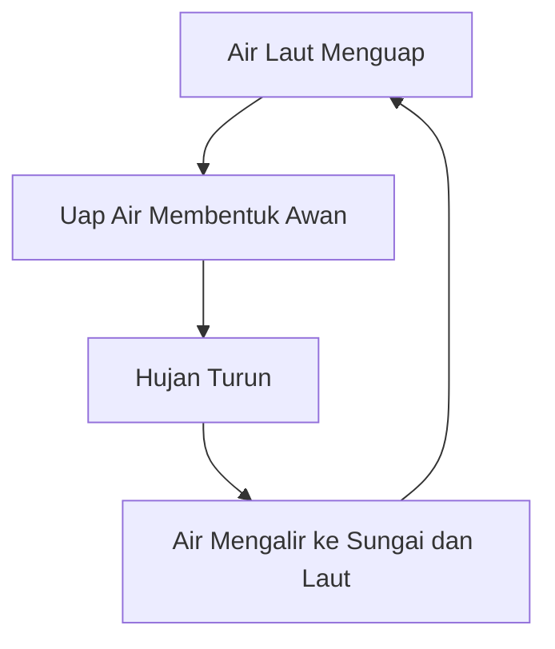

# Panduan Kalibrasi Wacana dan Visual Fungsional SD/MI

Reference for Section 2 (Stimulus & Ilustrasi) of the kurikulum_merdeka_sd_mi skill: fase calibration for Fase A-C, a ready-to-adapt visual template, curated sources, and the illustration specification format.

Note on sources: every length figure in this file is a practical default of this skill, not an official rule. The 2025 Kemendikdasmen documents set no official word-count or sentence-length limits for Fase A-C. The one verified official figure in this area (a 250-300 word passage with 8-12 word sentences) belongs to the Bahasa Indonesia test subject at the senior secondary level and is intentionally not used anywhere in this file.

## 1. Calibration matrix: practical house defaults, not official rules

Adjust these figures to the class in front of you, and never present them as regulation.

| Fase | Sentence length (default) | Passage length (default) | Typical text and visual character |
| --- | --- | --- | --- |
| Fase A (Kelas I-II) | About 3-7 words, spoken or read aloud | No independent reading passage; 1-3 short sentences at most, always with a picture | Single simple sentences, concrete vocabulary from the child's daily life, one large clear picture does the heavy lifting |
| Fase B (Kelas III-IV) | About 6-10 words | Around 50-100 words | Short information texts and children's fiction, basic time and cause conjunctions, tables of 2-3 columns, labelled pictures, picture series of 3-4 frames |
| Fase C (Kelas V-VI) | About 8-12 words | Around 100-200 words | Simple information texts (procedure, concept, fact) and short fiction, bar charts, simple cycle diagrams, a short text paired with a table |

Contexts follow the AKM frame at every fase: personal (the child's own experience), socio-cultural (family, school, neighbourhood, local tradition), and scientific (simple phenomena and living things). At Fase A the context is almost always personal and immediate; by Fase C simple scientific contexts with one variable are normal.

## 2. Mermaid template: simple cycle diagram

For simple science cycles at Fase B-C: water cycle, life cycle of a butterfly or frog, day and night rotation. Adapt the node labels to the item; every arrow the question depends on must be present. Keep the node count small (four to six) so the diagram stays readable at this jenjang.



## 3. SVG notes for simple charts

For bar charts and simple diagrams at Fase B-C, a clean SVG works well: two axes with labels and units, one bar per category, values printed above the bars. The namespace must stay exactly `http://www.w3.org/2000/svg` with no extra characters or link syntax inside it, or the file will not render. Keep the category count at five or fewer, use round numbers from the item's own data table, and print the values on the chart so no item depends on estimating a bar height by eye.

## 4. Curated sources for real images and data

Search these first when an item needs a real visual or real figures. Cite the source under the visual in every case.

- Wikimedia Commons (commons.wikimedia.org): open-licensed photographs of animals, plants, natural phenomena, and everyday scenes.
- BMKG (bmkg.go.id): Indonesian weather material, rainfall and season information, simple weather maps.
- BPS (bps.go.id): official Indonesian statistics for simple stimulus data tables. Name the table and year when you use its figures.
- BIG, Badan Informasi Geospasial (tanahair.indonesia.go.id): Indonesian base maps, useful for simple neighbourhood or regional maps at Fase C.

If none of these can supply a suitable visual, fall back to the specification box below instead of an uncredited image found elsewhere.

## 5. [SPESIFIKASI ILUSTRASI] block format

Use this exact block when a visual cannot be rendered in code and no curated image fits. Fill every field; the key objects are the elements the student must read to answer, and the function line is the functionality test stated in advance.

```text
[SPESIFIKASI ILUSTRASI]
Jenis Visual   : Gambar Berseri / Diagram Siklus / Peta Sederhana
Sumber Rujukan : Wikimedia Commons - Kueri: "Butterfly life cycle stages diagram"
Objek Kunci    : 1) Telur pada daun, 2) Ulat, 3) Kepompong, 4) Kupu-kupu dewasa.
Label Wajib    : Nama setiap tahap metamorfosis dan panah urutan antar tahap.
Fungsi Soal    : Murid mengurutkan tahap metamorfosis dari gambar untuk menjawab soal urutan daur hidup.
```
