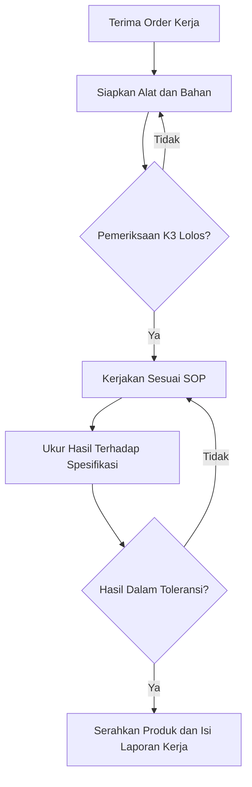

# Panduan Kalibrasi Wacana dan Visual SMK/MAK

Reference for the stimulus_smk_mak skill, filtered to Fase E-F: calibration for general-subject texts and for workplace documents, ready-to-adapt visual templates, curated sources, and the illustration specification format.

Note on sources: the length figures below are practical defaults, not official rules, with one precisely scoped exception: the Fase E-F passage and sentence figures are verified for the Bahasa Indonesia test subject in TKA SMA/MA/Sederajat and SMK/MAK (Buletin Asesmen Vol-1 2025, p. 12), as section 1 explains. The SVG template's namespace is written clean, with no markup corruption.

## 1. Calibration: practical house defaults, not official rules

The 2025 Kemendikdasmen documents set no official word-count or sentence-length limits for most subjects. The figures in this table are therefore working defaults this skill uses to pitch a stimulus at roughly the right reading load for Fase E-F. Adjust them to the class in front of you, and never present them as regulation.

| Stimulus kind | Sentence length (default) | Length (default) | Character |
| --- | --- | --- | --- |
| General-subject text, Fase E-F | About 8-12 words (verified only for the TKA Bahasa Indonesia test subject) | 250-300 words for the TKA Bahasa Indonesia test subject (verified scope); the same range is this skill's practical default for other general subjects; up to 700 words for multi-text with infographic (source-reported) | Complex sentences, contrast and cause-effect conjunctions across paragraphs, multi-text sets, infographics |
| SOP or work instruction excerpt | Short imperative steps, one action per step | Only the steps the item set needs, typically 5-12 steps plus warnings | Numbered steps, standard K3 warnings, the tested step or limit present but not highlighted |
| Gambar kerja or technical sketch | n/a | One drawing per item set | Views and sections as the item needs, dimensions and tolerances printed, scale stated |
| Specification or data table | n/a | 4-10 rows the item can actually use | Real-shaped values with units; simulated data labelled as simulated |
| Industry case study | About 8-12 words | Around 150-300 words plus its data table | A workplace problem with actors, constraints, and the numbers needed to analyse it |

Verified scope, stated precisely: the 250-300 word passage length and the 8-12 word sentence length are the text characteristics for the Bahasa Indonesia test subject in TKA SMA/MA/Sederajat and SMK/MAK (Buletin Asesmen Vol-1 2025, p. 12). They bind that subject and that test, nothing else; do not quote them as a general Fase E-F or cross-subject rule. The up-to-700-words multi-text figure is source-reported from ANBK Kelas XI reporting. Workplace documents are calibrated differently: an SOP excerpt is as long as the real procedure step range it covers, and a work drawing is complete when every dimension the item needs is printed. Every other figure in this table is this skill's own calibration default with no official source.

## 2. Mermaid template: production or service flow

For work procedures, production flows, service sequences, and cycles. Adapt the node labels and the decision point to the item; every arrow and every decision the question depends on must be present.



## 3. SVG template: two-axis chart (fixed namespace)

As the structural pattern for any two-axis SVG (Economics curves, Physics graphs, Mathematics functions, production charts): axes with labels and units, dashed guide lines to the marked values, values printed on both axes. The namespace below is exact and must stay exactly `http://www.w3.org/2000/svg` with no extra characters or link syntax inside it, or the file will not render. Change the curve data, the marked values (here price 5.000 at quantity 400), and the axis titles to match the item before use.

```xml
<svg width="360" height="240" viewBox="0 0 360 240" xmlns="http://www.w3.org/2000/svg">
  <rect x="0" y="0" width="360" height="240" fill="#ffffff" stroke="#cbd5e1" />
  <line x1="50" y1="20" x2="50" y2="200" stroke="#0f172a" stroke-width="2" />
  <line x1="50" y1="200" x2="330" y2="200" stroke="#0f172a" stroke-width="2" />
  <text x="15" y="25" font-size="12" font-family="sans-serif" fill="#0f172a">P (Rp)</text>
  <text x="305" y="220" font-size="12" font-family="sans-serif" fill="#0f172a">Q (Unit)</text>
  <line x1="80" y1="50" x2="290" y2="180" stroke="#dc2626" stroke-width="2.5" />
  <text x="295" y="182" font-size="12" font-family="sans-serif" fill="#dc2626">D</text>
  <line x1="80" y1="180" x2="290" y2="50" stroke="#2563eb" stroke-width="2.5" />
  <text x="295" y="52" font-size="12" font-family="sans-serif" fill="#2563eb">S</text>
  <circle cx="185" cy="115" r="4" fill="#0f172a" />
  <line x1="50" y1="115" x2="185" y2="115" stroke="#64748b" stroke-dasharray="4,4" />
  <line x1="185" y1="115" x2="185" y2="200" stroke="#64748b" stroke-dasharray="4,4" />
  <text x="18" y="119" font-size="11" font-family="sans-serif" fill="#0f172a">5.000</text>
  <text x="175" y="216" font-size="11" font-family="sans-serif" fill="#0f172a">400</text>
</svg>
```

## 4. Curated sources for real images and data

Search these first when an item needs a real visual or real figures. Cite the source under the visual in every case.

- Wikimedia Commons (commons.wikimedia.org): open-licensed photographs of machines and components, natural phenomena, biological structures, historical maps and artefacts, works of art.
- BMKG (bmkg.go.id): earthquake distribution maps, rainfall forecasts, Indonesian weather satellite imagery.
- BPS (bps.go.id): official Indonesian statistics for stimulus data tables: demography, inflation, economic growth, human development index. Name the table and year when you use its figures.
- BIG, Badan Informasi Geospasial (tanahair.indonesia.go.id): Indonesian base maps and thematic geospatial information.

For equipment-specific material (a particular machine's nameplate or manual), prefer a specification box built from the values the subject teaches over an uncredited image found elsewhere; label simulated values as simulated.

If none of these can supply a suitable visual, fall back to the specification box below instead of an uncredited image found elsewhere.

## 5. [SPESIFIKASI ILUSTRASI] block format

Use this exact block when a visual cannot be rendered in code and no curated image fits. Fill every field; the key objects are the elements the student must read to answer, and the function line is the functionality test stated in advance. Full gambar kerja almost always uses this block, because examination printing must reproduce every dimension exactly.

```text
[SPESIFIKASI ILUSTRASI]
Jenis Visual   : Gambar Kerja / Tampak dan Potongan
Sumber Rujukan : Digambar ulang oleh guru dari contoh benda kerja pada jobsheet praktik
Objek Kunci    : 1) Tampak depan poros bertingkat, 2) Diameter luar 40 mm dan 25 mm, 3) Panjang total 120 mm, 4) Toleransi diameter ±0,05 mm.
Label Wajib    : Semua ukuran dalam mm, garis sumbu, simbol toleransi, dan skala gambar.
Fungsi Soal    : Murid membaca diameter dan toleransi untuk menentukan urutan pengerjaan dan alat ukur yang tepat.
```
