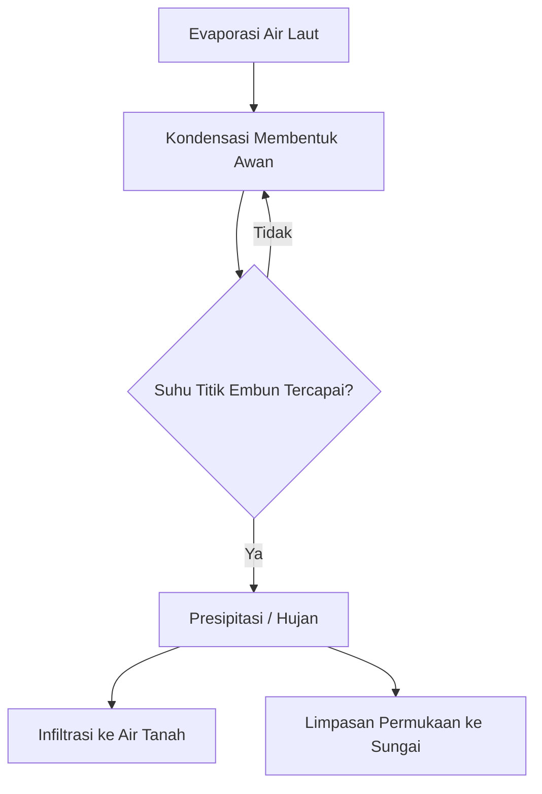

# Panduan Kalibrasi Wacana dan Visual Fungsional

Reference for the stimulus_dan_ilustrasi_asesmen skill: phase calibration, ready-to-adapt visual templates, curated sources, and the illustration specification format.

Note on sources: the length figures below are practical defaults, not official rules, with one precisely scoped exception: the Fase E-F passage and sentence figures are verified for the Bahasa Indonesia test subject in TKA SMA/MA/Sederajat and SMK/MAK (Buletin Asesmen Vol-1 2025, p. 12), as section 1 explains. The SVG template's namespace is written clean, with no markup corruption.

## 1. Calibration matrix: practical house defaults, not official rules

The 2025 Kemendikdasmen documents set no official word-count or sentence-length limits for most phases. The figures in this table are therefore working defaults this skill uses to pitch a stimulus at roughly the right reading load for a phase. Adjust them to the class in front of you, and never present them as regulation.

| Phase | Sentence length (default) | Passage length (default) | Typical text and visual character |
| --- | --- | --- | --- |
| PAUD and Fase A (SD Kelas I-II) | About 3-7 words | Oral, or 1-3 short sentences | Single simple sentences, concrete vocabulary from the child's daily life, large clear pictures do the heavy lifting |
| Fase B-C (SD Kelas III-VI) | About 6-10 words | Around 100 words | Simple information texts and children's fiction, basic time and cause conjunctions, tables of 2-3 columns, labelled pictures |
| Fase D (SMP Kelas VII-IX) | About 7-11 words | Around 150-250 words | Information texts (procedure, concept, fact) and mid-level fiction, bar and line charts, cycle diagrams |
| Fase E-F (SMA/SMK Kelas X-XII) | About 8-12 words (verified only for the TKA Bahasa Indonesia test subject) | 250-300 words for the TKA Bahasa Indonesia test subject (verified scope); the same range is this skill's practical default for other subjects; up to 700 words for multi-text with infographic (source-reported) | Complex sentences, contrast and cause-effect conjunctions across paragraphs, multi-text sets, infographics |

Verified scope, stated precisely: the 250-300 word passage length and the 8-12 word sentence length are the text characteristics for the Bahasa Indonesia test subject in TKA SMA/MA/Sederajat and SMK/MAK (Buletin Asesmen Vol-1 2025, p. 12). They bind that subject and that test, nothing else; do not quote them as a general Fase E-F or cross-subject rule. The up-to-700-words multi-text figure is source-reported from ANBK Kelas XI reporting. Every other figure in this table is this skill's own calibration default with no official source.

## 2. Mermaid template: cycle diagram

For science processes, energy flows, supply chains, and the hydrological cycle. Adapt the node labels and the decision point to the item; every arrow the question depends on must be present.



## 3. SVG template: supply and demand curve (fixed)

For Economics curves, and as the structural pattern for any two-axis SVG (Physics graphs, Mathematics functions): axes with labels and units, dashed guide lines to the equilibrium values, values printed on both axes. The namespace below is exact and must stay exactly `http://www.w3.org/2000/svg` with no extra characters or link syntax inside it, or the file will not render. Change the curve data, the equilibrium values (here price 5.000 at quantity 400), and the axis titles to match the item before use.

```xml
<svg width="360" height="240" viewBox="0 0 360 240" xmlns="http://www.w3.org/2000/svg">
  <rect x="0" y="0" width="360" height="240" fill="#ffffff" stroke="#cbd5e1" />
  <line x1="50" y1="20" x2="50" y2="200" stroke="#0f172a" stroke-width="2" />
  <line x1="50" y1="200" x2="330" y2="200" stroke="#0f172a" stroke-width="2" />
  <text x="15" y="25" font-size="12" font-family="sans-serif" fill="#0f172a">P (Rp)</text>
  <text x="305" y="220" font-size="12" font-family="sans-serif" fill="#0f172a">Q (Unit)</text>
  <line x1="80" y1="50" x2="290" y2="180" stroke="#dc2626" stroke-width="2.5" />
  <text x="295" y="182" font-size="12" font-family="sans-serif" fill="#dc2626">D</text>
  <line x1="80" y1="180" x2="290" y2="50" stroke="#2563eb" stroke-width="2.5" />
  <text x="295" y="52" font-size="12" font-family="sans-serif" fill="#2563eb">S</text>
  <circle cx="185" cy="115" r="4" fill="#0f172a" />
  <line x1="50" y1="115" x2="185" y2="115" stroke="#64748b" stroke-dasharray="4,4" />
  <line x1="185" y1="115" x2="185" y2="200" stroke="#64748b" stroke-dasharray="4,4" />
  <text x="18" y="119" font-size="11" font-family="sans-serif" fill="#0f172a">5.000</text>
  <text x="175" y="216" font-size="11" font-family="sans-serif" fill="#0f172a">400</text>
</svg>
```

## 4. Curated sources for real images and data

Search these first when an item needs a real visual or real figures. Cite the source under the visual in every case.

- Wikimedia Commons (commons.wikimedia.org): open-licensed photographs of natural phenomena, biological structures, historical maps and artefacts, works of art.
- BMKG (bmkg.go.id): earthquake distribution maps, rainfall forecasts, Indonesian weather satellite imagery.
- BPS (bps.go.id): official Indonesian statistics for stimulus data tables: demography, inflation, economic growth, human development index. Name the table and year when you use its figures.
- BIG, Badan Informasi Geospasial (tanahair.indonesia.go.id): Indonesian base maps and thematic geospatial information.

If none of these can supply a suitable visual, fall back to the specification box below instead of an uncredited image found elsewhere.

## 5. [SPESIFIKASI ILUSTRASI] block format

Use this exact block when a visual cannot be rendered in code and no curated image fits. Fill every field; the key objects are the elements the student must read to answer, and the function line is the functionality test stated in advance.

```text
[SPESIFIKASI ILUSTRASI]
Jenis Visual   : Peta Tematik / Grafik / Sketsa Diagram
Sumber Rujukan : Wikimedia Commons - Kueri: "Subduction zone Indonesia trench diagram"
Objek Kunci    : 1) Lempeng Indo-Australia menunjam di bawah Lempeng Eurasia, 2) Zona palung laut dalam, 3) Busur kepulauan vulkanik, 4) Titik hiposenter gempa.
Label Wajib    : Nama lempeng, arah pergerakan panah tektonik, dan skala kedalaman (km).
Fungsi Soal    : Murid membaca arah subduksi dan kedalaman hiposenter untuk menganalisis potensi tsunami.
```
